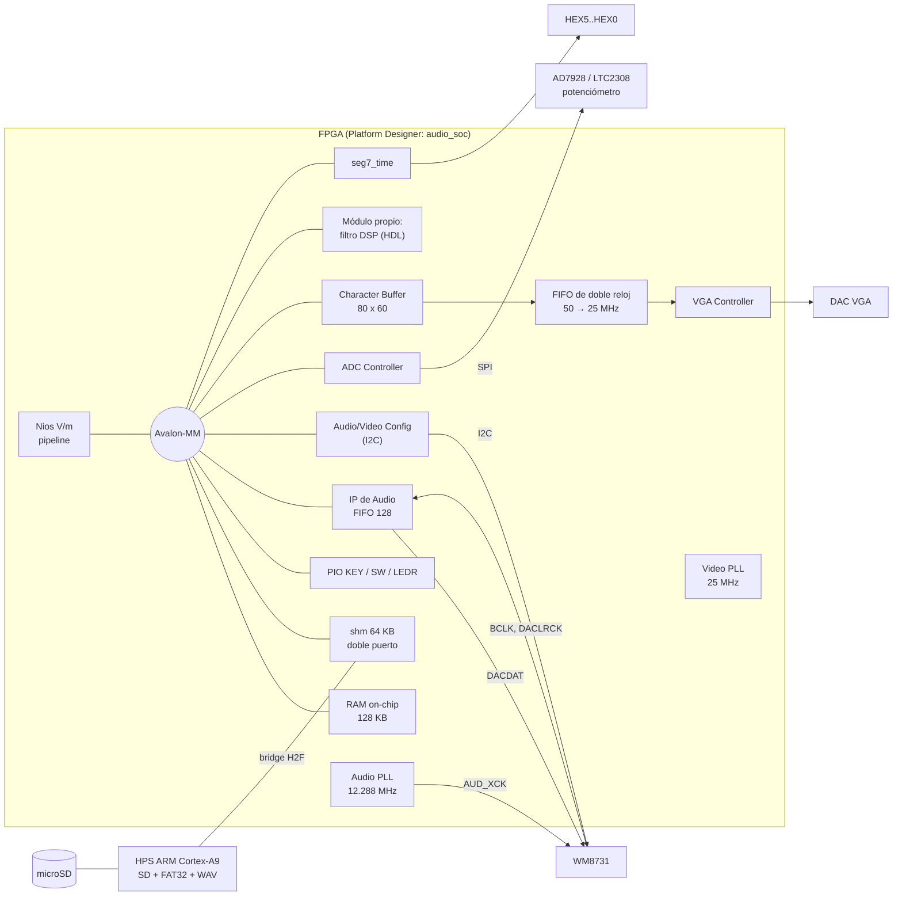
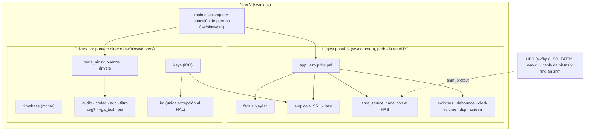

# Reproductor de audio en SoC — Proyecto II, CE-1113 Sistemas Empotrados

Co-diseño hardware/software de un sistema en chip para un reproductor de audio portable
sobre la **Altera DE1-SoC** (Cyclone V 5CSEMA5F31C6), construido con **Platform Designer**
y **Quartus Prime Lite 25.1std**. El procesador de la FPGA es un **Nios V/m** programado
*bare metal* sin HAL; el HPS (ARM Cortex-A9) lee la tarjeta SD.

> Estado: en desarrollo (entrega: 2 de diciembre de 2026). Plan y avance: [TODO.md](TODO.md).
> Las secciones marcadas *(pendiente)* se completan con las tareas indicadas.

## Contenido

1. [Arquitectura](#arquitectura)
2. [Estructura del repositorio](#estructura-del-repositorio)
3. [Instalación y entorno](#instalación-y-entorno)
4. [Compilación](#compilación)
5. [Verificación sin tarjeta](#verificación-sin-tarjeta)
6. [Programar la tarjeta](#programar-la-tarjeta)
7. [Uso del sistema](#uso-del-sistema)
8. [Mapa de memoria e interfaces](#mapa-de-memoria-e-interfaces)
9. [Recursos y potencia](#recursos-y-potencia)
10. [Decisiones de diseño](#decisiones-de-diseño)
11. [Equipo](#equipo)

## Arquitectura

### Hardware



Todo lo anterior está en `hw/soc/build_system.tcl`, compila en Quartus y está verificado
por simulación, incluidos los dos módulos de hardware propio (`filtro_audio` y
`seg7_time`, en `hw/rtl/`). Falta el HPS con su bridge (HW-05, D).

### Hardware propio

| Módulo | Qué hace | Documento |
|---|---|---|
| `filtro_audio` (`0x0004_0100`) | FIR estéreo de 127 taps y 2 bancos (pasa-bajos 1 kHz, pasa-banda 1–4 kHz), dos MAC en paralelo, acumulador de 40 bits, redondeo y saturación, y ganancia del volumen. Esclavo Avalon-MM con `waitrequest`. 250 ALMs, 4 DSP, 3 M10K, 4.4 mW; 136 ciclos por muestra | [docs/hw/modulo-filtro.md](docs/hw/modulo-filtro.md) |
| `seg7_time` (`0x0004_0120`) | Tiempo MM:SS (conversión por restas en hardware) y canción en HEX5..HEX0 | [docs/hw/seg7-time.md](docs/hw/seg7-time.md) |

Los tres filtros ([CD-12](docs/decisiones/CD-12.md)): **pasa-bajos FIR** y **pasa-banda
FIR** en el hardware propio, y **reverberación** en el Nios V (sumas y desplazamientos).
Un FIR o un biquad en el Nios V/m (sin multiplicador) costarían 16 y 5 veces el
procesador, respectivamente (medido con `tb_ciclos`).


### Software



La lógica no llama a los drivers: recibe *puertos* (structs de punteros a función,
`sw/common/include/ports.h`). En el Nios V los implementa `ports_niosv.c`; en el PC, mocks
que permiten probar el reproductor completo sin tarjeta (`tests/test_app.c`). Diseño
completo del software: [docs/software/diseno-software.md](docs/software/diseno-software.md).

**Restricción del enunciado (§3-SW):** los drivers acceden a los periféricos con
punteros `volatile` a las bases de `system.h`; no se usan funciones `alt_*` ni las
macros `IOWR`/`IORD`. La única excepción es `sw/niosv/drivers/irq.c`, que registra y
habilita interrupciones (`alt_ic_isr_register`, `alt_ic_irq_enable`).

```bash
scripts/audit-hal.sh       # NV-17 (también en make lint): solo aparece irq.c
```

## Estructura del repositorio

| Ruta | Contenido |
|---|---|
| `hw/soc/build_system.tcl` | **Única fuente del SoC** (Platform Designer) |
| `hw/quartus/` | Top-level `DE1_SoC_top.v`, pines (`.qsf`) y restricciones (`.sdc`) |
| `hw/rtl/` | HDL propio: módulo de filtro y `seg7_time`; `lint.vlt` (exenciones de Verilator) |
| `sw/niosv/drivers/` | Drivers sin HAL del Nios V |
| `sw/niosv/tests/` | Programas de prueba de cada periférico (PR-05) |
| `sw/niosv/src/` | Aplicación del reproductor (NV-14) |
| `sw/niosv/bsp.tcl` | Ajustes del BSP |
| `sw/common/include/`, `sw/common/src/` | Lógica portable (sin `system.h`): WAV, playlist, FSM, cola, protocolo con el HPS, lazo principal ([README](sw/common/README.md)) |
| `sw/hps/` | Software del HPS *(pendiente, D)* |
| `sim/questa/` | Testbenches autoverificables y modelos del códec y del ADC |
| `tests/` | Pruebas en el PC (`make test`) y generador de WAV de prueba (`tests/data/gen_wavs.py`) |
| `docker/`, `Makefile` | Contenedor de desarrollo y objetivos `make test/sim/lint/hps/ci` |
| `.github/workflows/` | CI: lint, pruebas y compilación para el HPS en el contenedor |
| `scripts/` | Generar, compilar, simular, programar y reportar |
| `docs/` | Decisiones (`docs/decisiones/`), hardware (`docs/hw/`) y entorno |

## Instalación y entorno

Requisitos: Quartus Prime Lite 25.1std con Cyclone V, Nios V/RiscFree y Questa Altera
Starter (licencia gratuita atada a la MAC). Detalle completo en
[docs/entorno-nativo.md](docs/entorno-nativo.md).

Cada máquina define sus rutas en `scripts/env.local.sh` (no se versiona):

```bash
export ALTERA_ROOT=$HOME/altera_lite/25.1std
export SALT_LICENSE_SERVER=$HOME/ruta/a/LR-XXXXXX_License.dat
```

### Contenedor

Lo que no necesita Quartus corre en un contenedor Docker con versiones fijas (Ubuntu
24.04 por digest, gcc 13, Icarus 12, Verilator 5.020, cocotb 1.9.2, toolchain
`arm-linux-gnueabihf`); la CI usa la misma imagen. Detalle y versiones:
[docker/README.md](docker/README.md).

```bash
make docker-build    # construir la imagen (999 MB; 252 MB comprimida)
make docker-ci       # lint + pruebas en C + cocotb + compilación para el HPS
make docker-shell    # terminal con el repositorio en /work
```

| Dentro del contenedor | Fuera, nativo |
|---|---|
| Pruebas en C de `sw/common` con sanitizers (`make test`) | Platform Designer y Quartus |
| cocotb + Icarus del HDL propio (`make sim`) | BSP y compilación del Nios V |
| Verilator y auditoría sin HAL (`make lint`) | Questa (co-simulación del SoC) |
| Toolchain ARM del HPS (`make hps`) e imagen de la SD | Programación por JTAG |

Quartus queda fuera porque necesita el USB-Blaster (JTAG) y herramientas gráficas,
ocupa más de 20 GB y la licencia de Questa está atada a la MAC del equipo.

## Compilación

```bash
scripts/build-soc.sh       # 1. Platform Designer: .qsys, RTL de síntesis, .sopcinfo, testbench
scripts/build-niosv.sh     # 2. BSP del Nios V + aplicación → ram.hex
scripts/build-quartus.sh   # 3. Quartus: síntesis, fitter, .sof y Timing Analyzer (~4 min)
```

Para cambiar solo el software sin recompilar el hardware: `scripts/update-sw.sh` (~20 s).

Resultado actual de la compilación: sin errores ni warnings críticos, tiempos cumplidos en
las cuatro esquinas del Timing Analyzer (slack mínimo de setup **+7.18 ns** a 50 MHz, hold +0.06 ns).

## Verificación sin tarjeta

Cada periférico se verifica con un **testbench autoverificable** que simula el SoC
completo en Questa con el Nios V ejecutando un programa de prueba, y con modelos de los
chips externos hechos a partir de sus datasheets. Los módulos de hardware propio se
verifican además **aislados**, antes de integrarlos (§3-HW), contra vectores dorados de
un modelo bit a bit ([reporte](docs/hw/verificacion-filtro.md)). Cada prueba termina en
`PASS` o `FAIL`.

```bash
scripts/test-all.sh        # PC + modulos propios + testbenches rapidos (~4 min); --all agrega los lentos
scripts/sim-rtl.sh filtro_audio           # un modulo propio aislado (filtro_audio, seg7_time, filtro_respuesta)
scripts/sim-tb.sh pio      # un testbench del SoC: pio, audio, codec, adc, shm, vga, filtro, ciclos
ELAB_OPTS=-gLTC=1 scripts/sim-tb.sh adc   # ADC con LTC2308 en vez de AD7928
make test                  # lógica portable en el PC (o make docker-test)
make lint                  # Verilator + auditoría sin HAL
```

| Prueba | Qué verifica | Resultado |
|---|---|---|
| `tb_pio` | Escritura de LEDR, lectura de SW, IRQ de cada KEY, pulsación simultánea, rebote, IRQ de SW | PASS; respuesta botón → LED **17 µs** (requisito < 200 ms) |
| `tb_audio` | 240 pares seguidos (5 ms a 48 kHz) en Left Justified, canales sin cruzarse, sin muestras perdidas por sondeo ni por IRQ | PASS |
| `tb_codec` | Las 57 transferencias I²C de la autoinicialización (10 al WM8731, 47 al ADV7180); R7 = 0x041 (maestro, LJ, 16 bits), R8 = 0x000 (48 kHz), R9 activo; `codec_init` quita la de-énfasis (R5 0x006 → 0x000) y `codec_mute` | PASS; todo listo a los 71.4 ms del reset |
| `tb_adc` | Potenciómetro en CH0 con el modelo del **AD7928** y con el del **LTC2308** (las dos revisiones de la placa) | PASS en ambos |
| `tb_shm` | Memoria compartida: bus de datos, bus de direcciones en 64 KB, March C-, accesos de 8/16 bits, sin solape con la RAM | PASS |
| `tb_vga` | 640 × 480 @ 60 Hz (línea de 32.000 µs, HS de 3.840 µs, 640 píxeles activos) y texto: las filas 9–12 coinciden celda por celda con la pantalla de referencia | PASS |
| `rtl_filtro_audio` | Módulo propio **aislado**, solo por Avalon-MM: registros y 8 casos dorados comparados bit a bit (impulso, escalón, senos, saturación, banco 1, bypass, 16 taps, ganancia alta) | PASS, 1 253 comprobaciones; 136 ciclos por muestra |
| `rtl_seg7_time` | `seg7_time` aislado: 00:00 … 99:59, saturación, canción, apagado | PASS |
| `rtl_filtro_respuesta` | Respuesta en frecuencia medida con 30 senos por banco | Error ≤ 0.83 dB en la banda de paso, rechazo ≥ 55.7 dB |
| `tb_filtro` | **Co-simulación HW/SW**: el Nios V carga coeficientes y corre la autoprueba del módulo (431 pares contra el modelo en C) dentro del SoC; displays | PASS, 0 diferencias; `03 02:05` en HEX |
| `tb_ciclos` | Costo por muestra en el Nios V/m (`-O2`): volumen 271, FIR 8 181, biquad 2 404, reverberación 54 ciclos | Base de CD-04, CD-05 y CD-12 |
| `tb_player` | **Reproductor completo en el Nios V**: lógica real (`app.c`), botones por IRQ, switches, LEDs, displays y la memoria compartida real con un modelo del HPS (10 pistas): navegación con vuelta, avance automático durante **dos vueltas**, pausa, stop, filtros por switches y combinación inválida | PASS; respuesta botón → LED ≤ **2.2 ms**, 0 subdesbordes |
| `test_volume`, `test_screen`, `test_tone`, `test_dsp` | Curva de volumen, histéresis y saturación; pantalla; tono de 440 Hz con SNR de 48.9 dB; filtros en software y modelo del FIR igual a los vectores dorados | PASS |
| `test_wav` | Parser con 26 WAV generados: 8/16/44.1/48 kHz, mono/estéreo, `LIST/INFO` antes y después de `data`, ID3, `WAVE_FORMAT_EXTENSIBLE`, chunks impares, truncados en cada byte de la cabecera, 8/24 bits, float, 3 canales | PASS, 163 comprobaciones |
| `test_fsm` | Playlist con vuelta y avance automático; tabla de transiciones; errores seguidos; 10 000 eventos aleatorios | PASS |
| `test_input`, `test_shm` | Cola de eventos (también con los índices dando la vuelta), switches, antirrebote, reloj sin división; protocolo con el HPS: flujo de 24 699 cuadros sin pérdidas, cambio de pista sin restos | PASS |
| `test_app` | Lazo principal con mocks y el modelo del HPS: dos vueltas a 10 pistas sin subdesbordes, respuesta a botones en el mismo ms, cambio de filtro ≤ 41 ms, cambio de canción < 2 s, pistas ilegibles, subdesbordes, SD ausente | PASS |

Pantalla del reproductor tal como sale del Character Buffer en `tb_vga` (líneas 0–103
del cuadro, a escala 2; `scripts/pbm2png.py`):


Hallazgos de la verificación que cambiaron el diseño:

- Con el **LTC2308** el IP del ADC guarda cada resultado en el registro del canal
  anterior: con un solo canal, CH0 nunca se actualizaría. Se convierten dos canales.
- La ROM de autoinicialización del códec deja **de-énfasis a 48 kHz** (atenúa agudos):
  `codec_init` la quita.
- El borrado del **Character Buffer** tarda un cuadro de video (16.7–33 ms, no "5000 ciclos")
  y sus lecturas por el bus no son confiables: el driver espera el borrado y no relee.
- Dos artefactos de simulación (no del diseño) se resuelven en el testbench y están
  documentados en `sim/questa/tb_vga.sv`: el `.mif` de la fuente con varios valores por
  línea y la salida X del `dcfifo` en modo *show-ahead*.

Salida completa de cada testbench: [docs/verificacion/](docs/verificacion/README.md).
Pruebas que faltan en la tarjeta y su procedimiento: [docs/pruebas-tarjeta.md](docs/pruebas-tarjeta.md).

## Programar la tarjeta

```bash
scripts/program.sh                                   # .sof por JTAG (FPGA = dispositivo 2)
niosv-download -g -r build/niosv/app/build/audio_player.elf   # solo el programa
```

## Uso del sistema

| Control | Función |
|---|---|
| KEY0 | Play / pausa |
| KEY1 | Stop |
| KEY2 | Canción anterior |
| KEY3 | Canción siguiente |
| SW0 / SW1 / SW2 | Filtro: pasa-bajos 1 kHz / pasa-banda 1–4 kHz / reverberación; todos abajo = bypass; dos o más = inválido (bypass y LEDR9) ([CD-08](docs/decisiones/CD-08.md)) |
| LEDR[2:0] · 5 · 6 · 7 · 8 · 9 | Filtro activo · hubo subdesborde · cambia con cada botón · reproduciendo · pausado · alerta |
| Potenciómetro (ADC CH0) | Volumen (32 escalones de 2 dB), aplicado por la ganancia del módulo propio |
| HEX3..HEX0 / HEX5..HEX4 | Tiempo transcurrido MM:SS / número de canción (`seg7_time`) |
| VGA | Título, artista, álbum, duración, canción n/total, estado, filtro y volumen |

## Mapa de memoria e interfaces

- Mapa de memoria e interrupciones: [docs/hw/mapa-memoria.md](docs/hw/mapa-memoria.md).
- Justificación de cada componente: [docs/hw/componentes-soc.md](docs/hw/componentes-soc.md).
- Interfaz del módulo de hardware propio: [docs/hw/modulo-filtro.md](docs/hw/modulo-filtro.md)
  (registros, tiempos, diagrama de bloques) y [docs/hw/seg7-time.md](docs/hw/seg7-time.md).

## Recursos y potencia

Sistema completo (con el módulo propio; sin el HPS todavía), de
`python3 scripts/report-resources.py` y `scripts/report-power.sh`:

| Recurso | Uso |
|---|---|
| Lógica | 3 773 / 32 070 ALMs (12 %) |
| Registros | 5 304 |
| Memoria embebida | 1 661 056 bits (41 %), 210 / 397 M10K (53 %) |
| DSP | 4 / 87 (el filtro propio) |
| PLL | 2 / 6 |
| Potencia total estimada | 557.0 mW (dinámica del núcleo 99.3 mW, estática 421.7 mW, E/S 36.0 mW; estimación sin vectores); el filtro propio, 4.4 mW |

## Decisiones de diseño

| Decisión | Resumen |
|---|---|
| [CD-06](docs/decisiones/CD-06.md) Memoria | Todo en on-chip: 128 KB para el Nios V y 64 KB de doble puerto compartidos con el HPS; sin SDRAM |
| [CD-07](docs/decisiones/CD-07.md) Frecuencias | Códec fijo a 48 kHz; el HPS remuestrea 8/16/44.1 kHz |
| [CD-09](docs/decisiones/CD-09.md) Visualización | VGA con Character Buffer 80 × 60 |
| [CD-04](docs/decisiones/CD-04.md) Conexión del filtro | Mapeado a memoria con *pipelining* en software |
| [CD-05](docs/decisiones/CD-05.md) Volumen | Ganancia en el módulo propio (en software costaba el 52 % del CPU) |
| [CD-12](docs/decisiones/CD-12.md) Filtros | Pasa-bajos y pasa-banda FIR en hardware; reverberación en el Nios V |
| [CD-13](docs/decisiones/CD-13.md) HDL | Verilog-2005 sintetizable; testbenches SystemVerilog en Questa |
| [CD-14](docs/decisiones/CD-14.md) Punto fijo | Q1.15, acumulador de 40 bits, redondeo y saturación |
| [CD-08](docs/decisiones/CD-08.md) Switches | Encuesta cada 20 ms con confirmación; un switch por filtro, combinación inválida = bypass |
| [CD-10](docs/decisiones/CD-10.md) Tiempo | Cuadros enviados al códec / 48 000: sincronizado con el audio y se detiene solo en pausa |
| [CD-11](docs/decisiones/CD-11.md) Máquina de reproducción | Tabla de transiciones en software (`sw/common`), probada en el PC |

## Equipo

| Persona | Área |
|---|---|
| A — Randall Bolaños | SoC y plataforma: Platform Designer, Quartus, periféricos de catálogo y sus drivers |
| B | Hardware propio y DSP *(trabajo hecho por Randall Bolaños; persona por asignar)* |
| C | Software de aplicación |
| D | HPS y arranque |
