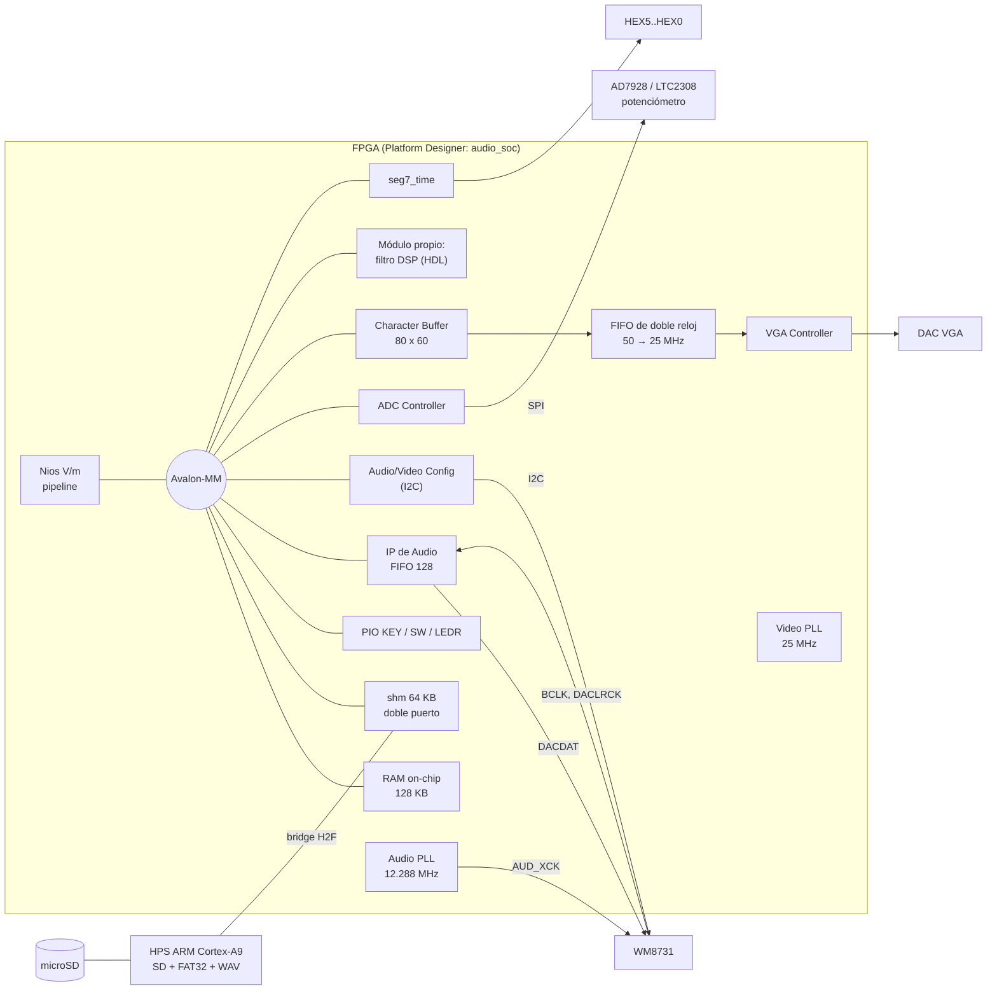
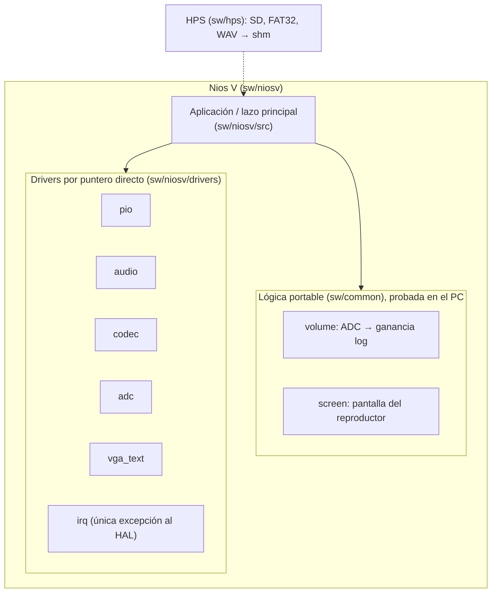
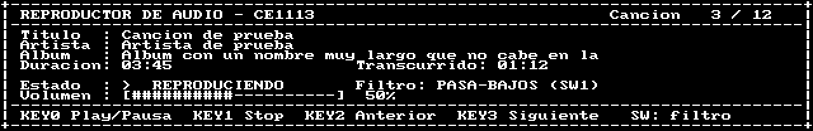

# Reproductor de audio en SoC — Proyecto II, CE-1113 Sistemas Empotrados

Co-diseño hardware/software de un sistema en chip para un reproductor de audio portable
sobre la **Altera DE1-SoC** (Cyclone V 5CSEMA5F31C6), construido con **Platform Designer**
y **Quartus Prime Lite 25.1std**. El procesador de la FPGA es un **Nios V/m** programado
*bare metal* sin HAL; el HPS (ARM Cortex-A9) lee la tarjeta SD.

> Estado: en desarrollo (entrega: 2 de diciembre de 2026). Plan y avance: [TODO.md](TODO.md).
> Las secciones marcadas *(pendiente)* se completan con las tareas indicadas.

## Contenido

1. [Arquitectura](#arquitectura)
2. [Estructura del repositorio](#estructura-del-repositorio)
3. [Instalación y entorno](#instalación-y-entorno)
4. [Compilación](#compilación)
5. [Verificación sin tarjeta](#verificación-sin-tarjeta)
6. [Programar la tarjeta](#programar-la-tarjeta)
7. [Uso del sistema](#uso-del-sistema)
8. [Mapa de memoria e interfaces](#mapa-de-memoria-e-interfaces)
9. [Recursos y potencia](#recursos-y-potencia)
10. [Decisiones de diseño](#decisiones-de-diseño)
11. [Equipo](#equipo)

## Arquitectura

### Hardware



Las piezas en cursiva del plan aún no están en el SoC: el módulo de filtro propio
(HW-17), `seg7_time` (HW-10) y el HPS con su bridge (HW-05). El resto está en
`hw/soc/build_system.tcl`, compila en Quartus y está verificado por simulación.

### Software



**Restricción del enunciado (§3-SW):** los drivers acceden a los periféricos con
punteros `volatile` a las bases de `system.h`; no se usan funciones `alt_*` ni las
macros `IOWR`/`IORD`. La única excepción es `sw/niosv/drivers/irq.c`, que registra y
habilita interrupciones (`alt_ic_isr_register`, `alt_ic_irq_enable`).

```bash
grep -rnE 'IOWR|IORD|alt_' sw/niosv/ sw/common/    # solo aparece irq.c
```

## Estructura del repositorio

| Ruta | Contenido |
|---|---|
| `hw/soc/build_system.tcl` | **Única fuente del SoC** (Platform Designer) |
| `hw/quartus/` | Top-level `DE1_SoC_top.v`, pines (`.qsf`) y restricciones (`.sdc`) |
| `hw/rtl/` | HDL propio: módulo de filtro y `seg7_time` *(pendiente, B)* |
| `sw/niosv/drivers/` | Drivers sin HAL del Nios V |
| `sw/niosv/tests/` | Programas de prueba de cada periférico (PR-05) |
| `sw/niosv/src/` | Aplicación del reproductor |
| `sw/niosv/bsp.tcl` | Ajustes del BSP |
| `sw/common/` | Lógica portable (sin `system.h`) |
| `sw/hps/` | Software del HPS *(pendiente, D)* |
| `sim/questa/` | Testbenches autoverificables y modelos del códec y del ADC |
| `tests/` | Pruebas en el PC (`make -C tests`) |
| `scripts/` | Generar, compilar, simular, programar y reportar |
| `docs/` | Decisiones (`docs/decisiones/`), hardware (`docs/hw/`) y entorno |

## Instalación y entorno

Requisitos: Quartus Prime Lite 25.1std con Cyclone V, Nios V/RiscFree y Questa Altera
Starter (licencia gratuita atada a la MAC). Detalle completo en
[docs/entorno-nativo.md](docs/entorno-nativo.md).

Cada máquina define sus rutas en `scripts/env.local.sh` (no se versiona):

```bash
export ALTERA_ROOT=$HOME/altera_lite/25.1std
export SALT_LICENSE_SERVER=$HOME/ruta/a/LR-XXXXXX_License.dat
```

## Compilación

```bash
scripts/build-soc.sh       # 1. Platform Designer: .qsys, RTL de síntesis, .sopcinfo, testbench
scripts/build-niosv.sh     # 2. BSP del Nios V + aplicación → ram.hex
scripts/build-quartus.sh   # 3. Quartus: síntesis, fitter, .sof y Timing Analyzer (~4 min)
```

Para cambiar solo el software sin recompilar el hardware: `scripts/update-sw.sh` (~20 s).

Resultado actual de la compilación: sin errores ni warnings críticos, tiempos cumplidos en
las cuatro esquinas del Timing Analyzer (slack mínimo de setup **+7.55 ns** a 50 MHz, hold +0.05 ns).

## Verificación sin tarjeta

Cada periférico se verifica con un **testbench autoverificable** que simula el SoC
completo en Questa con el Nios V ejecutando un programa de prueba, y con modelos de los
chips externos hechos a partir de sus datasheets. Cada uno termina en `PASS` o `FAIL`.

```bash
scripts/test-all.sh        # PC + testbenches rapidos (~3 min); --all agrega vga y codec
scripts/sim-tb.sh pio      # un testbench: pio, audio, codec, adc, shm, vga
ELAB_OPTS=-gLTC=1 scripts/sim-tb.sh adc   # ADC con LTC2308 en vez de AD7928
make -C tests              # lógica portable en el PC
```

| Prueba | Qué verifica | Resultado |
|---|---|---|
| `tb_pio` | Escritura de LEDR, lectura de SW, IRQ de cada KEY, pulsación simultánea, rebote, IRQ de SW | PASS; respuesta botón → LED **17 µs** (requisito < 200 ms) |
| `tb_audio` | 240 pares seguidos (5 ms a 48 kHz) en Left Justified, canales sin cruzarse, sin muestras perdidas por sondeo ni por IRQ | PASS |
| `tb_codec` | Las 57 transferencias I²C de la autoinicialización (10 al WM8731, 47 al ADV7180); R7 = 0x041 (maestro, LJ, 16 bits), R8 = 0x000 (48 kHz), R9 activo; `codec_init` quita la de-énfasis (R5 0x006 → 0x000) y `codec_mute` | PASS; todo listo a los 71.4 ms del reset |
| `tb_adc` | Potenciómetro en CH0 con el modelo del **AD7928** y con el del **LTC2308** (las dos revisiones de la placa) | PASS en ambos |
| `tb_shm` | Memoria compartida: bus de datos, bus de direcciones en 64 KB, March C-, accesos de 8/16 bits, sin solape con la RAM | PASS |
| `tb_vga` | 640 × 480 @ 60 Hz (línea de 32.000 µs, HS de 3.840 µs, 640 píxeles activos) y texto: las filas 9–12 coinciden celda por celda con la pantalla de referencia | PASS |
| `test_volume`, `test_screen`, `test_tone` | Curva de volumen, histéresis y saturación; pantalla del reproductor; tono de 440 Hz con SNR de 48.9 dB | PASS |

Pantalla del reproductor tal como sale del Character Buffer en `tb_vga` (líneas 0–103
del cuadro, a escala 2; `scripts/pbm2png.py`):



Hallazgos de la verificación que cambiaron el diseño:

- Con el **LTC2308** el IP del ADC guarda cada resultado en el registro del canal
  anterior: con un solo canal, CH0 nunca se actualizaría. Se convierten dos canales.
- La ROM de autoinicialización del códec deja **de-énfasis a 48 kHz** (atenúa agudos):
  `codec_init` la quita.
- El borrado del **Character Buffer** tarda un cuadro de video (16.7–33 ms, no "5000 ciclos")
  y sus lecturas por el bus no son confiables: el driver espera el borrado y no relee.
- Dos artefactos de simulación (no del diseño) se resuelven en el testbench y están
  documentados en `sim/questa/tb_vga.sv`: el `.mif` de la fuente con varios valores por
  línea y la salida X del `dcfifo` en modo *show-ahead*.

Pruebas que faltan en la tarjeta y su procedimiento: [docs/pruebas-tarjeta.md](docs/pruebas-tarjeta.md).

## Programar la tarjeta

```bash
scripts/program.sh                                   # .sof por JTAG (FPGA = dispositivo 2)
niosv-download -g -r build/niosv/app/build/audio_player.elf   # solo el programa
```

## Uso del sistema

| Control | Función |
|---|---|
| KEY0 | Play / pausa |
| KEY1 | Stop |
| KEY2 | Canción anterior |
| KEY3 | Canción siguiente |
| SW | Selección del filtro *(asignación en CD-08)* |
| Potenciómetro (ADC CH0) | Volumen (32 escalones de 2 dB) |
| HEX3..HEX0 | Tiempo transcurrido MM:SS *(HW-10)* |
| VGA | Título, artista, álbum, duración, canción n/total, estado, filtro y volumen |

## Mapa de memoria e interfaces

- Mapa de memoria e interrupciones: [docs/hw/mapa-memoria.md](docs/hw/mapa-memoria.md).
- Justificación de cada componente: [docs/hw/componentes-soc.md](docs/hw/componentes-soc.md).
- Interfaz del módulo de hardware propio *(pendiente, HW-11)*.

## Recursos y potencia

Sistema completo (sin el módulo propio ni el HPS todavía), de
`python3 scripts/report-resources.py` y `scripts/report-power.sh`:

| Recurso | Uso |
|---|---|
| Lógica | 3 292 / 32 070 ALMs (10 %) |
| Registros | 4 671 |
| Memoria embebida | 1 648 768 bits (41 %), 207 / 397 M10K (52 %) |
| DSP | 0 / 87 |
| PLL | 2 / 6 |
| Potencia total estimada | 547.8 mW (dinámica del núcleo 94.7 mW, estática 421.6 mW, E/S 31.5 mW; estimación sin vectores) |

## Decisiones de diseño

| Decisión | Resumen |
|---|---|
| [CD-06](docs/decisiones/CD-06.md) Memoria | Todo en on-chip: 128 KB para el Nios V y 64 KB de doble puerto compartidos con el HPS; sin SDRAM |
| [CD-07](docs/decisiones/CD-07.md) Frecuencias | Códec fijo a 48 kHz; el HPS remuestrea 8/16/44.1 kHz |
| [CD-09](docs/decisiones/CD-09.md) Visualización | VGA con Character Buffer 80 × 60 |

## Equipo

| Persona | Área |
|---|---|
| A — Randall Bolaños | SoC y plataforma: Platform Designer, Quartus, periféricos de catálogo y sus drivers |
| B | Hardware propio y DSP |
| C | Software de aplicación |
| D | HPS y arranque |
