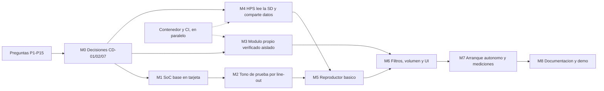

# TODO — Proyecto II: SoC Reproductor de Audio (co-diseño HW/SW)

**Curso:** CE-1113 Sistemas Empotrados — TEC · **Profesor:** Dr.-Ing. Jeferson González Gómez
**Plataforma:** Altera DE1-SoC · Platform Designer · Quartus Prime Lite 25.1std
**Fecha de entrega:** 2 de diciembre de 2026 · **Última revisión de este plan:** 29 de octubre de 2026

## Cómo leer este plan

- `[ ]` pendiente · `[~]` en progreso · `[x]` hecho.
- **OBL** obligatorio · **OPC** opcional / crédito extra · **EVID** genera evidencia que va
  al repositorio · `#n` issue del board (de la versión anterior de este plan; las tareas
  marcadas *issue nuevo* todavía no tienen issue).
- Cada tarea tiene un identificador (`HW-07`, `NV-04`…). `⟵ X` significa "depende de X".
  `→` indica cuándo se da por terminada.
- Referencias al enunciado (`proyecto-2-reproductor-audio-2026ii.pdf`):

| Código | Sección del PDF | Pág. |
|---|---|---|
| §2 | Descripción general (plataforma, procesadores, HAL mínimo, Taller 9) | 2 |
| §3-F | Especificación → Funcionalidades del reproductor (contenido, control, visualización, procesamiento, rendimiento) | 3–4 |
| §3-HW | Requerimientos de Hardware (solo hardware) | 4–5 |
| §3-SW | Requerimientos de Software (solo software) | 5 |
| §3-SIS | Requerimientos de Sistema (co-diseño: filtros, volumen, tiempo, visualización, control) | 5–6 |
| §3-REC | Análisis de Recursos y Consumo | 6 |
| §3-EXT | Crédito Extra (opcional) | 6 |
| §4 | Material de apoyo | 7 |
| §5 | Entregables y porcentajes | 7–8 |
| GRUPO | Requisito acordado por el grupo, no está en el PDF (modularidad, contenedor, CI). Se indica a qué rubro del PDF aporta. | — |

## Reglas transversales

- **Sin HAL en el Nios V** [§3-SW p.5]: los periféricos se acceden con punteros `volatile`
  a las bases de `system.h`; nada de `alt_*` ni `IOWR`/`IORD`. **Única excepción:**
  `alt_ic_isr_register` y, si hace falta, `alt_ic_irq_enable`/`alt_ic_irq_disable` para las
  interrupciones de los botones.
- **Código portable y modular** [GRUPO → §5 p.7, documento de diseño de software]:
  `sw/common/` no incluye `system.h`, no toca registros, no usa `malloc` y lee los datos
  little-endian byte a byte. La lógica (parseo WAV, metadatos, playlist, máquina de
  estados, filtros en software) vive ahí y se prueba en el PC; los drivers viven en
  `sw/niosv/drivers/` y `sw/hps/drivers/`.
- **Cada módulo HDL propio tiene su testbench** [§3-HW p.4 + GRUPO]. El HDL propio se
  escribe portable (multiplicadores y memorias inferidos, sin primitivas de Altera) para
  que corra en Icarus/cocotb dentro del contenedor y también en Questa.
- **Estructura del repositorio:** `hw/` (HDL en `hw/rtl/`, Platform Designer en `hw/soc/`),
  `sw/niosv/`, `sw/hps/`, `sw/common/`, `sim/` (cocotb y `.do` de Questa), `tests/`
  (pruebas en C y `tests/data/`), `docker/`, `docs/`, `scripts/` (flujo nativo de Quartus).
- **El contenedor no bloquea a Quartus:** la sección 8 es trabajo en paralelo. Quartus,
  Platform Designer, el BSP del Nios V, Questa y la programación de la tarjeta se usan de
  forma nativa ([docs/entorno-nativo.md](docs/entorno-nativo.md)).
- **No se instala nada en las máquinas sin acordar antes la ubicación.**
- **Git:** Conventional Commits, ramas `main`/`develop`/`feat/*` (ver `CONTRIBUTING.md`),
  sin co-autores de IA en los commits.

## Datos ya verificados que condicionan el diseño

Revisado en la instalación local de Quartus 25.1std (`/opt/altera_lite/25.1std`) y en el
Taller 9:

1. **Los IP del University Program están instalados** en
   `ip/altera/university_program/`: Audio (`altera_up_avalon_audio`), Audio and Video
   Config, Audio PLL, ADC de la DE1-SoC (`altera_up_avalon_de1_soc_adc`), VGA controller,
   Character Buffer y Pixel Buffer DMA, SDRAM PLL, RS232, Character LCD.
2. **Frecuencias de muestreo:** el IP *Audio and Video Config* solo ofrece **8, 32, 48 y
   96 kHz**; el PDF pide **8, 16 y 44.1 kHz**. El Audio PLL genera 12.288, 11.2896 y
   12.0 MHz (entre otras), y el Config permite escribir registros del códec WM8731 en
   tiempo de ejecución. 16 kHz y 44.1 kHz necesitan una decisión (CD-07).
3. **El Nios V/m no tiene multiplicador por hardware:** es RV32I (`CORE_SUPPORTS_MULDIV 0`
   en el IP; el BSP del Taller 9 compila con `-march=rv32i`). Cada multiplicación en
   software es una llamada a `__mulsi3`. Esto pesa en CD-05 (volumen) y CD-12 (filtros en
   software).
4. **ADC:** el IP de ADC de la DE1-SoC soporta el AD7928 y el LTC2308 (parámetro interno
   `isLTC`). Hay que confirmar qué chip trae nuestra revisión de la placa (HW-08).
5. **SD:** el enunciado pide la SD "mediante el HPS" [§3-SW p.5]. En la DE1-SoC el zócalo
   microSD está cableado al HPS (confirmar en el manual de Terasic, HW-05), así que el
   Nios V no puede leerla sin un módulo externo.
6. **Taller 9 reutilizado:** SoC base en Tcl, scripts de generación/compilación/simulación
   y prueba de humo en C, ya copiados y adaptados
   ([docs/reutilizado-taller9.md](docs/reutilizado-taller9.md)).

---

## Preguntas para el profesor

Se anotan en vez de suponer. Las tareas que dependen de una respuesta lo indican con
`⟵ P#`.

- [ ] **P1 — Partición de procesadores.** §3-SW p.5 pide la SD "mediante el HPS" y §2 p.2
      permite Nios V "de ser requerido". ¿Se acepta una arquitectura híbrida (HPS: SD y
      archivos; Nios V: botones, reproducción, visualización)? ¿O debe usarse un solo
      procesador? ¿En cuál deben atenderse las interrupciones de los botones?
- [ ] **P2 — SO del HPS.** "El sistema operativo deberá ser mínimo sin
      visualización/interacción directa con el SO" (§3-SW p.5). ¿Vale una aplicación bare
      metal sin SO (U-Boot SPL + aplicación)? ¿Vale un Linux mínimo (Buildroot) que arranca
      la aplicación sin consola?
- [ ] **P3 — Audio "por la FPGA".** §3-HW p.4: el audio lo maneja la FPGA "y no
      directamente por el HPS". Si el HPS escribe muestras en la FIFO del IP de Audio a
      través del bridge, ¿cuenta como "directamente por el HPS"? ¿Debe alimentarla el
      Nios V, un DMA o hardware propio?
- [ ] **P4 — HAL en el HPS y bibliotecas.** La restricción de `alt_*` está escrita para el
      Nios V. ¿Aplica también a la HWLib del HPS (que usa el prefijo `alt_`, por ejemplo
      `alt_sdmmc`)? ¿Se permiten bibliotecas de terceros: FatFs para FAT32 y un framework
      de pruebas en C (Unity)?
- [ ] **P5 — Depuración en el Nios V.** ¿Se permite `printf` por la JTAG UART (stdio del
      HAL) para depuración y mediciones, aunque no forme parte del producto? Se asume que
      el código de arranque del BSP (`alt_main`, `alt_sys_init`) no cuenta como uso del HAL.
- [ ] **P6 — 7 segmentos "solo hardware".** §3-HW p.4 pone el "manejo directo de los
      displays" en la lista de hardware obligatorio. ¿Debe ser un bloque HDL que decodifica
      (el software solo escribe el tiempo), o se acepta un PIO con decodificación en
      software?
- [ ] **P7 — Metadatos.** Los WAV guardan título/artista/álbum en el chunk `LIST/INFO`
      (`INAM`/`IART`/`IPRD`). ¿Hay que soportar también ID3 dentro del WAV (chunk `id3 `)?
      Si un archivo no trae metadatos, ¿basta mostrar el nombre del archivo?
- [ ] **P8 — Frecuencias y canales.** El IP de configuración del códec solo trae 8/32/48/96
      kHz. ¿Se acepta remuestrear (16→32 o 48 kHz, 44.1→48 kHz) o el códec debe correr a la
      frecuencia nativa del archivo? ¿Hay que soportar mono y estéreo?
- [ ] **P9 — Visualización.** ¿Hay LCD o TFT disponible en el laboratorio o se espera VGA?
      ¿Se pueden usar los IP de video del University Program (Character Buffer) o debe ser
      un controlador propio?
- [ ] **P10 — ADC y potenciómetro.** ¿Qué revisión de DE1-SoC nos toca (la rev. F usa
      LTC2308 en vez de AD7928)? ¿El laboratorio presta el potenciómetro y el cableado al
      conector del ADC?
- [ ] **P11 — Herramienta de verificación.** §3-HW p.4 menciona ModelSim/Questa o una
      rutina de software. ¿Se acepta cocotb con Icarus Verilog (en contenedor) como
      testbench del módulo propio, o la evidencia debe salir de Questa?
- [ ] **P12 — Conteo de filtros.** ¿El bypass cuenta como uno de los 3 filtros mínimos, o
      son 3 filtros más el bypass?
- [ ] **P13 — Crédito extra.** ¿Cuántos puntos vale cada opción? Para UART/Bluetooth: ¿hay
      módulo disponible (p. ej. HC-05)? ¿Se acepta audio comprimido (μ-law) o a 8 kHz por
      el ancho de banda de la UART?
- [ ] **P14 — Tiempo de arranque.** ¿Los 10 s se miden desde el reset con la FPGA ya
      configurada por JTAG, o desde el encendido incluyendo la configuración de la FPGA
      desde la SD?
- [ ] **P15 — Formato de entrega.** ¿La documentación de diseño (20%) va como PDF aparte o
      en el repositorio (`docs/`)? ¿Hay rúbrica de la presentación funcional (60%), fecha
      y duración?

---

## Orden sugerido y dependencias

| Semana | Fechas | Objetivo |
|---|---|---|
| S1 | 29 oct – 4 nov | Enviar P1–P15. Cerrar CD-01, CD-02 y CD-07 (M0). SoC base con PIO definitivos y proyecto Quartus (HW-01..02, HW-19..23). Definir y construir el contenedor (DK-01..09). Empezar el parser WAV (SC-03..06). |
| S2 | 5 – 11 nov | M1 y M2 en tarjeta. Módulo propio en HDL con cocotb (HW-11..14, DK-11..12) → M3. U-Boot SPL e imagen SD (HP-02..03). |
| S3 | 12 – 18 nov | HPS ↔ Nios V (HW-05..06, HP-05..07) → M4. Reproductor básico con botones y playlist (IN-05..07) → M5. CI funcionando (DK-18..20). |
| S4 | 19 – 25 nov | Filtros 2 y 3, volumen, VGA (IN-03, IN-04, IN-08) → M6. Arranque autónomo, mediciones, recursos y potencia (IN-09, PR-07..10, RP-*) → M7. Opcionales solo si M5 se cumplió antes del 18 nov y el profesor los aprobó. |
| S5 | 26 nov – 2 dic | Congelar funciones el 30 nov. Documentación, README, videos, ensayo (DOC-*) → M8. PR final `develop` → `main`. |

Camino crítico: **P1/P2 → CD-01/CD-02 → HW-05 (HPS) → HP-02..07 → IN-05 → IN-06**. Es la
parte con más incertidumbre técnica (arranque del HPS y canal con la FPGA); conviene
empezar HP-02 en S1 aunque CD-02 no esté cerrado.

---

## 0. Arranque y organización

- [ ] **OR-01** Leer el enunciado completo y enviar P1–P15 al profesor; registrar las
      respuestas en `docs/respuestas-profesor.md`. *§3-N p.6* → archivo con fecha de cada
      respuesta.
- [ ] **OR-02** Definir roles (HDL/DSP · SoC/Quartus · Nios V · HPS/arranque · contenedor/CI
      · documentación) y responsables por sección de este plan. *§5 p.8 (gestión)* → tabla
      de roles en el README.
- [x] **OR-03** Revisar el Taller 9 y copiar lo reutilizable. *§2 p.2* →
      [docs/reutilizado-taller9.md](docs/reutilizado-taller9.md).
- [ ] **OR-04** Verificar en cada máquina Quartus 25.1std + Nios V/RiscFree + Questa con
      `scripts/env.sh` (la sección "Verificar que todo responde" de
      [docs/entorno-nativo.md](docs/entorno-nativo.md)). *§2 p.2* → los 4 comandos responden.
- [ ] **OR-05** Conseguir el material: DE1-SoC, microSD (≥ 4 GB), lector de SD,
      potenciómetro y cables para el conector del ADC, parlantes o audífonos, monitor VGA
      (o LCD/TFT según P9). *§3-F p.3–4, §3-SIS p.5* ⟵ P9, P10 → lista con responsable.

## 1. Repositorio y flujo Git — 10% — #1, #2

- [x] **GIT-01** Ramas `main`/`develop`, protección de `main`, `CONTRIBUTING.md`, etiquetas,
      hitos e issues de planeamiento, `.gitignore`. *§5 p.8*
- [~] **GIT-02** Estructura de directorios (ver "Reglas transversales"). Ya existen `hw/soc/`,
      `scripts/`, `sim/questa/`, `sw/niosv/src/`, `docs/`; faltan `hw/rtl/`, `sw/common/`,
      `sw/hps/`, `tests/`, `docker/`, que se crean con su primer archivo real. *§5 p.8* · #2
- [ ] **GIT-03** Actualizar `CONTRIBUTING.md` a la estructura nueva: `software/` → `sw/`,
      testbenches en `sim/` (no en `hw/tb/`), auditoría con
      `grep -rnE 'IOWR|IORD|alt_' sw/niosv/` y ámbitos de commit `docker`, `ci`, `hps`,
      `common`. Ajustar en `.gitignore` la regla `software/*bsp*/*`, que ya no aplica.
      *§5 p.8* ⟵ GIT-02
- [ ] **GIT-04** Crear issues para las tareas nuevas de este plan (OR, CD, SC, HP, IN, DK, PR,
      RP, DOC sin número) y asignarlas a hitos M0–M8. *§5 p.8* → todas las tareas OBL tienen
      issue.
- [ ] **GIT-05** Una rama `feat/*` por issue, PR a `develop` con `Refs #n`, revisión de otra
      persona antes del merge. Historial distribuido en el tiempo. *§5 p.8* (continuo)

## 2. Co-diseño: análisis, alternativas y decisiones — #3, #4

> Cada decisión se registra en `docs/decisiones/CD-xx.md`: alternativas (≥ 2), criterios
> (rendimiento, latencia, recursos, complejidad), datos o mediciones, decisión y fecha.
> Alimenta el documento de metodología (7%, §5 p.7).

- [ ] **CD-01** Partición de procesadores. *§2 p.2, §3-SW p.5, §3-HW p.4* ⟵ P1, P3 · #3 (OBL)
      - A: híbrida. HPS lee la SD y deja PCM y metadatos en memoria compartida; el Nios V
        atiende botones, máquina de estados, audio y visualización.
      - B: solo HPS. Todo por el bridge liviano; interrupciones de la FPGA al GIC del HPS.
      - C: solo Nios V con SD por SPI en GPIO. Choca con "SD mediante el HPS"; solo si P1
        lo permite.
      → decisión escrita. **Las secciones 5 y 6 asumen la alternativa A** porque es la única
      que cumple "SD mediante el HPS" y deja el audio en manos de la FPGA. Si P1/P3 dicen
      otra cosa, se mueven tareas entre esas secciones.
- [ ] **CD-02** Software del HPS: bare metal (U-Boot SPL + aplicación propia, driver SD/MMC
      + FatFs) vs Linux mínimo (Buildroot, aplicación con `mmap` de `/dev/mem`). Criterios:
      arranque < 10 s, esfuerzo del driver SD, "SO mínimo sin interacción". *§3-SW p.5,
      §3-F p.4* ⟵ P2, P4, P14 · *issue nuevo* → decisión escrita. Define la toolchain del
      contenedor (DK-02).
- [ ] **CD-03** Camino de las muestras y presupuesto de latencia: SD → HPS → buffer compartido
      → Nios V → filtro → FIFO del IP de Audio. Calcular tamaños de buffer: el audio que ya
      pasó por el filtro y espera salir debe durar < 100 ms (cambio de filtro, §3-F p.4) y el
      buffer previo debe cubrir el peor caso de lectura de la SD (sin cortes, §3-F p.4).
      *§3-F p.4, §3-SIS p.5* ⟵ CD-01 · #3 → tabla de buffers con duración en ms para 8/16/44.1
      kHz.
- [ ] **CD-04** Conexión del filtro propio: mapeado a memoria (la CPU escribe la muestra y lee
      el resultado) vs en línea por Avalon-ST antes del IP de Audio. Estimar la carga de CPU
      con la frecuencia de muestreo máxima (accesos por segundo × ciclos por acceso).
      *§3-HW p.4, §3-SIS p.5* ⟵ CD-03 · #3 → decisión con la estimación.
- [ ] **CD-05** Volumen: multiplicador en hardware (dentro del módulo propio) vs escalado en
      software. Considerar que el Nios V/m no tiene `mul` (dato 3). *§3-SIS p.5* · #17 →
      decisión con ciclos medidos de `__mulsi3` o recursos estimados del multiplicador.
- [ ] **CD-06** Memoria: código y datos del Nios V en RAM on-chip (256 KB del Taller 9) vs
      SDRAM de 64 MB de la FPGA vs DDR3 del HPS por el bridge F2H; dónde vive el buffer
      compartido (RAM on-chip de doble puerto vs SDRAM). *§3-SW p.5 (gestión de memoria)*
      ⟵ CD-01, CD-03 · #4 → mapa de memoria preliminar.
- [ ] **CD-07** Frecuencias de muestreo (dato 2). *§3-F p.3* ⟵ P8 · *issue nuevo*
      - A: códec fijo a 48 kHz y remuestreo de 8k (×6), 16k (×3) y 44.1k (→48k).
      - B: reconfigurar el códec por canción con el registro de direcciones/datos del IP de
        Config: 8k nativo; 16k → 32k (×2); 44.1k con MCLK de 11.2896 MHz o modo USB a 12 MHz.
      → prototipo en tarjeta de B con un tono a 44.1 kHz antes de decidir. Mono → duplicar
      en ambos canales.
- [ ] **CD-08** Switches: lectura periódica (≤ 20 ms) vs interrupción por flanco; asignación
      de switches a filtros y qué pasa con combinaciones inválidas. *§3-F p.4, §3-SIS p.5*
      · #16 → tabla SW → filtro.
- [ ] **CD-09** Visualización: VGA con IP del University Program (Character Buffer 80×60)
      vs controlador VGA propio en HDL vs LCD/TFT externo. *§3-F p.4, §3-SIS p.6* ⟵ P9 · #19
      → decisión y boceto de la pantalla.
- [ ] **CD-10** Tiempo de reproducción: timer de hardware vs contar muestras enviadas al
      códec (queda sincronizado con el audio y se detiene solo en pausa). *§3-SIS p.6* · #18
      → decisión.
- [ ] **CD-11** Máquina de reproducción: software (en `sw/common/`, probada en el PC) vs FSM
      en hardware. *§3-SIS p.6* · #14 → decisión.
- [ ] **CD-12** Ubicación de los filtros 2 y 3: Nios V (sin multiplicador), HPS (ARM con
      NEON) o hardware. Medir ciclos por muestra del filtro en software antes de decidir.
      *§3-SIS p.5* ⟵ CD-01, SC-10 · #16 → tabla de ciclos/muestra vs presupuesto
      (ciclos de reloj / fs).
- [ ] **CD-13** HDL: Verilog-2005/SystemVerilog sintetizable (subconjunto que entiende Icarus)
      vs VHDL (GHDL). Define el simulador del contenedor. *GRUPO → §5 p.8 herramientas* →
      decisión.
- [ ] **CD-14** Formato de punto fijo: muestras Q1.15, coeficientes (Q1.15 o Q2.14), ancho
      del acumulador (16 + 16 + ⌈log2 N⌉ bits), redondeo y saturación. *§3-SIS p.5* · #9 →
      documento con el análisis de error.
- [ ] **CD-15** Comparar al menos dos arquitecturas completas (p. ej. A con filtros en HW vs
      A con filtros en HPS) en una tabla de rendimiento, latencia, recursos y complejidad.
      *§3 p.3, §5 p.7 (7%)* ⟵ CD-01..14, RP-04 · #3 (EVID)
- [ ] **CD-16** Diagramas de arquitectura de hardware (bloques del SoC) y de software
      (módulos, flujo, ISR, comunicación HPS ↔ Nios V). *§5 p.8 (README)* ⟵ CD-01 · #4 (EVID)

## 3. Hardware (FPGA)

### 3.1 SoC base en Platform Designer — #5

- [ ] **HW-01** `hw/soc/build_system.tcl` es la fuente de verdad del SoC; decidir si el
      `.qsys` se versiona (recomendado: no, se regenera con `REGEN_QSYS=1
      scripts/build-soc.sh`). Lo hecho en la GUI se pasa al Tcl antes del commit.
      *§5 p.8 (compilación con Platform Designer)* → regla escrita en `CONTRIBUTING.md`.
- [ ] **HW-02** PIO definitivos: `pio_key` (KEY[3:0], entrada, captura de flanco de bajada,
      IRQ), `pio_sw` (SW[9:0], entrada; IRQ según CD-08) y `pio_led` (LEDR[9:0]); quitar
      `pio_in`/`pio_out` del Taller 9. *§3-F p.3 (botones por interrupción), §3-SIS p.5* ·
      #5 (OBL) → `system.h` define `PIO_KEY_BASE`, `PIO_KEY_IRQ`, `PIO_SW_BASE`,
      `PIO_LED_BASE`.
- [ ] **HW-03** Configurar el Nios V/m: pipeline sí/no (medir), tamaño de la RAM on-chip,
      vector de reset, `timer_sw_agent`. *§2 p.2* ⟵ CD-06 · #5
- [ ] **HW-04** Si CD-06 lo pide: SDRAM de 64 MB (`altera_up_avalon_sys_sdram_pll` +
      controlador SDRAM) con los pines `DRAM_*`. *§3-SW p.5* ⟵ CD-06 · #5

### 3.2 HPS y canal HPS ↔ FPGA — *issue nuevo*

- [ ] **HW-05** Agregar el componente HPS de Cyclone V con la configuración de la DE1-SoC
      (DDR3, pines de SD/MMC, UART0, reloj) tomada del GHRD del System CD de Terasic;
      habilitar el bridge liviano H2F y los que pida CD-06. Confirmar en el manual que la
      microSD está cableada al HPS. *§3-SW p.5, §4 p.7* ⟵ CD-01 (OBL)
- [ ] **HW-06** Canal HPS ↔ Nios V: memoria compartida (según CD-06) + registros de buzón para
      el handshake (comandos y punteros del ring buffer), y una IRQ si hace falta. *§3-SW p.5*
      ⟵ HW-05, SC-13 (OBL) → dirección del canal vista por ambos procesadores, documentada.

### 3.3 Periféricos de catálogo — #6, #7

- [ ] **HW-07** Audio: Audio PLL (frecuencia según CD-07), IP de Audio (Memory-Mapped o
      Streaming según CD-04) y Audio and Video Config (I2C al WM8731); exportar `AUD_*` y
      `FPGA_I2C_*`. *§3-HW p.4 (audio en la FPGA), §4 p.7* ⟵ CD-04, CD-07 · #6 (OBL)
- [ ] **HW-08** ADC: IP de ADC de la DE1-SoC con el chip de nuestra revisión (AD7928 o
      LTC2308), canal del potenciómetro; exportar `ADC_*`. *§3-SIS p.5, §4 p.7* ⟵ P10 · #6
      (OBL)
- [ ] **HW-09** Visualización según CD-09 (p. ej. Video PLL + VGA Controller + Character
      Buffer) y pines `VGA_*`. *§3-F p.4, §3-SIS p.6* ⟵ CD-09 · #7 (OBL)

### 3.4 Displays de 7 segmentos — #18

- [ ] **HW-10** Módulo HDL `seg7_time` (en `hw/rtl/`) con esclavo Avalon-MM: registro con el
      tiempo (segundos o BCD MM:SS), registro de control (encendido, blanking) y salida a
      HEX3..HEX0 (HEX5..HEX4 libres para el número de canción). Testbench propio (DK-13).
      *§3-HW p.4, §3-F p.3 (MM:SS)* ⟵ P6 (OBL) → el testbench verifica 00:00, 09:59, 59:59
      y el blanking.

### 3.5 Módulo de hardware personalizado y filtro DSP propio — #8, #9, #10

- [ ] **HW-11** Mapa de registros con registros de control (habilitar, bypass, selección,
      limpiar), estado (listo, ocupado, saturación, versión) y datos (muestra de entrada y
      de salida, dirección y dato de coeficiente, número de taps, ganancia si CD-05 = HW), en
      `docs/hw/modulo-filtro.md`. *§3-HW p.4* ⟵ CD-04, CD-05 · #8 (OBL)
- [ ] **HW-12** Diseñar el filtro obligatorio (p. ej. FIR pasa-bajos de N taps): script
      `scripts/design_fir.py` que calcula y cuantiza los coeficientes según CD-14 y exporta la
      tabla para HDL, C y cocotb. *§3-SIS p.5, §5 p.8 (herramientas)* ⟵ CD-14 · #9 (OBL) →
      gráfico de respuesta ideal vs cuantizada.
- [ ] **HW-13** Núcleo del filtro en HDL propio (`hw/rtl/`): registros de retardo,
      multiplicador-acumulador (secuencial con un bloque DSP, compartido entre canales, o
      paralelo, justificado), redondeo y saturación, banco de coeficientes recargable. Sin IP
      de filtrado del catálogo. *§3-SIS p.5* ⟵ HW-12 · #9 (OBL)
- [ ] **HW-14** Esclavo Avalon-MM del módulo según HW-11 (y Avalon-ST si CD-04 = en línea).
      *§3-HW p.4* ⟵ HW-11, HW-13 · #8 (OBL)
- [ ] **HW-15** Volumen en hardware si CD-05 = HW: multiplicador de ganancia con saturación
      dentro del módulo, antes del IP de Audio. *§3-SIS p.5* ⟵ CD-05 · #17
- [ ] **HW-16** Verificación aislada documentada **antes de integrar** (puerta de paso):
      DK-11, DK-12 y PR-02 en verde, reporte PR-03 escrito. *§3-HW p.4* ⟵ DK-11, DK-12, PR-02,
      PR-03 · #10 (OBL, EVID)
- [ ] **HW-17** Empaquetar el módulo como componente de Platform Designer (`*_hw.tcl` en
      `hw/rtl/`) y agregarlo a `build_system.tcl`. *§3-HW p.4* ⟵ HW-16 · #8 (OBL)
- [ ] **HW-18** Diagrama de bloques y diagramas de tiempo (escritura de registro, muestra
      entrando y saliendo, recarga de coeficientes), p. ej. con WaveDrom. *§5 p.7 (4%)* ⟵ HW-14
      · #8 (EVID)

### 3.6 Proyecto Quartus y tarjeta — #5

- [ ] **HW-19** Top-level `hw/DE1_SoC_top.v` que instancia `audio_soc` y un `.qsf` con los pines
      tomados del `.qsf` de referencia del System CD de Terasic (solo los que se usan).
      *§2 p.2, §4 p.7* ⟵ HW-02 · #5 (OBL)
- [ ] **HW-20** Restricciones de tiempo `.sdc`: reloj de 50 MHz, `derive_pll_clocks`,
      `derive_clock_uncertainty`, rutas falsas para entradas asíncronas (KEY, SW). *§3-F p.4
      (estabilidad)* ⟵ HW-19 · #5 → Timing Analyzer sin slack negativo en ningún reloj.
- [ ] **HW-21** Script `scripts/build-quartus.sh` (`quartus_sh --flow compile`) y compilación
      limpia: sin errores, warnings críticos revisados. *§5 p.8 (compilación)* ⟵ HW-20 · #5
      (OBL)
- [ ] **HW-22** Cargar el software del Nios V: `ram.hex` dentro del `.sof` (actualizar la MIF
      sin recompilar todo) o `niosv-download` por JTAG; script `scripts/program.sh` con
      `quartus_pgm`. *§3-F p.4 (arranque)* ⟵ HW-21, NV-01 · #5
- [ ] **HW-23** Tabla de justificación de **cada** componente del SoC (componente → función →
      requisito) y quitar los que no tengan función (p. ej. la JTAG UART en la versión final,
      salvo que se use para mediciones). *§3-HW p.5* ⟵ HW-01..17 · #5 (OBL, EVID)
- [ ] **HW-24** Mapa de memoria final visto desde el Nios V y desde el HPS (exportado de
      Platform Designer). *§5 p.7–8* ⟵ HW-23 · #4 (EVID)

## 4. Software portable `sw/common/` — #11, #12, #14

> Sin `system.h`, sin registros, sin `malloc`. Compila con gcc del PC (pruebas),
> `riscv32-unknown-elf-gcc` (Nios V) y la toolchain ARM (HPS). C11, `-Wall -Wextra`.

- [ ] **SC-01** Estructura `sw/common/include/` y `sw/common/src/`, prefijos de módulo y
      códigos de error comunes. *GRUPO → §5 p.7 (documento de SW)* ⟵ GIT-02
- [ ] **SC-02** Lectura little-endian segura (`le16`, `le32`) con comprobación de límites.
      *§3-SW p.5* ⟵ SC-01
- [ ] **SC-03** Parser RIFF/WAVE: `fmt ` (PCM = 1, 16 bits, 1–2 canales, 8000/16000/44100
      Hz), `data`, saltar chunks desconocidos respetando el relleno a tamaño par, rechazar
      formatos no soportados con código de error. *§3-F p.3* ⟵ SC-02 · #12 (OBL) → pruebas
      DK-14 en verde.
- [ ] **SC-04** Metadatos `LIST/INFO`: `INAM` (título), `IART` (artista), `IPRD` (álbum), con
      recorte y terminación segura; valor de respaldo si faltan (según P7). *§3-F p.3,
      §3-SW p.5* ⟵ SC-03 · #12 (OBL)
- [ ] **SC-05** ID3 dentro del WAV (`TIT2`, `TPE1`, `TALB`), solo si P7 lo pide. *§3-F p.3*
      ⟵ P7, SC-03 · #12
- [ ] **SC-06** Duración total = bytes de datos / byte rate, y formateo MM:SS. *§3-F p.3* ⟵ SC-03
      · #12 (OBL)
- [ ] **SC-07** Playlist: ≥ 10 pistas, siguiente/anterior con vuelta al inicio, avance
      automático al terminar, índice "n/total". *§3-F p.3* ⟵ SC-01 · #14 (OBL)
- [ ] **SC-08** Máquina de estados de reproducción (detenido, reproduciendo, pausado; eventos
      play/pausa, stop, siguiente, anterior, fin de pista, error) como tabla de transiciones
      que devuelve acciones, sin tocar hardware. *§3-F p.3, §3-SIS p.6* ⟵ CD-11, SC-07 · #14
      (OBL)
- [ ] **SC-09** Cola de eventos de un productor y un consumidor (ISR → lazo principal), sin
      bloqueo. *§3-SW p.5 (interrupciones)* ⟵ SC-01 · #13
- [ ] **SC-10** Filtros en software en punto fijo (biquad forma directa I, ecualizador de 3
      bandas o notch/pasa-banda) y modelo del FIR igual bit a bit al HDL. *§3-SIS p.5* ⟵ CD-14
      · #16 (OBL)
- [ ] **SC-11** Volumen: lectura del ADC de 12 bits → ganancia (curva logarítmica) y escalado
      con saturación. *§3-SIS p.5* ⟵ CD-05 · #17 (OBL)
- [ ] **SC-12** Remuestreo, si CD-07 lo pide. *§3-F p.3* ⟵ CD-07
- [ ] **SC-13** Protocolo HPS ↔ Nios V en un header común (`shm_proto.h`): versión, tabla de
      pistas con metadatos, ring buffer con índices de productor y consumidor, comandos;
      `_Static_assert` de tamaños y alineación (ambos son de 32 bits little-endian).
      *§3-SW p.5* ⟵ CD-01, CD-06 (OBL)
- [ ] **SC-14** Interfaces de "puerto" (structs de punteros a función: salida de audio,
      display, reloj) para que la lógica no dependa del hardware y se pueda probar con mocks.
      *GRUPO → §5 p.7* ⟵ SC-01

## 5. Software Nios V `sw/niosv/` — #13 a #19

> Asume CD-01 = A. Drivers en `sw/niosv/drivers/`: un `.h`/`.c` por periférico, con
> offsets y bits tomados de la documentación del IP, y un puntero `volatile` a la base de
> `system.h`.

- [ ] **NV-01** Ajustes del BSP como opciones de `niosv-bsp` dentro de
      `scripts/build-niosv.sh` (biblioteca C reducida, drivers reducidos, stdout por JTAG UART
      solo para depuración, tamaño de pila, regiones de memoria según CD-06). *§3-SW p.5
      (gestión de memoria)* ⟵ CD-06, P5 · #15
- [ ] **NV-02** Compilar `sw/common/` dentro de la aplicación del Nios V (`--srcs` de
      `niosv-app` o `CMakeLists.txt` propio) con `-std=c11 -Wall -Wextra`. *GRUPO* ⟵ SC-01 →
      `scripts/build-niosv.sh` compila sin warnings.
- [ ] **NV-03** Driver de botones: `interruptmask` y `edgecapture` (se limpia escribiendo 1)
      por puntero, ISR registrada con `alt_ic_isr_register` que solo limpia la fuente y
      encola el evento (SC-09). *§3-F p.3, §3-SW p.5* ⟵ HW-02 · #13 (OBL)
- [ ] **NV-04** Antirrebote: verificar en el manual de la DE1-SoC si KEY[3:0] ya traen
      antirrebote; si no, ventana en software con la base de tiempo NV-12. *§3-F p.4
      (< 200 ms)* ⟵ NV-03 · #13
- [ ] **NV-05** Switches (lectura periódica o IRQ según CD-08) → selección de filtro; LEDs para
      el estado y el filtro activo. *§3-F p.4, §3-SIS p.5* ⟵ HW-02, CD-08 · #16 (OBL)
- [ ] **NV-06** Driver del IP de Audio: espacio libre de la FIFO, escritura de canal izquierdo
      y derecho, limpieza de FIFOs; escritura no bloqueante de bloques de muestras. *§3-HW p.4*
      ⟵ HW-07 · #14 (OBL)
- [ ] **NV-07** Driver del Audio and Video Config: inicializar el códec (salida de línea, sin
      silencio, formato) y, si CD-07 = B, cambiar la frecuencia por canción. *§3-HW p.4*
      ⟵ HW-07, CD-07 · #14 (OBL)
- [ ] **NV-08** Driver del ADC (actualización automática, canal del potenciómetro) +
      volumen (SC-11 o registro de HW-15). *§3-SIS p.5* ⟵ HW-08 · #17 (OBL)
- [ ] **NV-09** Driver de 7 segmentos (registro de HW-10) que muestra MM:SS del tiempo
      transcurrido. *§3-F p.3* ⟵ HW-10, CD-10 · #18 (OBL)
- [ ] **NV-10** Driver del módulo de filtro (modo, coeficientes, muestras o configuración del
      flujo). *§3-HW p.4* ⟵ HW-17 · #9 (OBL)
- [ ] **NV-11** Driver de video (p. ej. escribir texto en (x, y) del Character Buffer) y
      pantalla con título, artista, álbum, duración, "n/total", estado y filtro activo.
      *§3-F p.4* ⟵ HW-09 · #19 (OBL)
- [ ] **NV-12** Base de tiempo por puntero a `mtime` del `timer_sw_agent` (milisegundos) y
      `mcycle` para medir ciclos. *§3-SIS p.6* ⟵ HW-03 · #18
- [ ] **NV-13** Lado Nios V del canal con el HPS (consumir el ring buffer, enviar comandos de
      pista). *§3-SW p.5* ⟵ HW-06, SC-13 (OBL)
- [ ] **NV-14** Lazo principal: eventos → FSM (SC-08) → acciones; bombeo de audio sin cortes;
      refresco de pantalla y 7 segmentos limitado (p. ej. 10 Hz); contador de underruns.
      *§3-SW p.5 (interfaz de usuario)* ⟵ NV-03..13 · #15 (OBL)
- [ ] **NV-15** Autoprueba del módulo propio en el arranque: escribe vectores conocidos y
      compara con la salida esperada (la "rutina de prueba en software" de §3-HW p.4).
      *§3-HW p.4* ⟵ NV-10 · #10 (EVID)
- [ ] **NV-16** Gestión de memoria: revisar el `.map` y `riscv32-unknown-elf-size`, ubicar
      buffers en la memoria elegida y documentar el uso. *§3-SW p.5* ⟵ NV-14 · #15 (OBL, EVID)
- [ ] **NV-17** Auditoría sin HAL: `grep -rnE 'IOWR|IORD|alt_' sw/niosv/ sw/common/` solo
      muestra `alt_ic_isr_register` / `alt_ic_irq_enable` / `alt_ic_irq_disable`. *§3-SW p.5*
      (OBL) → agregar el chequeo a `make lint` (DK-10).

## 6. Software HPS `sw/hps/` — *issue nuevo*

> Asume CD-01 = A. Toolchain ARM dentro del contenedor (DK-02).

- [ ] **HP-01** Ejecutar la decisión de CD-02 (bare metal o Linux mínimo) y fijar versiones de
      U-Boot y, si aplica, Buildroot. *§3-SW p.5* ⟵ CD-02
- [ ] **HP-02** U-Boot SPL para Cyclone V a partir del handoff de Quartus (`hps_isw_handoff`)
      con el script `qts-filter` de U-Boot, compilado en el contenedor. *§3-F p.4 (arranque)*
      ⟵ HW-05, HW-21, DK-08 → la tarjeta arranca el SPL desde la SD (mensaje por UART0).
- [ ] **HP-03** Imagen de la SD con `scripts/make-sdimage.sh`: partición tipo A2 (SPL), FAT32
      (WAV, `.rbf`, aplicación o script de U-Boot) y, si es Linux, rootfs. El script genera un
      archivo `.img`, nunca escribe en un dispositivo; la grabación se hace a mano. *§3-F p.3
      (≥ 10 canciones en SD)* ⟵ HP-02
- [ ] **HP-04** Arranque autónomo: U-Boot configura la FPGA con el `.rbf` (convertido del
      `.sof` con `quartus_cpf`, nativo), habilita los bridges y lanza la aplicación. *§3-F p.4
      (< 10 s)* ⟵ HP-03, P14
- [ ] **HP-05** Acceso a la SD y a FAT32: driver SD/MMC + FatFs (bare metal) o sistema de
      archivos de Linux; en bare metal, región de los bridges como memoria de dispositivo en la
      MMU (sin caché). *§3-SW p.5* ⟵ HP-01, P4 · #11 (OBL)
- [ ] **HP-06** Recorrer la SD: ≥ 10 `.wav`, orden estable, parseo con `sw/common/`
      (SC-03..06) y tabla de pistas publicada en memoria compartida. *§3-F p.3* ⟵ HP-05, SC-13
      · #11 (OBL)
- [ ] **HP-07** Productor del ring buffer: lectura de PCM por bloques, atención de comandos
      del Nios V (cambiar pista, stop) y fin de archivo. *§3-F p.3–4 (continuidad, cambio
      < 2 s)* ⟵ HP-06, HW-06 (OBL)
- [ ] **HP-08** Sin interacción con el SO: arranque automático, sin consola de usuario.
      *§3-SW p.5* ⟵ HP-04 (OBL)
- [ ] **HP-09** Errores: SD ausente, archivo corrupto o no soportado (se salta y se informa),
      menos de 10 archivos. *§3-F p.4 (estabilidad)* ⟵ HP-06
- [ ] **HP-10** Filtros en el ARM, solo si CD-12 los asigna al HPS. *§3-SIS p.5* ⟵ CD-12

## 7. Integración HW/SW en la tarjeta

- [ ] **IN-01** Prueba de humo en tarjeta: LEDs y 7 segmentos por puntero desde el Nios V.
      *§3-HW p.4* ⟵ HW-02, HW-10, HW-22 (EVID foto)
- [ ] **IN-02** Tono senoidal generado por el Nios V por el line-out, sin SD. *§3-HW p.4* ⟵ NV-06,
      NV-07 → se oye limpio en audífonos.
- [ ] **IN-03** Potenciómetro → volumen sobre el tono. *§3-SIS p.5* ⟵ NV-08, IN-02
- [ ] **IN-04** Pantalla con metadatos fijos. *§3-F p.4* ⟵ NV-11
- [ ] **IN-05** El HPS lee un WAV de la SD y lo deja en memoria compartida; el Nios V lo recibe
      completo (checksum). *§3-SW p.5* ⟵ HP-07, NV-13
- [ ] **IN-06** Reproducción de un WAV completo desde la SD, en bypass y sin cortes. *§3-F p.3–4*
      ⟵ IN-02, IN-05
- [ ] **IN-07** Botones + FSM + playlist + avance automático con ≥ 10 canciones. *§3-F p.3* ⟵ IN-06,
      NV-03, NV-14
- [ ] **IN-08** Filtros 1–3 seleccionables con switches durante la reproducción. *§3-F p.4,
      §3-SIS p.5* ⟵ IN-06, NV-05, NV-10
- [ ] **IN-09** Sistema completo arrancando solo desde reset, sin PC conectado. *§3-F p.4* ⟵ HP-04,
      IN-07, IN-08

## 8. Contenedor Docker y CI (en paralelo, no bloquea Quartus) — *issues nuevos*

> El contenedor no reemplaza a Quartus. Sirve para: toolchain del HPS, simulación del HDL
> propio con cocotb, pruebas en C de `sw/common/` y CI. Aporta al rubro "Herramientas de
> ingeniería" (§5 p.8) y a "configuración del entorno" del README (§5 p.8).
> Docker ya está instalado en la máquina de Chris (`/usr/bin/docker`); confirmar en las demás.

### 8.1 Definición

- [ ] **DK-01** Imagen base: `ubuntu:24.04` o `debian:bookworm-slim`, fijada por digest.
      *GRUPO → §5 p.8* → decisión en `docker/README.md`.
- [ ] **DK-02** Herramientas y versiones fijas (`apt` con `paquete=versión`, `pip` con `==`) en
      `docker/versions.md`: make, cmake, gcc del host, toolchain ARM según CD-02
      (`arm-none-eabi-gcc` para bare metal, `arm-linux-gnueabihf-gcc` para Linux; las dos
      solo si caben), Icarus Verilog (o GHDL según CD-13), Verilator (lint), Python 3 +
      cocotb + NumPy + SciPy + pytest, y herramientas para la imagen de la SD (`sfdisk`,
      `dosfstools`, `mtools`, `u-boot-tools`). *GRUPO* ⟵ CD-02, CD-13
- [ ] **DK-03** El repositorio se monta como volumen en `/work`; usuario no root con el UID/GID
      del anfitrión (argumentos de build) para que los archivos generados no queden de root.
      *GRUPO*

### 8.2 Construcción

- [ ] **DK-04** `docker/Dockerfile` liviano: usuario no root, una capa por grupo de
      herramientas, sin caché de `apt` ni de `pip`. *GRUPO* ⟵ DK-01..03
- [ ] **DK-05** `docker/compose.yml` con el servicio `dev` (volumen, `working_dir`, usuario).
      *GRUPO* ⟵ DK-04
- [ ] **DK-06** `.dockerignore` (`db/`, `incremental_db/`, `output_files/`, `hw/soc/gen/`,
      `build/`, `*.sof`, `*.rbf`, WAV grandes). *GRUPO* ⟵ DK-04
- [ ] **DK-07** Tamaño de la imagen < 1 GB (`docker image ls`). Si se pasa: una sola toolchain
      ARM o build multi-etapa. *GRUPO* ⟵ DK-04 → tamaño anotado en `docker/README.md`.
- [ ] **DK-08** "Hola mundo" ARM compilado en el contenedor; `file` muestra un ELF de ARM.
      *GRUPO* ⟵ DK-05
- [ ] **DK-09** Simulación trivial con cocotb (p. ej. un contador) que pasa en Icarus dentro
      del contenedor. *GRUPO* ⟵ DK-05

### 8.3 Simulación y pruebas

- [ ] **DK-10** `Makefile` raíz: `make sim` (cocotb de todos los módulos HDL), `make test`
      (pruebas en C), `make hps` (software del HPS), `make lint` (Verilator `--lint-only`,
      auditoría NV-17), `make clean`; y atajos `make docker-build` / `make docker-shell`.
      *GRUPO* ⟵ DK-09
- [ ] **DK-11** Testbench cocotb del filtro obligatorio contra el modelo NumPy/SciPy con los
      mismos coeficientes cuantizados: impulso (salida = coeficientes), escalón (valor final =
      suma de coeficientes), senoidales en banda de paso y de rechazo (atenuación esperada),
      saturación con entradas extremas, reset y bypass (identidad). Tolerancia en LSB
      justificada por el redondeo de CD-14. *§3-HW p.4* ⟵ HW-13, HW-12, DK-09 · #10 (OBL, EVID)
- [ ] **DK-12** Testbench cocotb de la interfaz de registros Avalon-MM: valores de reset,
      lectura/escritura de cada registro, bits de solo lectura, carga y relectura de
      coeficientes, dirección inválida. *§3-HW p.4* ⟵ HW-14, DK-09 · #10 (OBL, EVID)
- [ ] **DK-13** Testbench cocotb de cada módulo HDL propio restante (`seg7_time`, volumen si
      es HW, remuestreo si es HW). *GRUPO + §3-HW p.4* ⟵ HW-10, HW-15
- [ ] **DK-14** Pruebas en C de `sw/common/` (Unity vendorizado o un `test.h` mínimo, según
      P4) con archivos en `tests/data/` generados por `tests/data/gen_wavs.py` (8/16/44.1
      kHz, mono/estéreo, con y sin `LIST/INFO`, chunks extra y tamaños impares, truncados, de
      8 y 24 bits para el rechazo), compiladas con `-Werror` y sanitizers. Cubren SC-03..11.
      *§3-SW p.5* ⟵ SC-03..11 · #12 (EVID)
- [ ] **DK-15** `make hps` compila el software del HPS (y el SPL si aplica) dentro del
      contenedor. *§3-SW p.5* ⟵ HP-01, DK-08
- [ ] **DK-16** Formas de onda (VCD/FST) y reportes JUnit (`results.xml`) en `build/sim/`;
      `.gitignore` para `sim_build/`, `results.xml`, `*.vcd`, `*.fst`, `__pycache__/`.
      Revisar que `*.hex` ignorado no tape coeficientes que se quieran versionar. *GRUPO* ⟵ DK-10

### 8.4 CI

- [ ] **DK-17** `.github/workflows/ci.yml`: en cada `push` y `pull_request` hacia `develop` y
      `main`, construir (o descargar de GHCR) la misma imagen con caché y correr `make lint`,
      `make sim` y `make test` (y `make hps` como prueba de compilación). *GRUPO → §5 p.8 (Git)*
      ⟵ DK-10..15
- [ ] **DK-18** Subir como artefactos los reportes, logs y formas de onda (VCD/FST), también
      cuando fallan (`if: always()`), con tiempo de retención definido. *GRUPO* ⟵ DK-17
- [ ] **DK-19** Hacer obligatorio el check de CI en la protección de `main` y `develop` (lo
      configura quien administra el repositorio). *§5 p.8* ⟵ DK-17

### 8.5 Documentación

- [ ] **DK-20** Sección "Contenedor" del README: cómo construir y usarlo, qué se hace dentro
      (toolchain HPS, cocotb, pruebas C, CI) y qué fuera (Quartus, Platform Designer, BSP del
      Nios V, Questa, programación), y por qué Quartus queda fuera: JTAG/USB-Blaster,
      herramientas gráficas, tamaño de la instalación, licencia de Questa atada a la MAC.
      *§5 p.8 (README: entorno)* ⟵ DK-07

## 9. Pruebas y verificación

- [ ] **PR-01** Plan de pruebas en `docs/plan-pruebas.md`: por cada requisito del PDF, método
      (simulación, prueba unitaria, tarjeta), criterio de aceptación y responsable. *§5 p.7
      (lista de chequeo)* ⟵ OR-01
- [ ] **PR-02** Verificación aislada del módulo propio en Questa (lo que pide §3-HW p.4 al pie
      de la letra): los mismos tests de DK-11/12 con `SIM=questa` de forma nativa si la
      edición Starter lo permite, o un testbench SystemVerilog equivalente. *§3-HW p.4* ⟵ DK-11,
      DK-12, P11 · #10 (OBL, EVID)
- [ ] **PR-03** Reporte de verificación del módulo (casos, resultados, capturas de formas de
      onda) en `docs/hw/verificacion-filtro.md`, terminado antes de integrar. *§3-HW p.4* ⟵ PR-02
      · #10 (OBL, EVID)
- [ ] **PR-04** Co-simulación del SoC en Questa con el flujo del Taller 9 (`scripts/sim-soc.sh`):
      el Nios V escribe muestras al módulo propio y compara con vectores dorados. Es la
      verificación conjunta HW/SW de §2. *§2 p.2, §3-HW p.4* ⟵ HW-17, NV-15 (EVID)
- [ ] **PR-05** Prueba en tarjeta de cada driver por separado (programa de prueba por
      periférico) antes del lazo principal. *§3-SW p.5* ⟵ NV-03..13
- [ ] **PR-06** Colección de ≥ 10 canciones WAV de licencia libre (8/16/44.1 kHz, mono y
      estéreo) con `LIST/INFO`, etiquetadas con un script; fuentes y licencias en
      `docs/canciones.md`. *§3-F p.3* ⟵ SC-04 · #24 (OBL)
- [ ] **PR-07** Medir y registrar: arranque < 10 s, respuesta a botones < 200 ms, cambio de
      filtro < 100 ms, cambio de canción < 2 s. Método: marcas de tiempo con `mcycle`/`mtime`
      y un LED o GPIO que conmuta, más video a 60 fps o SignalTap. *§3-F p.4* ⟵ IN-09 · #20
      (OBL, EVID)
- [ ] **PR-08** Estabilidad: la lista completa al menos dos vueltas sin reinicios y con el
      contador de underruns en 0. *§3-F p.4* ⟵ IN-09 · #20 (OBL, EVID)
- [ ] **PR-09** Calidad en bypass: grabar el line-out en un PC y comparar espectro y nivel con
      el archivo original (sin recorte ni distorsión audible). *§3-F p.4* ⟵ IN-06 · #16 (EVID)
- [ ] **PR-10** Evidencias de los filtros: respuesta en frecuencia medida con un barrido
      (chirp) desde la SD frente a la teórica, espectrogramas y audio antes/después.
      *§3-F p.4, §5 p.8 (README)* ⟵ IN-08 · #16 (OBL, EVID)
- [ ] **PR-11** Regresión antes de cada PR a `develop`: `make lint sim test`, compilación de
      Quartus y auditoría sin HAL. *§5 p.8* ⟵ DK-10 (continuo)

## 10. Recursos y potencia — #21

- [ ] **RP-01** Utilización del sistema completo (ALMs, registros, bits y bloques M10K,
      bloques DSP) desde el reporte del Fitter; script que extrae la tabla. *§3-REC p.6* ⟵ HW-21
      (OBL, EVID)
- [ ] **RP-02** Utilización del módulo propio por separado ("Resource Utilization by Entity").
      *§3-REC p.6* ⟵ HW-17, HW-21 (OBL, EVID)
- [ ] **RP-03** Potencia del sistema completo con el Power Analyzer de Quartus (`quartus_pow`);
      documentar las tasas de conmutación supuestas o usar un VCD de simulación. *§3-REC p.6*
      ⟵ HW-21 (OBL, EVID)
- [ ] **RP-04** Costo de mover un filtro de software a hardware: recursos y potencia del
      módulo frente a ciclos por muestra del mismo filtro en software (medidos con `mcycle`).
      *§3-REC p.6* ⟵ RP-02, CD-12
- [ ] **RP-05** Discusión de cómo la partición HW/SW afectó recursos y potencia. *§3-REC p.6,
      §5 p.8 (3%)* ⟵ RP-01..04 (OBL)

## 11. Documentación y entregables — #22 a #25

- [ ] **DOC-01** Documento de diseño de software: módulos, métodos, bibliotecas, API (headers
      documentados), requisitos de software (del PDF y del profesor) y lista de chequeo de
      cumplimiento. *§5 p.7 (3%)* ⟵ PR-01, NV-14, HP-07 · #22 (OBL)
- [ ] **DOC-02** Metodología de diseño del sistema: análisis del problema, investigación,
      propuestas, comparación, evaluación y justificación del co-diseño (CD-01..16). *§5 p.7 (7%)*
      ⟵ CD-15 · #22 (OBL)
- [ ] **DOC-03** Diseño del hardware personalizado: diagrama de bloques, registros, mapa de
      memoria, diagramas de tiempo y justificación. *§5 p.7 (4%)* ⟵ HW-11, HW-18, HW-24 · #22
      (OBL)
- [ ] **DOC-04** Análisis de recursos y consumo (RP-01..05). *§5 p.8 (3%)* ⟵ RP-05 · #22 (OBL)
- [ ] **DOC-05** Herramientas de ingeniería: herramientas usadas (Quartus, Platform Designer,
      Questa, Docker, cocotb, GitHub Actions), modelos y ecuaciones (FIR, punto fijo,
      duración, volumen, presupuesto de latencia), scripts creados o modificados (incluye
      [docs/reutilizado-taller9.md](docs/reutilizado-taller9.md)). *§5 p.8 (3%)* · #22 (OBL)
- [ ] **DOC-06** `README.md`: instalación, compilación con Platform Designer, entorno nativo
      ([docs/entorno-nativo.md](docs/entorno-nativo.md)) y contenedor (DK-20), uso del sistema
      (botones y switches), diagramas de arquitectura HW y SW, interfaz del módulo propio,
      mapas de memoria, evidencias de los filtros, resultados con capturas y videos. *§5 p.8
      (10%)* ⟵ CD-16, HW-24, PR-10 · #23 (OBL, EVID)
- [ ] **DOC-07** Fuentes de los diagramas versionadas (draw.io o Mermaid) y exportadas en
      `docs/img/`. *§5 p.8* ⟵ CD-16, HW-18
- [ ] **DOC-08** Videos demostrativos (arranque, controles, filtros, volumen, cambio de
      canción) enlazados desde el README. *§5 p.8* ⟵ IN-09 · #23 (EVID)
- [ ] **DOC-09** Formato final de la documentación de diseño según P15. *§5 p.7* ⟵ P15
- [ ] **DOC-10** Presentación funcional: guion que recorra cada requisito de §3, ensayo
      cronometrado, tarjeta SD de respaldo y video de respaldo por si falla el hardware.
      *§5 p.7 (60%)* ⟵ IN-09, P15 · #24 (OBL)
- [ ] **DOC-11** PR final `develop` → `main` con `Closes #n` de todos los issues terminados.
      *§5 p.8* ⟵ todo lo anterior · #25 (OBL)

## 12. Elementos opcionales (crédito extra) — #26, #27

> El PDF exige acordar el puntaje con el profesor **antes** de empezar (§3-EXT p.6). Solo
> se empiezan si M5 se cumplió y no comprometen lo obligatorio.

- [ ] **OPC-00** Acordar con el profesor cuál opción y cuántos puntos (P13). *§3-EXT p.6* ⟵ P13
- [ ] **OPC-01** Ecualizador de ≥ 5 bandas en hardware DSP propio, ajustable en tiempo real.
      *§3-EXT p.6* ⟵ OPC-00, HW-16 · #26 (OPC)
      - [ ] Diseñar las bandas (biquads o FIR por banda) y las ganancias en punto fijo con un
            script; gráfico de la respuesta combinada.
      - [ ] HDL con ganancia por banda en registros; reutilizar el MAC de HW-13 si alcanzan
            los ciclos por muestra.
      - [ ] Ajuste en tiempo real con switches o pantalla, mostrando las ganancias en el VGA.
      - [ ] Testbench cocotb por banda y combinado (DK-11 como plantilla); recursos y potencia
            frente al filtro obligatorio (RP-04).
- [ ] **OPC-02** Transmisión o recepción de audio por UART o Bluetooth. *§3-EXT p.6* ⟵ OPC-00,
      P13 · #27 (OPC)
      - [ ] Ancho de banda: PCM de 16 bits a 8 kHz mono son 16 KB/s y no caben en 115200 baud
            (≈ 11.5 KB/s); hace falta más baudios (el módulo debe soportarlos) o μ-law de
            8 bits (8 KB/s).
      - [ ] UART en la FPGA (IP RS232 del University Program o UART de Altera) o UART del
            HPS, según CD-01.
      - [ ] Protocolo con tramas, control de flujo y buffer contra jitter; fuente seleccionable
            (SD o UART) desde la interfaz.
      - [ ] Prueba con un script de PC que envía un WAV; medir pérdidas y latencia.
- [ ] **OPC-03** Mejoras sin puntaje (solo con tiempo de sobra, no requieren acuerdo): ID3
      además de `LIST/INFO` (SC-05), vúmetro o espectro en el VGA, insignia de CI en el README.

---

## 13. Lista de comprobación de entregables y criterios de evaluación (§5, p. 7–8)

| Entregable / criterio | Peso | Tareas que lo cubren | Estado |
|---|---|---|---|
| Presentación funcional completa (según rúbrica) | 60% | IN-01..09, PR-07..10, DOC-10 | [ ] |
| Documento de diseño de software (métodos, bibliotecas, API, requisitos, checklist) | 3% | SC-*, NV-*, HP-*, PR-01, DOC-01 | [ ] |
| Metodología de diseño de sistema y justificación del co-diseño | 7% | CD-01..16, DOC-02 | [ ] |
| Diseño del hardware personalizado (bloques, registros, mapa de memoria, tiempos, justificación) | 4% | HW-10..18, HW-24, PR-03, DOC-03 | [ ] |
| Análisis de recursos y consumo con discusión de la partición | 3% | RP-01..05, DOC-04 | [ ] |
| Herramientas de ingeniería (herramientas, modelos, ecuaciones, scripts propios o modificados) | 3% | HW-12, DK-*, OR-03, DOC-05 | [ ] |
| Flujo Git: Conventional Commits, ramas main/develop/feat, issues | 10% | GIT-01..05, DK-17..19, DOC-11 | [ ] |
| README: instalación, compilación con Platform Designer, entorno, uso | 10% (README) | DOC-06, DK-20 | [ ] |
| README: diagramas de arquitectura HW y SW | ↑ | CD-16, DOC-07 | [ ] |
| README: interfaz del módulo propio y mapas de memoria | ↑ | HW-11, HW-24 | [ ] |
| README: evidencias de los filtros, capturas y videos | ↑ | PR-09, PR-10, DOC-08 | [ ] |
| Crédito extra (acordado antes con el profesor) | extra | OPC-00..02 | [ ] |

## 14. Trazabilidad de los requisitos del enunciado (§3)

| Requisito (§3) | Pág. | Tareas |
|---|---|---|
| ≥ 10 canciones en la SD | 3 | HP-03, HP-06, PR-06 |
| WAV de 16 bits a 8 / 16 / 44.1 kHz | 3 | SC-03, CD-07, SC-12, NV-07 |
| Metadatos: título, artista, álbum, duración | 3 | SC-04..06, NV-11 |
| Playlist anterior/siguiente con reproducción continua | 3 | SC-07, SC-08, IN-07 |
| Play, pausa, stop, anterior, siguiente con botones por interrupción | 3 | HW-02, NV-03, SC-08, SC-09 |
| Indicación del estado (reproduciendo, pausado, detenido) | 3 | NV-05, NV-11 |
| Avance automático a la siguiente canción | 3 | SC-07, HP-07, IN-07 |
| Tiempo transcurrido MM:SS en 7 segmentos | 3 | HW-10, NV-09, CD-10 |
| Metadatos en LCD/VGA/TFT | 4 | CD-09, HW-09, NV-11 |
| Número de canción actual y total | 4 | SC-07, NV-11 |
| Indicación del filtro activo | 4 | NV-05, NV-11 |
| ≥ 3 filtros seleccionables que se oyen | 4 | HW-13, SC-10, CD-12, IN-08 |
| Selección por switches en tiempo real | 4 | HW-02, CD-08, NV-05 |
| Bypass sin distorsión audible | 4 | PR-09 |
| Cambio de filtro < 100 ms | 4 | CD-03, PR-07 |
| Arranque < 10 s tras el reset | 4 | HP-04, PR-07 |
| Respuesta a botones < 200 ms | 4 | NV-04, PR-07 |
| Estabilidad sin cortes ni reinicios | 4 | CD-03, NV-14, PR-08 |
| Cambio de canción < 2 s | 4 | HP-07, PR-07 |
| HW: módulo propio con registros de control, estado y datos mapeados a memoria | 4 | HW-11, HW-14, HW-17 |
| HW: verificación aislada documentada antes de integrar | 4 | HW-16, DK-11, DK-12, PR-02, PR-03, NV-15 |
| HW: audio por la FPGA (IP de Audio), no por el HPS | 4 | HW-07, NV-06, P3 |
| HW: control directo de los 7 segmentos | 4 | HW-10, P6 |
| HW: todo componente con función justificada | 5 | HW-23 |
| SW: SD mediante el HPS | 5 | HW-05, HP-05, P1 |
| SW: interrupciones de los botones | 5 | NV-03 |
| SW: parseo de metadatos | 5 | SC-03..06 |
| SW: interfaz de usuario que coordina todo | 5 | NV-14 |
| SW: gestión y optimización del mapa de memoria | 5 | CD-06, NV-01, NV-16 |
| SW: Nios V con punteros a `system.h`, sin `alt_*` ni `IOWR`/`IORD` | 5 | NV-03..13, NV-17 |
| SW: HPS con SO mínimo sin interacción | 5 | CD-02, HP-08, P2 |
| SIS: ≥ 1 filtro en HDL propio (no software, no IP de catálogo) | 5 | HW-12..17 |
| SIS: volumen con potenciómetro en el ADC | 5 | HW-08, CD-05, SC-11, NV-08 |
| SIS: control temporal | 6 | CD-10, NV-12 |
| SIS: interfaz de visualización | 6 | CD-09, HW-09, NV-11 |
| SIS: control de reproducción (FSM HW o SW) | 6 | CD-11, SC-08 |
| Recursos: sistema completo y módulo propio por separado | 6 | RP-01, RP-02 |
| Potencia con el Power Analyzer | 6 | RP-03 |
| Discusión del efecto de la partición | 6 | RP-04, RP-05 |
