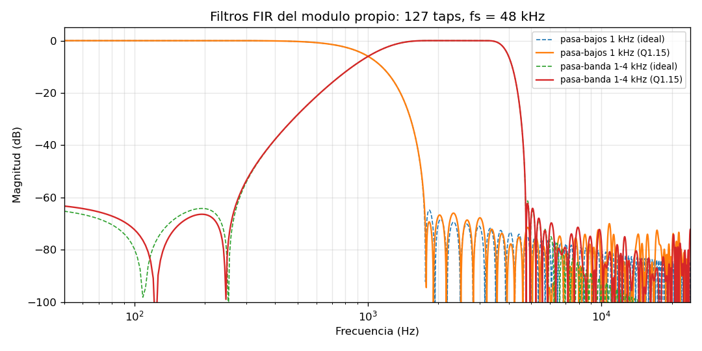

# CD-14 — Formato de punto fijo del filtro y de la ganancia

- **Responsable:** B · **Fecha:** 2026-11-07 · **Estado:** decidido
- **Requisito:** filtros que modifiquen el sonido de forma audible y bypass sin distorsión
  (§3-F p.4); filtro obligatorio en HDL con multiplicadores/acumuladores (§3-SIS p.5).
- **Herramienta:** `scripts/design_fir.py` (diseño, cuantización, análisis y vectores).

## Formato

| Señal | Formato | Bits | Justificación |
|---|---|---|---|
| Muestra de entrada/salida | Q1.15 con signo | 16 | Es el formato del WAV y del IP de Audio (16 bits, CD-07) |
| Coeficiente | Q1.15 con signo | 16 | Todos los coeficientes cumplen \|h\| < 1 (máximo 4 096/32 767); cabe en un bloque DSP 18×18 |
| Producto | Q2.30 | 32 | 16 × 16 |
| Acumulador | Q10.30 | **40** | 16 + 16 + ⌈log2 128⌉ = 39 bits, más uno de guarda: no desborda con 128 taps ni con entrada a fondo de escala |
| Salida del FIR | Q1.15 | 16 | `y = sat16((acc + 2^14) >> 15)`: redondeo al más cercano y saturación |
| Ganancia (volumen, CD-05) | Q1.15 **sin** signo | 16 | 0 … 65 535 = 0 … 2.0; `z = sat16((y·g + 2^14) >> 15)` |

Se redondea **una sola vez** por etapa (al final del acumulado y al aplicar la ganancia):
el error de redondeo es ≤ 0.5 LSB (−96 dBFS), muy por debajo de lo audible.

## Análisis de error (salida de `design_fir.py`)

| | Pasa-bajos 1 kHz (banco 0) | Pasa-banda 1–4 kHz (banco 1) |
|---|---|---|
| Taps / ventana | 127 / Kaiser β = 6 | 127 / Kaiser β = 6 |
| Ganancia en continua (cuantizada) | 0.99988 | 0.00085 |
| Error máximo \|H − Hq\| por cuantizar los coeficientes | −72.2 dB | −72.0 dB |
| Atenuación mínima en la banda de rechazo (cuantizado) | 67.8 dB (> 2.4 kHz) | 61.4 dB (< 250 Hz y > 5.6 kHz) |
| Σ\|h\| (ganancia máxima posible) | 1.22 → **puede saturar** | 1.78 → **puede saturar** |

## Consecuencias

- **Saturación obligatoria** en la salida del FIR y de la ganancia: con Σ|h| > 1, una señal
  a fondo de escala con la "forma" de los coeficientes desborda 16 bits. El hardware satura
  y levanta un bit pegajoso `SAT` en el registro de estado (HW-11). Los vectores
  `fir_saturacion.txt` y `fir_ganancia_alta.txt` lo ejercitan.
- Un pasa-banda de 300–3400 Hz no se puede realizar con 127 taps a 48 kHz (transición de
  ~1.4 kHz; dejaba 31 % en continua): el segundo banco es un pasa-banda de 1–4 kHz ("voz"),
  que cubre la opción "pasa-banda o notch" del enunciado con el mismo hardware.
- El modelo bit a bit (`FirModel` en `design_fir.py`) es la referencia de los testbenches
  y del modelo en C (SC-10).
