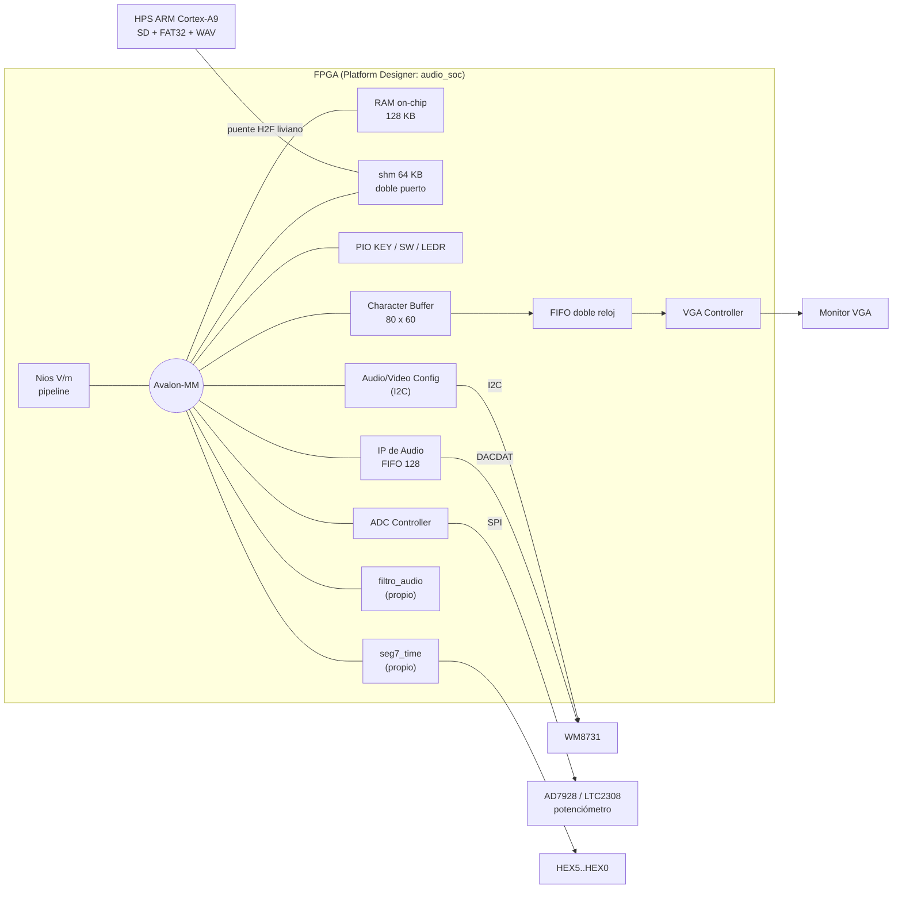
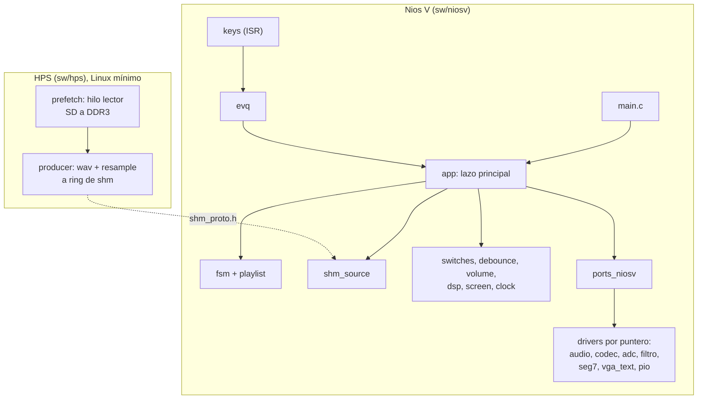
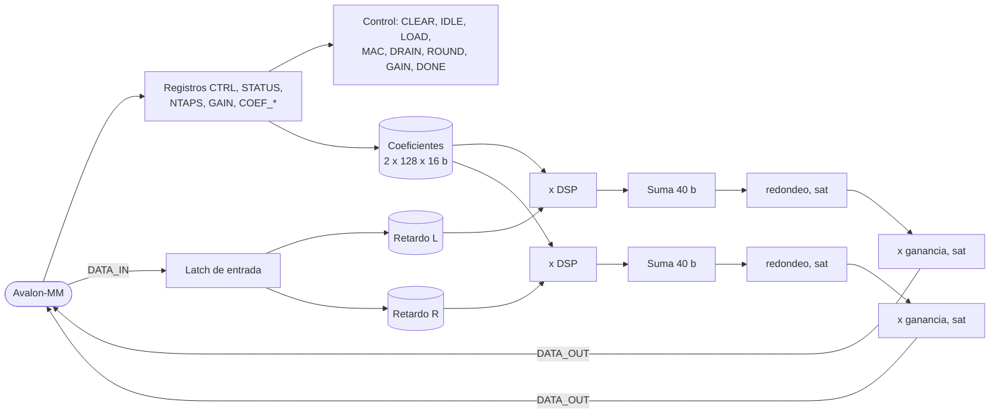
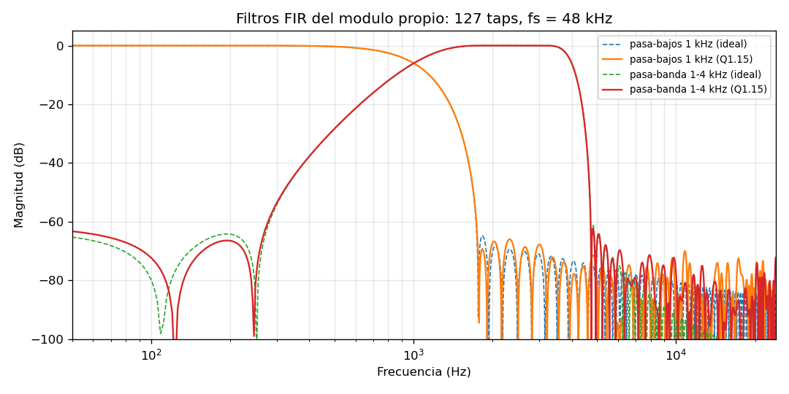
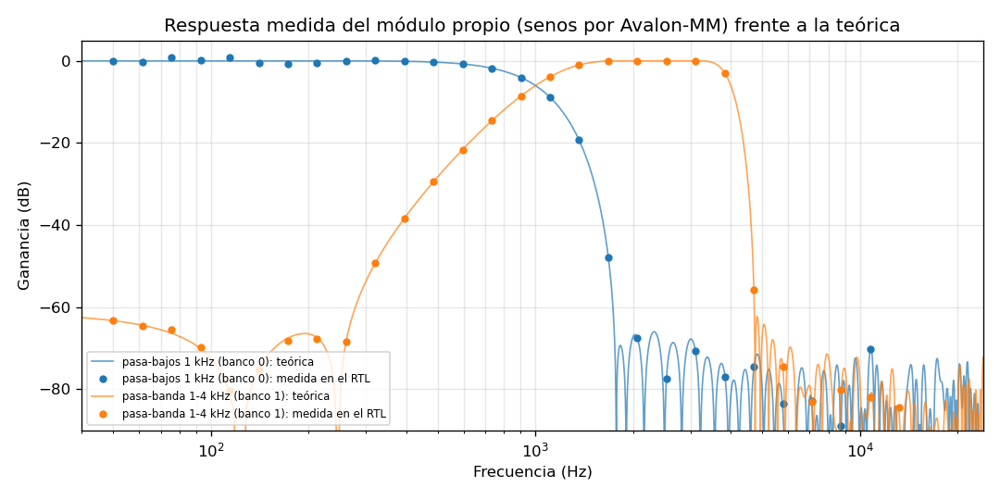
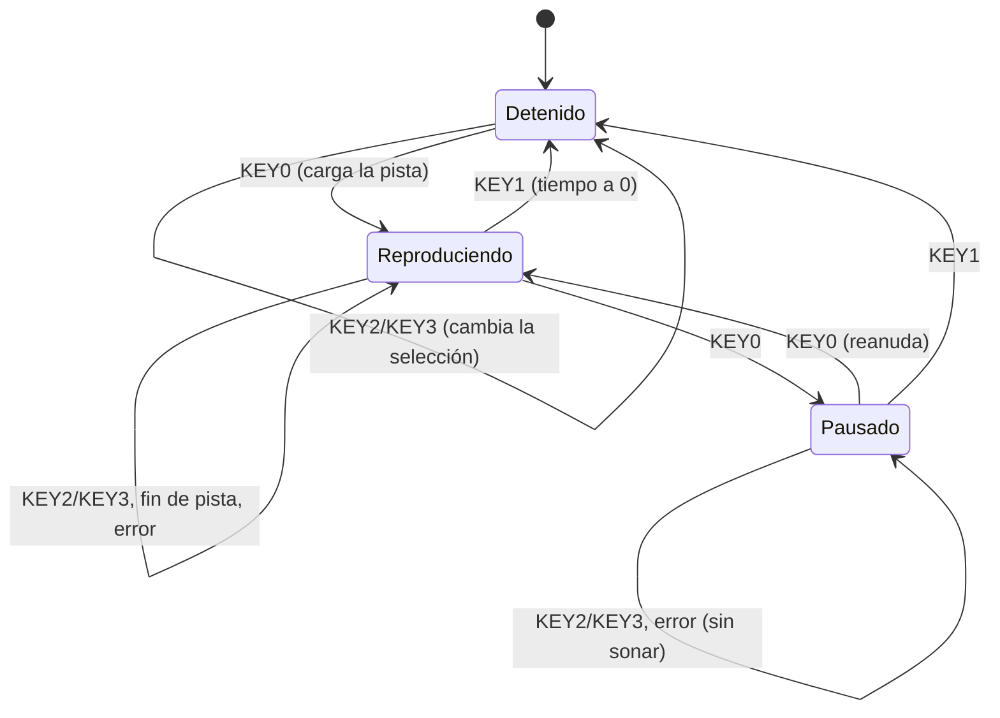
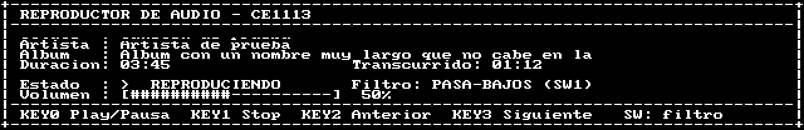

<!-- pdf:omitir -->
# Documento de diseño — Proyecto II: reproductor de audio en SoC

**CE-1113 Sistemas Empotrados · Instituto Tecnológico de Costa Rica**
Profesor: Dr.-Ing. Jeferson González Gómez · Entrega: 2 de diciembre de 2026

| Integrante | Carné |
|---|---|
| Randall Bolaños López | 2019043784 |
| Aldo Alessandro Bagliano Gómez | 2020018456 |
| Yendry Badilla Gutierrez | 2016113047 |
| Christopher David Rodriguez Cordero | 2022040771 |

> Versión PDF: `scripts/build-doc.sh` genera `docs/documento-diseno.pdf` a partir de este
> archivo (los diagramas Mermaid se reemplazan por figuras TikZ de `docs/diseno/tikz/`).

## Contenido

1. [Introducción](#1-introducción)
2. [Requisitos del sistema](#2-requisitos-del-sistema)
3. [Metodología de diseño del sistema](#3-metodología-de-diseño-del-sistema)
4. [Arquitectura del sistema](#4-arquitectura-del-sistema)
5. [Diseño del hardware personalizado](#5-diseño-del-hardware-personalizado)
6. [Diseño del software](#6-diseño-del-software)
7. [Análisis de recursos y consumo](#7-análisis-de-recursos-y-consumo)
8. [Herramientas de ingeniería](#8-herramientas-de-ingeniería)
9. [Verificación y resultados](#9-verificación-y-resultados)
10. [Limitaciones y trabajo futuro](#10-limitaciones-y-trabajo-futuro)

<!-- pdf:fin-omitir -->

## 1. Introducción

Este documento describe el diseño de un reproductor de audio portable implementado como
un sistema en chip sobre la **Altera DE1-SoC** (Cyclone V 5CSEMA5F31C6). El reproductor
lee canciones WAV de una tarjeta SD, muestra sus metadatos en un monitor VGA y el tiempo
transcurrido en los displays de 7 segmentos, se controla con los botones y switches de la
tarjeta, ajusta el volumen con un potenciómetro y aplica en tiempo real uno de tres
filtros de audio.

El SoC se construyó en **Platform Designer** alrededor de un **Nios V/m** programado en
*bare metal* sin HAL, dos módulos de hardware propio en Verilog (un filtro FIR estéreo con
etapa de ganancia y un controlador de 7 segmentos) y los IP de audio, video y ADC del
University Program. El **HPS** (ARM Cortex-A9 con Linux mínimo) lee los WAV de la SD y
los entrega al Nios V por una memoria compartida de doble puerto.

El capítulo 2 define los requisitos del sistema. El 3 describe la metodología seguida, las
arquitecturas que se compararon y las decisiones de partición hardware/software. Los
capítulos 4 a 6 documentan la arquitectura resultante, el hardware propio y el software.
El 7 analiza los recursos y la potencia de la implementación, el 8 resume las
herramientas, modelos y scripts del proyecto, y el 9 los resultados de la verificación.

El detalle de cada parte está en el repositorio: las decisiones de diseño en
`docs/decisiones/CD-*.md`, la documentación de cada módulo en `docs/hw/` y
`docs/software/` y la salida de cada prueba en `docs/verificacion/resultados/`.

## 2. Requisitos del sistema

Los requisitos parten de la especificación del proyecto. Cada uno tiene un identificador
que se usa en la lista de chequeo (6.11) y en la verificación (capítulo 9).

### 2.1 Funcionales

| ID | Requisito |
|------|---------------------------------------------------------------------------|
| RF-01 | Al menos 10 canciones almacenadas en la tarjeta SD |
| RF-02 | WAV de 16 bits a 8, 16 y 44.1 kHz |
| RF-03 | Extraer y mostrar título, artista, álbum y duración |
| RF-04 | Navegación anterior/siguiente con reproducción continua |
| RF-05 | Play, pausa, stop, anterior y siguiente con los botones, por interrupciones |
| RF-06 | Indicar el estado: reproduciendo, pausado, detenido |
| RF-07 | Al terminar una canción, reproducir la siguiente |
| RF-08 | Tiempo transcurrido MM:SS en los 7 segmentos |
| RF-09 | Metadatos en una interfaz externa (LCD/VGA/TFT) |
| RF-10 | Número de canción actual y total |
| RF-11 | Indicar el filtro activo |
| RF-12 | Al menos 3 filtros que modifiquen audiblemente el sonido, elegidos con los switches en tiempo real |
| RF-13 | Bypass sin distorsión audible |
| RF-14 | Volumen con un potenciómetro en el ADC |

### 2.2 De rendimiento

| ID | Requisito | Meta |
|------|---------------------------------------------------------------|------------|
| RR-01 | Tiempo de inicio tras el reset | < 10 s |
| RR-02 | Respuesta a los botones | < 200 ms |
| RR-03 | Cambio de filtro | < 100 ms |
| RR-04 | Cambio de canción | < 2 s |
| RR-05 | Reproducción continua sin cortes ni reinicios | — |

### 2.3 De hardware

| ID | Requisito |
|------|---------------------------------------------------------------------------|
| RH-01 | Módulo de hardware propio con registros de control, estado y datos mapeados a memoria |
| RH-02 | Verificación aislada del módulo (incluido el filtro DSP) antes de integrarlo, documentada |
| RH-03 | El audio lo maneja la FPGA (IP de Audio), no el HPS |
| RH-04 | Manejo directo de los displays de 7 segmentos |
| RH-05 | Todo componente del SoC con función justificada |
| RH-06 | Al menos un filtro como bloque DSP en HDL propio (registros, MAC, coeficientes); ni en software ni con IP de catálogo |

### 2.4 De software

| ID | Requisito |
|------|---------------------------------------------------------------------------|
| RS-01 | Acceso y manejo de los archivos de la SD mediante el HPS |
| RS-02 | Interrupciones para los botones de control |
| RS-03 | Parseo de metadatos (artista, álbum, duración) desde los archivos |
| RS-04 | Interfaz de usuario que coordina todas las funciones |
| RS-05 | Mapa de memoria optimizado y manejo eficiente de recursos |
| RS-06 | Nios V con punteros directos a las direcciones de `system.h`, sin funciones `alt_*` ni macros `IOWR`/`IORD` |
| RS-07 | HPS con un sistema operativo mínimo, sin visualización ni interacción con el SO |

**Acceso al hardware sin HAL.** Los drivers del Nios V no usan funciones `alt_*` ni las
macros `IOWR`/`IORD`: acceden a cada periférico con un puntero `volatile` a su base en
`system.h`. La única parte del HAL que se usa es el registro y la habilitación de
interrupciones (`alt_ic_isr_register`, `alt_ic_irq_enable`/`disable`), en un solo archivo
(`sw/niosv/drivers/irq.c`); dentro de la ISR los registros se leen y se limpian por
puntero. `scripts/audit-hal.sh` lo comprueba en cada `make lint` y en la CI.

## 3. Metodología de diseño del sistema

### 3.1 Proceso

El diseño siguió un flujo en V: de los requisitos a la arquitectura, de ahí a cada
módulo, y de vuelta hacia arriba verificando cada nivel antes de integrar el siguiente.

| Etapa | Qué se hizo | Producto en el repositorio |
|------------------|----------------------------------------------------|----------------------------------|
| 1. Análisis del problema | Requisitos con ID (capítulo 2) y presupuestos de tiempo, ancho de banda y memoria (3.2) | Capítulo 2 y sección 3.2 |
| 2. Investigación | Hojas de datos del WM8731, AD7928/LTC2308 y de los IP; mediciones en simulación del costo de cada operación en el Nios V/m (3.3) | `docs/material.md`, `sim/questa/tb_ciclos.sv` |
| 3. Propuestas | Alternativas por decisión (memoria, frecuencias, filtros, volumen, visualización, FSM…) y tres arquitecturas completas (3.4) | `docs/decisiones/CD-01..CD-14` |
| 4. Evaluación y decisión | Comparación con datos medidos; cada decisión registra datos, alternativas, decisión y consecuencias | Idem |
| 5. Diseño detallado | HDL propio, drivers, lógica portable, software del HPS | `hw/rtl/`, `sw/` |
| 6. Verificación por niveles | Modelos y vectores dorados → módulo aislado → co-simulación del SoC → PC con mocks → tarjeta | `sim/`, `tests/`, `docs/verificacion/`, `docs/pruebas-tarjeta.md` |
| 7. Integración y medición | Recursos, potencia, tiempos y pruebas en la tarjeta | `docs/metricas/`, capítulo 7 |

La organización del trabajo usó Git Flow (`main` protegida, `develop`, ramas `feat/*`,
`fix/*`, `docs/*` por persona), Conventional Commits en español, issues y un tablero de
GitHub Projects con hitos semanales (`CONTRIBUTING.md`). La CI (`.github/workflows/ci.yml`)
corre en cada PR el lint de Verilator, la auditoría sin HAL, las pruebas en C con
sanitizers, las simulaciones cocotb y la compilación cruzada del HPS, dentro de un
contenedor con versiones fijas (`docker/`).

### 3.2 Análisis del problema: presupuestos

Antes de proponer arquitecturas se calcularon los números que limitan el diseño:

| Magnitud | Cálculo | Valor | Consecuencia |
|--------------------|------------------------------------------|----------------|--------------------------------|
| Ciclos por par estéreo | 50 MHz / 48 kHz | **1 041 ciclos** | Todo el procesamiento por muestra del Nios V tiene que caber aquí |
| Flujo de audio HPS → FPGA | 48 000 × 2 canales × 2 B | **192 KB/s** | Cabe holgado en el puente liviano H2F y en una RAM on-chip |
| Duración de la FIFO del IP de Audio | 128 cuadros / 48 kHz | **2.7 ms** | El Nios V no puede detenerse más de esto; el lazo principal no puede bloquear |
| Memoria embebida | 397 M10K × 10 Kbit | ≈ **496 KB** | Alcanza para RAM del Nios V + buffer compartido sin SDRAM (CD-06) |
| Frecuencias del códec | MCLK 12.288 MHz → 8/32/48/96 kHz | **no hay 16 ni 44.1 kHz** con un solo reloj | Hay que remuestrear o reconfigurar (CD-07) |
| Multiplicador del Nios V/m | RV32I sin extensión M | `mul` = llamada a `__mulsi3` | Todo lo que multiplica por muestra es caro en el Nios V (3.3) |

### 3.3 Investigación: costo medido de cada operación

En lugar de estimar, se midió en simulación el costo real de cada candidato a software en
el Nios V/m (`tb_ciclos`, `-O2`, contador `mtime`):

| Operación en el Nios V/m | Ciclos por muestra | Por par estéreo | % del presupuesto (1 041) |
|--------------------------------------|-------:|-------:|-------------------:|
| Volumen (`volume_scale`, Q1.15 con redondeo y saturación) | 271 | 542 | **52 %** |
| FIR de 127 taps (`dsp_fir`) | 8 181 | 16 362 | **1 572 %** (imposible) |
| Biquad forma directa I (`dsp_biquad`) | 2 404 | 4 808 | **462 %** (imposible) |
| Reverberación por comb (`dsp_reverb`, sumas y desplazamientos) | 54 | 108 | **10 %** |
| Filtro propio por el bus (escribir `DATA_IN`, leer `DATA_OUT`) | — | 163 (peor caso, sin trabajo intercalado) | 16 % |

Otros hallazgos de la investigación que cambiaron el diseño (todos verificados con modelos
de los chips hechos a partir de sus hojas de datos):

- Con el **LTC2308** (revisión nueva de la placa), el IP del ADC guarda cada resultado en
  el registro del canal anterior: con un solo canal, CH0 nunca se actualiza. Se configuran
  dos canales (`tb_adc`).
- La ROM de autoinicialización del códec deja la **de-énfasis a 48 kHz** activa, que
  atenúa los agudos; `codec_init` la quita (`tb_codec`).
- Bajo Linux, la microSD del grupo tarda a veces más de 100 ms por bloque y el kernel la
  reinicia (cortes de ~1 s). Se corrigió con un parche del controlador `dw_mmc` y lectura
  anticipada en el HPS (CD-02).

### 3.4 Propuestas: tres arquitecturas completas

Con los presupuestos y las mediciones se compararon tres particiones completas del
sistema.

- **A — Híbrida (elegida).** HPS: SD, FAT32, parseo de WAV, remuestreo a 48 kHz.
  Nios V: botones por IRQ, máquina de reproducción, interfaz, reverberación. Hardware
  propio: FIR de 2 bancos (pasa-bajos y pasa-banda) y ganancia del volumen; 7 segmentos.
  Canal: RAM de doble puerto de 64 KB.
- **B — Todo en el Nios V.** El Nios V lee la SD por SPI (FatFs), parsea, remuestrea y
  filtra; el HPS no se usa. El FIR obligatorio va en HDL, pero el resto de filtros y el
  volumen en software.
- **C — Todo en el HPS.** El ARM hace SD, parseo, filtros 2 y 3, volumen, interfaz y FSM;
  la FPGA solo tiene el FIR obligatorio, el IP de Audio, video y PIO, sin Nios V. Los
  botones llegan al ARM por el GIC (F2H IRQ) y el audio se escribe en la FIFO por el puente.

| Criterio (peso) | A — Híbrida | B — Solo Nios V | C — Solo HPS |
|---------------------------|------------------------------|------------------------------|------------------------------|
| Cumplimiento de requisitos (30 %) | Cumple todo: SD por el HPS, audio en la FPGA, filtro en HDL | **No cumple RS-01** (la SD la debe leer el HPS) | Cumple, pero la FSM y los botones corren sobre Linux (RS-07: sin interacción con el SO) |
| Rendimiento y latencia (25 %) | Nios V dedicado: lazo sin bloqueo, botón → LED ≤ 2.2 ms; FIFO de 2.7 ms siempre atendida | Volumen + remuestreo + lectura SPI no caben: el volumen solo ya es el 52 % del CPU y remuestrear 44.1 → 48 kHz exige multiplicar por muestra | La FIFO de 2.7 ms se atiende desde Linux: bajo Linux se midieron lecturas de la SD de 60–190 ms (y bloqueos de 4–6 s antes del parche); necesitaría tiempo real duro o un buffer grande en la FPGA |
| Recursos de FPGA (15 %) | 4 087 ALMs (13 %), 4 DSP, 210 M10K | Similar, más un controlador SPI y menos puente | Menos ALMs (sin Nios V: −1 876) pero más puente y lógica de IRQ al GIC |
| Complejidad y riesgo (15 %) | Dos procesadores y un protocolo; cada lado se prueba por separado | Driver SD/SPI + FatFs propios en *bare metal* (el mayor riesgo del plan) | Drivers de Linux (UIO) para IRQ de botones; sin HAL ni hwlib, el acceso al GIC es delicado |
| Verificabilidad sin tarjeta (15 %) | Lógica portable probada en el PC; SoC completo en Questa con un modelo del HPS | Igual en el Nios V, pero la SD no se simula fácilmente | El lado del ARM no se co-simula con la FPGA en Questa |
| **Evaluación** | **Elegida** | Descartada por RS-01 y por el CPU | Descartada por la latencia de audio sobre Linux |

La arquitectura A además deja cada tarea en el procesador que mejor la hace: el remuestreo
(que multiplica) en el ARM, que tiene multiplicador y FPU; el FIR y el volumen (que
multiplican por muestra) en el hardware propio; el control y la reverberación (que solo
suman y desplazan) en el Nios V. Las variantes dentro de A se decidieron por separado
(3.5).

### 3.5 Decisiones de co-diseño hardware/software

| Decisión | Alternativas evaluadas | Elegida | Justificación (dato que decide) |
|-----------------|------------------------------|------------------------|----------------------------------------|
| CD-01 Partición de procesadores | Híbrida / solo HPS / solo Nios V | Híbrida | Única que cumple RS-01 y RH-03 a la vez (3.4) |
| CD-02 Software del HPS | Linux mínimo / *bare metal* con FatFs | Linux mínimo en initramfs | Drivers de SD y FAT32 del kernel; sin login ni consola; el acceso al hardware sigue siendo por `/dev/mem` y punteros |
| CD-04 Conexión del filtro | Mapeado a memoria / en línea por Avalon-ST | Mapeado a memoria | No cambia el IP de Audio ya verificado; el CPU decide bypass, banco y ganancia y puede autoprobar el módulo |
| CD-05 Volumen | Software / multiplicador en el módulo | Hardware (registro `GAIN`) | En software costaba el 52 % del CPU; en hardware, 2 DSP de 87 |
| CD-06 Memoria | On-chip / SDRAM / DDR3 del HPS | On-chip: 128 KB + 64 KB de doble puerto | Latencia determinista, sin controlador SDRAM ni PLL extra, simulable |
| CD-07 Frecuencias | Códec fijo a 48 kHz / reconfigurado / modo USB | Fijo a 48 kHz; el HPS remuestrea | Un solo juego de coeficientes, sin tocar el códec al cambiar de canción, el costo en el ARM |
| CD-08 Switches | Encuesta 20 ms / interrupción | Encuesta con confirmación | Los SW rebotan igual con IRQ; cambio medido ≤ 41 ms (meta 100 ms) |
| CD-09 Visualización | Character Buffer / VGA propio / LCD | VGA con Character Buffer 80 × 60 | IP probado en la DE1-SoC; la visualización no necesita hardware propio |
| CD-10 Tiempo | Timer / cuadros enviados | Cuadros enviados / 48 000 | Exacto con lo que se oye y se detiene solo en pausa |
| CD-11 Máquina de reproducción | Software / hardware | Tabla en software | Todas sus acciones son de software; 450 B de código y probada con 10 000 eventos aleatorios |
| CD-12 Filtros 2 y 3 | HW / Nios V / HPS | Pasa-banda en el banco 1 del mismo FIR; reverberación en el Nios V | El segundo banco no agrega multiplicadores; la reverberación cuesta 10 % del CPU |
| CD-13 Lenguaje HDL | Verilog-2005 / VHDL / SystemVerilog | Verilog-2005 + testbenches SystemVerilog | Compila igual en Quartus, Questa e Icarus |
| CD-14 Punto fijo | — | Q1.15, acumulador de 40 bits, redondeo y saturación | No desborda con 128 taps; error ≤ 0.5 LSB por etapa |

### 3.6 Presupuesto de latencias (resultado)

| Camino | Etapas | Valor | Meta |
|--------------------|-------------------------------------------------|----------------|--------|
| Muestra: SD → parlante | SD → prefetch del HPS (4 MiB en DDR3, ~24 s) → ring de `shm` (8 192 cuadros, 170 ms) → FIFO del IP (2.7 ms) → códec | El buffer del HPS absorbe lecturas lentas de la SD de hasta 190 ms medidas | Sin cortes |
| Botón → acción | Flanco → IRQ → ISR + cola → lazo → FSM → LED | 17 µs (solo PIO, `tb_pio`); ≤ 2.2 ms con la aplicación completa (`tb_player`) | < 200 ms |
| Switch → filtro audible | Encuesta (≤ 20 ms) + confirmación (20 ms) + FIFO (2.7 ms) | ≤ 41 ms medido (`test_app`) | < 100 ms |
| Cambio de canción | Comando por `shm` → el HPS abre el archivo y llena el primer bloque → ack | < 2 s (`test_app` con el modelo del HPS) | < 2 s |
| Arranque | U-Boot (1 s de espera) → configura la FPGA → Linux → `init` → `hps_player` publica la tabla | **< 5 s** medido en la tarjeta | < 10 s |

## 4. Arquitectura del sistema

### 4.1 Hardware



Cada instancia tiene una función justificada (RH-05); la tabla completa con su costo está
en `docs/hw/componentes-soc.md`:

| Instancia | Función | Requisito |
|--------------------|------------------------------------------------|-----------------|
| `cpu` (Nios V/m con pipeline) | Drivers, interrupciones, FSM, interfaz, reverberación | RS-02, RS-04 |
| `ram` (128 KB) | Código y datos del Nios V | RS-05 (CD-06) |
| `shm` (64 KB, doble puerto) | Canal con el HPS: control, tabla de pistas y ring | RS-01 (CD-06) |
| `pio_key`, `pio_sw`, `pio_led` | Botones con IRQ, switches, LEDs de estado | RF-05, RF-06, RF-11, RF-12 |
| `audio_pll`, `audio`, `av_config` | MCLK de 12.288 MHz, FIFO y serializador al WM8731, configuración I²C | RH-03 (CD-07) |
| `adc` | Potenciómetro de volumen (2 canales por el LTC2308) | RF-14 |
| `video_pll`, `char_buf`, `video_fifo`, `vga` | Pantalla de texto 80 × 60 a 640 × 480 @ 60 Hz | RF-09, RF-10 (CD-09) |
| `filtro` (`filtro_audio`, propio) | FIR estéreo de 2 bancos + ganancia | RH-01, RH-06, RF-12, RF-14 |
| `seg7` (`seg7_time`, propio) | MM:SS y número de canción en HEX5..HEX0 | RH-04, RF-08, RF-10 |
| `juart` | Consola de depuración y mediciones de tiempos | RR-01..RR-04 (medición) |
| `hps` | ARM con DDR3, SD y puente liviano hacia `shm` | RS-01, RS-07 |

Se evaluaron y descartaron: SDRAM con su controlador y PLL (CD-06), RGB Resampler (el VGA
usa 10 bits por color igual que el Character Buffer), entrada de audio (no se graba),
Pixel Buffer DMA (solo hay texto) y un buzón HPS ↔ Nios V (los índices del ring ya son el
handshake).

### 4.2 Mapa de memoria e interrupciones (vista del Nios V)

| Base | Tamaño | Instancia | Uso |
|---------------|--------:|----------------------|------------------------------------------|
| `0x0000_0000` | 128 KB | `ram` | Código, datos y pila |
| `0x0002_0000` | 64 KB | `shm` (`s1`) | Memoria compartida; el HPS la ve en `0xFF20_0000` (`s2`) |
| `0x0004_0000` | 8 B | `juart` | Consola JTAG |
| `0x0004_0010` | 16 B | `pio_led` | LEDR[9:0] |
| `0x0004_0020` | 16 B | `pio_key` | KEY[3:0], IRQ por flanco |
| `0x0004_0030` | 16 B | `pio_sw` | SW[9:0] |
| `0x0004_0040` | 64 B | `cpu.timer_sw_agent` | `mtime` |
| `0x0004_0080` | 16 B | `audio` | FIFO de salida al códec |
| `0x0004_0090` | 16 B | `av_config` | I²C del códec |
| `0x0004_00A0` | 32 B | `adc` | Potenciómetro |
| `0x0004_00C0` | 8 B | `char_buf` (control) | Borrado de pantalla |
| `0x0004_0100` | 32 B | `filtro` | Módulo propio (capítulo 5) |
| `0x0004_0120` | 16 B | `seg7` | Módulo propio (5.4) |
| `0x0004_2000` | 8 KB | `char_buf` (caracteres) | `base + (y << 7) + x` |
| `0x0005_0000` | 64 KB | `cpu.dm_agent` | Depuración JTAG |

| IRQ | Fuente | Uso |
|----:|------------|--------------------------------------------------|
| 1 | `juart` | Consola |
| 2 | `pio_key` | Botones (la única que habilita la aplicación) |
| 3 | `pio_sw` | Disponible; los switches se encuestan (CD-08) |
| 4 | `audio` | FIFO con ≥ 75 % libre (usada en `test_audio`) |

### 4.3 Software



Tres reglas sostienen el diseño del software (detalle en el capítulo 6):

1. **`sw/common` no conoce el hardware**: compila igual para el PC, el Nios V y el ARM, y se
   prueba en el PC con sanitizers.
2. **La lógica habla con el hardware por puertos** (`ports.h`, structs de punteros a
   función). En el Nios V los implementa `ports_niosv.c`; en el PC, mocks.
3. **Sin HAL**: los drivers usan `HW_REG(base, off)`, un puntero `volatile` a la base de
   `system.h` más el offset del registro tomado de la documentación del IP.

### 4.4 Camino de una muestra

1. El hilo lector del HPS (`prefetch.c`) trae el PCM de la SD en bloques de 64 KB a un buffer
   de 4 MiB en la DDR3.
2. `producer.c` lo convierte a 48 kHz estéreo (`resample_run`, interpolación lineal; el
   mono se duplica) y lo escribe en el ring de `shm` (`shm_hps_write`).
3. En el Nios V, `pump_audio()` lee del ring mientras haya espacio en la FIFO del códec; si
   el filtro elegido es la reverberación, la aplica (`dsp_reverb_step`).
4. `audio_write_port()` escribe el par en `DATA_IN` del módulo propio (FIR + ganancia), lee
   `DATA_OUT` (el `waitrequest` espera el resultado) y lo escribe en la FIFO del IP de Audio.
5. Cada cuadro enviado se cuenta: cada 48 000 se incrementa el tiempo y se escribe en
   `seg7_time` (CD-10).

## 5. Diseño del hardware personalizado

El hardware propio son dos esclavos Avalon-MM en Verilog-2005, empaquetados como
componentes de Platform Designer (`hw/rtl/*_hw.tcl`) y verificados aislados antes de
integrarlos (5.5).

### 5.1 `filtro_audio`: funcionamiento

`filtro_audio.v` es la interfaz de registros y `fir_core.v` el datapath. Por cada par de
muestras que el procesador escribe en `DATA_IN`:

1. **LOAD**: cada muestra entra en la línea de retardo circular de su canal (128 posiciones).
2. **MAC**: dos multiplicadores-acumuladores, uno por canal, recorren los `NTAPS`
   coeficientes del banco elegido, un tap por ciclo, en un pipeline de 3 etapas (lectura de
   memoria → producto 16 × 16 → acumulado de 40 bits). En bypass se salta el MAC, pero la
   línea de retardo se sigue actualizando: al volver al filtro no hay transitorio.
3. **ROUND**: `y = sat16((acc + 2^14) >>> 15)`.
4. **GAIN**: `z = sat16((y · g + 2^14) >>> 15)`, con `g` Q1.15 sin signo (volumen, CD-05).
5. El resultado queda en `DATA_OUT`; si alguna etapa saturó se levanta `STATUS.SAT`.

Latencia: `NTAPS + 9` ciclos, 136 ciclos = 2.72 µs con 127 taps a 50 MHz, el 13 % del
periodo de muestreo.



### 5.2 `filtro_audio`: registros

Base `0x0004_0100`; 8 registros de 32 bits, solo accesos de 32 bits.

| Offset | Registro | Acceso | Bits | Reset | Descripción |
|-------|-----------|------|------------------------|---------------|-------------------------------------------|
| `0x00` | `CTRL` | RW | `[0]` BYPASS · `[1]` BANK · `[2]` CLEAR | `0x1` | BYPASS: salida = entrada (con ganancia). BANK: 0 pasa-bajos 1 kHz, 1 pasa-banda 1–4 kHz. CLEAR: borra las líneas de retardo (128 ciclos); se lee 0 |
| `0x04` | `STATUS` | R / W1C | `[0]` READY · `[1]` BUSY · `[2]` SAT · `[15:8]` MAX_TAPS · `[31:16]` VERSION | `0x0100_8002` | SAT es pegajoso: se borra escribiendo 1 |
| `0x08` | `NTAPS` | RW | `[7:0]` | `127` | Taps usados, 1..128 (0 → 1, > 128 → 128) |
| `0x0C` | `GAIN` | RW | `[15:0]` | `0x8000` | Q1.15 sin signo: `0x8000` = 1.0, `0xFFFF` ≈ 2.0 |
| `0x10` | `COEF_ADDR` | RW | `[6:0]` índice · `[7]` banco | `0` | Dirección del próximo acceso a `COEF_DATA` |
| `0x14` | `COEF_DATA` | RW | `[15:0]` | — | Escribir guarda y avanza `COEF_ADDR` dentro del banco; leer devuelve el coeficiente con signo extendido |
| `0x18` | `DATA_IN` | RW | `[15:0]` L · `[31:16]` R | `0` | Escribir arranca el procesamiento del par |
| `0x1C` | `DATA_OUT` | R | `[15:0]` L · `[31:16]` R | `0` | Resultado del último par |

**Espera (`waitrequest`).** Mientras `BUSY = 1` se retienen las escrituras a `DATA_IN`,
`COEF_DATA` y `CTRL` con CLEAR, y las lecturas de `DATA_OUT` y `COEF_DATA`. El software
hace `DATA_IN ← x; y ← DATA_OUT` sin sondear `STATUS`, nunca lee un resultado a medias ni
cambia coeficientes en medio de una muestra.

### 5.3 `filtro_audio`: diagramas de tiempo

Escritura de una muestra y lectura del resultado (fuente WaveDrom en
`docs/img/filtro-tiempos.json`):

```
clk          _|‾|_|‾|_|‾|_|‾|_|‾|_ ... _|‾|_|‾|_|‾|_|‾|_
address       | DATA_IN |  DATA_OUT ......................|
write        _/‾‾‾‾‾‾‾‾‾\______________________________________
read         ___________/‾‾‾‾‾‾‾‾‾‾‾‾‾‾‾‾‾ ... ‾‾‾‾‾‾‾‾‾‾\___
waitrequest  ___________/‾‾‾‾‾‾‾‾‾‾‾‾‾‾‾‾‾ ... ‾‾‾‾‾\______
busy         _____/‾‾‾‾‾‾‾‾‾‾‾‾‾‾‾‾‾‾‾‾‾‾‾ ... \______________
state          IDLE|LOAD|MAC k=0..N-1|DRAIN|ROUND|GAIN|DONE|IDLE
readdata                                          | {R,L} |
                   |<------- NTAPS + 9 ciclos (136 con 127 taps) ------->|
```

Recarga de coeficientes (cada escritura avanza el índice):

```
clk          _|‾|_|‾|_|‾|_|‾|_|‾|_|‾|_|‾|_
address       |COEF_ADDR| COEF_DATA | COEF_DATA | COEF_DATA |
writedata     |  0x80   |   h[0]    |   h[1]    |   h[2]    |
coef_addr        0x00   |   0x80    |   0x81    |   0x82    | 0x83
memoria                     [0x80]=h0   [0x81]=h1   [0x82]=h2
```

### 5.4 `filtro_audio`: coeficientes, punto fijo y justificación

Los coeficientes se diseñan con `scripts/design_fir.py` (ventana de Kaiser, β = 6, 127
taps, fs = 48 kHz), se cuantizan a Q1.15 y se exportan a `hw/rtl/fir_coefs.hex` (contenido
inicial de la memoria) y a `sw/common/include/fir_coefs.h` (el driver los vuelve a cargar
y la autoprueba los usa).

| Señal | Formato | Bits | Justificación (CD-14) |
|--------------------|------------------|-----:|------------------------------------------------|
| Muestra de entrada/salida | Q1.15 con signo | 16 | Formato del WAV y del IP de Audio |
| Coeficiente | Q1.15 con signo | 16 | \|h\| < 1 en todos; cabe en un DSP 18 × 18 |
| Producto | Q2.30 | 32 | 16 × 16 |
| Acumulador | Q10.30 | 40 | 16 + 16 + ⌈log2 128⌉ = 39 bits, más uno de guarda |
| Ganancia | Q1.15 sin signo | 16 | 0 … 2.0 |

| | Pasa-bajos 1 kHz (banco 0) | Pasa-banda 1–4 kHz (banco 1) |
|------------------------------------|------------------:|------------------:|
| Error máximo por cuantizar los coeficientes | −72.2 dB | −72.0 dB |
| Atenuación mínima en la banda de rechazo | 67.8 dB (> 2.4 kHz) | 61.4 dB (< 250 Hz y > 5.6 kHz) |
| Σ\|h\| (ganancia máxima posible) | 1.22: puede saturar | 1.78: puede saturar |



| Decisión | Alternativa | Por qué |
|----------------------------|--------------------------|---------------------------------------------------|
| MAC secuencial, un tap por ciclo | FIR paralelo (127 multiplicadores) | 2 DSP en lugar de ~254; 2.7 µs sobra frente a los 20.8 µs del periodo |
| Un MAC por canal | Un MAC compartido | Mitad de latencia por 1 DSP más de 87 |
| Dos bancos de coeficientes | Recargar al cambiar de filtro | Cambiar de filtro es escribir `CTRL.BANK`; cuesta 4 Kbit de memoria |
| Ganancia en el módulo | Volumen en software | En el Nios V/m costaba el 52 % del CPU (CD-05) |
| `waitrequest` en `DATA_OUT` | Sondear `STATUS.READY` | Menos accesos por muestra y sin carreras |
| Mapeado a memoria | En línea por Avalon-ST | No cambia el IP de Audio verificado; el CPU controla y autoprueba (CD-04) |
| Saturación con bit pegajoso | Dejar desbordar | Σ\|h\| > 1: una señal a fondo de escala desbordaría 16 bits |

### 5.5 `seg7_time`

El software solo escribe el tiempo **en segundos**; el hardware lo convierte a MM:SS con
restas sucesivas de 60 y de 10 (sin divisores, ≤ 113 ciclos = 2.3 µs), pasa el BCD a los
displays de una vez (no se ven valores intermedios) y decodifica cada dígito a segmentos
activos en bajo. La canción (0..99) se pasa a BCD de forma combinacional. Así los displays
los maneja directamente el hardware (RH-04): ningún segmento lo decide el software.

| Offset | Registro | Acceso | Bits | Reset | Descripción |
|-------|-----------|------|--------------------------|---------------|-----------------------------------------|
| `0x0` | `CTRL` | RW | `[0]` ON · `[1]` TRACK | `0x1` | ON = 0 apaga los displays; TRACK = 1 muestra la canción en HEX5..HEX4 |
| `0x4` | `TIME` | RW | `[12:0]` | `0` | Segundos; desde 6 000 se muestra `99:59` |
| `0x8` | `TRACK` | RW | `[6:0]` | `0` | Número de canción; desde 100 se muestra `99` |
| `0xC` | `STATUS` | R | `[15:0]` BCD · `[16]` BUSY · `[31:24]` versión | `0x0100_0000` | BUSY mientras convierte |

```
clk        _|‾|_|‾|_|‾|_|‾| ... |‾|_|‾|_|‾|_
write      _/‾‾\____________ ... ____________
address     |TIME|
writedata   |125 |
cst        IDLE |MIN(-60 x2)|SEC(-10 x0)|MTEN|IDLE
STATUS.BUSY ____/‾‾‾‾‾‾‾‾‾‾‾‾ ... ‾‾‾‾\______
HEX3..HEX0  00:00 ................... | 02:05
```

### 5.6 Verificación aislada (RH-02)

Cada módulo se verificó solo, sin el SoC ni el Nios V, con un testbench de Questa que
actúa como maestro Avalon-MM y respeta `waitrequest`. La referencia son **vectores dorados**
generados por un **modelo bit a bit** del datapath (`FirModel` en `design_fir.py`); un
segundo modelo independiente en C (`sw/common/src/dsp.c`) reproduce los mismos vectores en
el PC. El criterio es igualdad exacta (0 LSB).

| # | Caso (`tb_filtro_audio`) | Qué demuestra | Resultado |
|----|-----------------------|---------------------------------------------|------------------|
| R1–R6 | Registros | Valores de reset, lectura/escritura, límites de NTAPS, STATUS solo lectura, autoincremento de coeficientes, CLEAR | PASS |
| D1 | `fir_impulso` | Salida = coeficientes del pasa-bajos | 140 muestras iguales |
| D2 | `fir_escalon` | Valor final = 0.5 × Σh | 200 iguales |
| D3 | `fir_senos` | 500 Hz pasa, 8 kHz se rechaza, retardo de grupo de 63 muestras | 200 iguales |
| D4 | `fir_saturacion` | Satura y levanta SAT | 200 iguales, SAT = 1 |
| D5 | `fir_ruido_banco1` | Banco 1 con ruido blanco | 200 iguales |
| D6 | `fir_bypass_gain` | Bypass con ganancia 0.5 | 64 iguales |
| D7 | `fir_taps16` | Solo 16 taps | 64 iguales |
| D8 | `fir_ganancia_alta` | Ganancia 1.5: satura la etapa de ganancia | 160 iguales, SAT = 1 |
| T1 | Latencia | `DATA_IN` → `DATA_OUT` | 136 ciclos |

**Total: 1 253 comprobaciones, 0 errores.** La respuesta en frecuencia medida en el RTL
(`tb_filtro_respuesta`, 30 senos por banco) tiene un error ≤ 0.83 dB en la banda de paso y
un rechazo ≥ 55.7 dB. `tb_seg7_time` comprueba 0, 59, 125, 599, 3 599 y 5 999 s, la
saturación, la canción y el apagado (14 comprobaciones, PASS).



La verificación encontró tres defectos que se corrigieron antes de integrar: el pulso de
saturación salía un ciclo antes que `done` (SAT nunca se levantaba), faltaba `$signed` en
el redondeo de negativos, y `seg7_time` truncaba la canción antes de compararla con el
máximo (150 se veía como "22"). Además, al arrancar, el Nios V corre una **rutina de
autoprueba** del módulo por sus registros (`filtro_selftest`: impulso, escalón, bypass con
ganancia y 431 pares contra el modelo en C) y avisa en la pantalla si falla.

Reporte completo: `docs/hw/verificacion-filtro.md`; salidas en
`docs/verificacion/resultados/rtl_*.txt`.

## 6. Diseño del software

### 6.1 Organización

```
sw/
├── common/            lógica portable: sin system.h, sin registros, sin malloc
│   ├── include/       API (un header por módulo)
│   └── src/
├── niosv/
│   ├── drivers/       un .h/.c por periférico, punteros volatile a system.h
│   ├── src/           aplicación del reproductor (main.c)
│   └── tests/         un programa por periférico o escenario
└── hps/
    ├── src/           hps_player: producer, prefetch, devmem
    └── linux/         init, device tree, fragmento del kernel, parche, boot.cmd
tests/                 pruebas en el PC (make test)
```

### 6.2 Módulos de la lógica portable (`sw/common`)

| Módulo | Responsabilidad | Prueba |
|--------------|-----------------------------------------------------------|------------------|
| `err`, `le` | Códigos de error; lecturas little-endian con comprobación de límites | `test_wav` |
| `wav` | Parser RIFF/WAVE, metadatos `LIST/INFO` e ID3, duración, metadatos de respaldo | `test_wav` |
| `resample` | Conversión a 48 kHz estéreo por interpolación lineal (Q15) | `test_resample` |
| `playlist` | Pista actual, anterior/siguiente con vuelta, avance automático | `test_fsm` |
| `fsm` | Máquina de reproducción como tabla `[estado][evento]` | `test_fsm` |
| `evq` | Cola sin bloqueo de un productor (ISR) y un consumidor (lazo) | `test_input` |
| `ports` | Interfaces hacia el hardware (audio, filtro, reloj, panel, entradas, fuente, pantalla) | `test_app` |
| `shm_proto` | Protocolo HPS ↔ Nios V: control, tabla de pistas y ring | `test_shm` |
| `shm_source` | Lado Nios V del canal, como puerto de fuente | `test_app`, `tb_player` |
| `hps_model` | Modelo del productor del HPS para probar sin tarjeta | `test_app`, `tb_player` |
| `switches`, `debounce`, `clock` | SW → filtro con confirmación; antirrebote de 50 ms; ciclos → ms sin dividir | `test_input` |
| `volume` | ADC → 32 escalones de 2 dB con histéresis → ganancia Q1.15 | `test_volume` |
| `dsp` | Modelo del FIR del hardware, ganancia, reverberación, biquad | `test_dsp` |
| `screen` | Pantalla del reproductor sobre un puerto de texto | `test_screen` |
| `app` | Lazo principal: eventos → FSM → acciones, bombeo de audio, encuesta, pantalla | `test_app`, `tb_player` |

### 6.3 Drivers del Nios V (`sw/niosv/drivers`)

| Driver | Periférico | Registros que usa |
|--------------------|---------------------------|----------------------------------------------|
| `hw.h`, `pio.h` | Acceso por puntero, PIO | `HW_REG(base, off)`; DATA, IRQ_MASK, EDGE_CAP |
| `irq` | **Única excepción al HAL** | `alt_ic_isr_register`, `alt_ic_irq_enable`/`disable` |
| `keys` | KEY[3:0] por IRQ | La ISR lee y limpia `edgecapture` y encola |
| `timebase` | `mtime` | Ciclos y ms |
| `audio`, `codec` | IP de Audio, Audio/Video Config | FIFOSPACE, LEFT/RIGHT DATA; I²C del WM8731 |
| `adc` | ADC Controller | Conversión continua, CH0 |
| `vga_text` | Character Buffer | Celdas `(y << 7) + x`, borrado |
| `filtro`, `seg7` | Hardware propio | Capítulo 5 |
| `ports_niosv` | — | Implementa los puertos de `ports.h` con los drivers |

### 6.4 Arranque y lazo principal del Nios V

`main.c`: LEDs en 0, base de tiempo, pantalla, 7 segmentos, ADC, FIFO de audio; autoprueba
del módulo propio; códec por I²C; cola de eventos e IRQ de los botones; fuente sobre
`shm`, puertos y `app_init`; luego `for (;;) app_step(&app);`.

Una vuelta de `app_step()`: (1) lee el reloj; (2) si todavía no hay tabla de pistas,
consulta el estado del HPS; (3) vacía la cola de botones con antirrebote y aplica las
acciones de la FSM; (4) si está reproduciendo, mientras haya espacio en la FIFO lee
cuadros del ring, aplica la reverberación si toca, los pasa por el filtro y la FIFO, y
cuenta cuadros; detecta subdesbordes y el fin de pista; (5) cada 20 ms encuesta switches
y potenciómetro; (6) refresca LEDs al cambiar y la pantalla a 10 Hz. **Nada bloquea**: si
la FIFO está llena o el ring vacío, la vuelta termina.

### 6.5 Interrupciones

| IRQ | Fuente | ISR | Qué hace |
|----:|-----------|------------|---------------------------------------------------------|
| 2 | `pio_key` | `keys_isr` | Lee y limpia `edgecapture` por puntero; `evq_push` por cada botón con flanco |

La ISR no llama a la FSM ni a la pantalla: la cola desacopla. Cada índice de la cola lo
escribe un solo lado, así que no hace falta deshabilitar interrupciones.

### 6.6 Máquina de reproducción



| Control | Función |
|------------------|-------------------------------------------------------------------|
| KEY0 / KEY1 / KEY2 / KEY3 | Play-pausa / stop / anterior / siguiente |
| SW0 / SW1 / SW2 | Pasa-bajos 1 kHz / pasa-banda 1–4 kHz / reverberación; todos abajo = bypass; dos o más = inválido (bypass y LEDR9) |
| LEDR[2:0] · 5 · 6 · 7 · 8 · 9 | Filtro activo · hubo subdesborde · cambia con cada botón · reproduciendo · pausado · alerta |
| Potenciómetro | Volumen, 32 escalones de 2 dB |
| HEX3..0 / HEX5..4 | MM:SS / número de canción |
| VGA | Título, artista, álbum, duración, canción n/total, estado, filtro, volumen |



### 6.7 Software del HPS

| Pieza | Versión / detalle |
|--------------------|------------------------------------------------------------------|
| Preloader + U-Boot | 2024.01, `socfpga_de1_soc_defconfig`; `boot.cmd` configura la FPGA con el `.rbf` y habilita los puentes |
| Kernel | Linux 6.6.60, `socfpga_defconfig` + `kernel.fragment`, parche `dw_mmc` (tiempo máximo de espera de la SD) |
| Rootfs | BusyBox 1.36.1 estático + `hps_player` dentro del `zImage` (initramfs) |
| `init` | Monta la SD en solo lectura y lanza `hps_player`; lo relanza si termina. Sin login ni consola de usuario (RS-07) |
| `hps_player` | C11 estático: `producer_scan` arma la tabla (≥ 10 WAV), `producer_publish` la escribe en `shm`, `producer_poll` atiende comandos y llena el ring |
| Acceso al hardware | `mmap` de `/dev/mem` con punteros `volatile` (`devmem.c`); sin hwlib |
| Tiempo real | `SCHED_FIFO` (prioridad 50), `mlockall`, hilo lector con 4 MiB de buffer |

### 6.8 Protocolo HPS ↔ Nios V (`shm_proto.h`)

| Región de `shm` | Offset | Tamaño | Escribe |
|--------------------|--------|-------------------|------------------------------|
| Control (`shm_ctrl_t`) | `0x0000` | 64 B | Cada campo, un solo lado |
| Tabla de pistas | `0x0040` | 32 × 160 B | HPS |
| Ring de cuadros estéreo a 48 kHz | `0x8000` | 8 192 × 4 B (170 ms) | HPS escribe, Nios V consume |

El Nios V pide una pista escribiendo `cmd`, `cmd_arg` y luego `cmd_seq + 1`. El HPS detiene
el flujo anterior, descarta el ring, arranca la pista y confirma con `ack_seq`. El Nios V
solo consume cuando la confirmación coincide con su último comando: nunca se oyen restos
de la pista anterior. Al terminar el archivo el HPS marca `EOF` y el Nios V avanza cuando
ve `EOF` con el ring vacío.

### 6.9 API principal

```c
/* wav.h */
err_t    wav_parse(const wav_reader_t *r, wav_info_t *info);
void     wav_meta_fallback(wav_info_t *info, const char *filename);
uint32_t wav_duration_s(uint32_t data_size, uint32_t byte_rate);
/* resample.h */
uint32_t resample_run(resample_t *r, const int16_t *in, uint32_t in_frames, ...);
/* playlist.h / fsm.h */
uint32_t playlist_next(playlist_t *p);          /* y _prev, _auto_advance */
uint32_t fsm_handle(fsm_t *f, fsm_event_t ev);  /* -> FSM_ACT_* */
/* evq.h */
err_t evq_push(evq_t *q, uint8_t ev);           /* ISR */
err_t evq_pop(evq_t *q, uint8_t *ev);           /* lazo principal */
/* shm_proto.h */
uint32_t shm_nios_send(volatile shm_t *s, uint32_t cmd, uint32_t arg);
uint32_t shm_nios_read(volatile shm_t *s, uint32_t seq, uint32_t *dst, uint32_t max);
uint32_t shm_hps_write(volatile shm_t *s, const uint32_t *frames, uint32_t n);
/* app.h */
void app_init(app_t *a, const app_ports_t *ports, evq_t *events, int16_t *rev_l, int16_t *rev_r);
void app_step(app_t *a);
/* drivers del Nios V */
void     filtro_config(uintptr_t base, int bypass, uint32_t bank);
void     filtro_set_gain(uintptr_t base, uint32_t gain_q15);
uint32_t filtro_selftest(uintptr_t base);
void     seg7_set_time(uintptr_t base, uint32_t seconds);
```

Bibliotecas: en el Nios V, la picolibc reducida del BSP (arranque C, `memcpy`), `libgcc`
(`__mulsi3`, que el lazo evita en el camino de cada muestra) y del HAL solo
`sys/alt_irq.h`. En el HPS, la libc estática y POSIX (`pthread`, `dirent`). En el PC, la
libc con ASan/UBSan, solo dentro de `tests/`. Todo se compila en C11 con `-Wall -Wextra`.

### 6.10 Memoria del Nios V

| Sección (`audio_player.elf`) | Bytes |
|-------------------------------------------|--------:|
| `.text` + `.rodata` + `.entry` + `.exceptions` | 20 560 |
| `.rwdata` | 500 |
| `.bss` (9 600 son las líneas de la reverberación) | 10 828 |
| **Total** | **31 888 de 131 072 (24 %)** |

No hay memoria dinámica: todo el estado es estático. El audio en tránsito vive en `shm` y
en la FIFO del IP; el buffer grande (4 MiB) está del lado del HPS, en la DDR3, sin gastar
M10K.

### 6.11 Lista de chequeo de requisitos

| ID | Cómo se cumple | Verificación | Estado |
|------|------------------------------------------|--------------------------------|-----------|
| RF-01 | `producer_scan` arma la tabla de la SD; `playlist_meets_minimum` | Tarjeta: 10 pistas, 0 descartadas; `tb_player` | ✔ |
| RF-02 | `wav_parse` + `resample_run` a 48 kHz | `test_wav` (26 WAV), `test_resample` | ✔ |
| RF-03 | `parse_info` (LIST/INFO), `parse_id3`, `wav_duration_s`; `screen_draw_track` | `test_wav`, `test_screen`, `tb_vga` | ✔ |
| RF-04, RF-07 | `playlist` + tabla de la FSM (`NAV_AUTO`) | `test_fsm`, `tb_player` (dos vueltas), tarjeta | ✔ |
| RF-05, RS-02 | `keys_isr` + `evq` + FSM | `tb_pio`, `tb_player`, tarjeta | ✔ |
| RF-06 | LEDR7/LEDR8 y fila de estado de la VGA | `tb_player`, `test_screen` | ✔ |
| RF-08 | Cuadros / 48 000 → `seg7_time` | `tb_seg7_time`, `tb_filtro`, tarjeta | ✔ |
| RF-09, RF-10, RF-11 | `screen.c` sobre `vga_text`; HEX5..4; LEDR[2:0] | `tb_vga`, `test_screen` | ✔ |
| RF-12 | FIR en hardware (2 bancos) + reverberación en software | `tb_filtro_audio`, `test_dsp`, tarjeta | ✔ |
| RF-13 | Bypass sin MAC; ganancia con redondeo y saturación | `fir_bypass_gain`, `tb_audio`, `test_tone` | ✔ |
| RF-14 | `adc_read` → `volume_update` → `GAIN` | `tb_adc`, `test_volume`, tarjeta | ✔ |
| RR-01 | Linux mínimo + `init` directo | Tarjeta: **< 5 s** | ✔ |
| RR-02 | ISR + lazo sin bloqueo | `tb_pio` 17 µs; `tb_player` ≤ 2.2 ms | ✔ |
| RR-03 | Encuesta de 20 ms con confirmación | `test_app` ≤ 41 ms | ✔ |
| RR-04 | Comando con secuencia y descarte del ring | `test_app` < 2 s | ✔ |
| RR-05 | Prefetch de 4 MiB, ring de 170 ms, detector de subdesbordes | Tarjeta: lista completa dos vueltas sin cortes ni reinicios; `test_app` | ✔ |
| RS-01 | `hps_player` en el ARM | Tarjeta | ✔ |
| RS-03 | `wav.c` | `test_wav` | ✔ |
| RS-04 | `app_step` | `test_app`, `tb_player` | ✔ |
| RS-05 | Todo on-chip y estático (24 % de la RAM); buffer grande en la DDR3 del HPS | 6.10, `tb_shm` | ✔ |
| RS-06 | `HW_REG` en todos los drivers; HAL solo en `irq.c` | `scripts/audit-hal.sh` en `make lint` y en la CI | ✔ |
| RS-07 | Initramfs con BusyBox, sin login; `init` solo lanza el reproductor | `sw/hps/linux/init`, tarjeta | ✔ |

## 7. Análisis de recursos y consumo

Compilación de Quartus Prime Lite 25.1std del sistema completo con el HPS (12 de noviembre
de 2026); potencia estimada el 27 de noviembre sobre esa misma compilación. Se regeneran con
`scripts/build-quartus.sh`, `python3 scripts/report-resources.py` y `scripts/report-power.sh`.

### 7.1 Recursos del sistema completo

| Recurso | Uso | Disponible | % |
|----------------------------|-------------:|-------------:|-----:|
| Lógica (ALMs) | 4 087 | 32 070 | 13 % |
| Registros | 5 777 | — | — |
| Bits de memoria embebida | 1 661 056 | 4 065 280 | 41 % |
| Bloques M10K | 210 | 397 | 53 % |
| Bloques DSP | 4 | 87 | 5 % |
| PLL | 2 | 6 | 33 % |
| Pines | 188 | 457 | 41 % |

Tiempos: sin violaciones en las cuatro esquinas del Timing Analyzer (TNS = 0). Peor slack
de setup de `CLOCK_50` (50 MHz): **+7.905 ns**; hold +0.020 ns.

### 7.2 Recursos por componente y del módulo propio

| Instancia | ALMs | Registros | Bits de memoria | M10K | DSP | Potencia |
|----------------------------|-------:|-------:|-----------:|-----:|----:|----------:|
| `cpu` (Nios V/m) | 1 876 | 2 441 | 2 048 | 2 | 0 | 14.66 mW |
| `mm_interconnect_0` (bus del Nios V) | 913 | 1 142 | 0 | 0 | 0 | 8.85 mW |
| `mm_interconnect_1` (puente del HPS) | 275 | 276 | 0 | 0 | 0 | 2.39 mW |
| **`filtro` (`filtro_audio` + `fir_core`)** | **249** | **343** | **12 288** | **3** | **4** | **4.26 mW** |
| **`seg7` (`seg7_time`)** | **109** | **104** | **0** | **0** | **0** | **0.62 mW** |
| `adc` | 127 | 273 | 0 | 0 | 0 | 0.71 mW |
| `av_config` | 114 | 174 | 0 | 0 | 0 | 0.71 mW |
| `audio` | 80 | 137 | 4 096 | 2 | 0 | 1.20 mW |
| `juart` | 59 | 112 | 1 024 | 2 | 0 | 0.59 mW |
| `char_buf` | 53 | 124 | 65 536 | 8 | 0 | 3.68 mW |
| `video_fifo`, `vga` | 73 | 206 | 3 200 | 1 | 0 | 0.71 mW |
| `ram` (128 KB) | 33 | 2 | 1 048 576 | 128 | 0 | 14.52 mW |
| `shm` (64 KB) | 3 | 2 | 524 288 | 64 | 0 | 13.76 mW |
| PIOs (KEY, SW, LEDR) | 39 | 82 | 0 | 0 | 0 | 0.24 mW |
| `audio_pll`, `video_pll` | 0 | 0 | 0 | 0 | 0 | 28.28 mW |
| `hps` (bloque duro) | 0 | 0 | 0 | 0 | 0 | 130.88 mW |

Los 4 DSP del filtro son los dos multiplicadores 16 × 16 de los MAC y los dos 16 × 17 de la
etapa de ganancia; los 3 M10K son el banco de coeficientes (2 × 128 × 16 bits) y las dos
líneas de retardo. El hardware propio completo ocupa **358 ALMs (1.1 % del dispositivo)**.

### 7.3 Potencia del sistema completo

Power Analyzer (`quartus_pow`), estimación *vectorless* con 12.5 % de conmutación en las
entradas (valor por defecto), modelos de potencia finales:

| Componente | Sistema completo (con HPS) | Antes del HPS (7 nov) |
|------------------------------|------------:|-------------:|
| **Total** | **699.5 mW** | 557.0 mW |
| Núcleo, estática | 422.5 mW | 421.7 mW |
| Núcleo, dinámica | 205.4 mW | 99.3 mW |
| E/S | 71.6 mW | 36.0 mW |

La estática (60 %) es la fuga del dispositivo y casi no depende del diseño. Con el HPS el
total subió 142 mW: +106 mW de dinámica del núcleo y +36 mW de E/S, sobre todo por la
interfaz de la DDR3; en el reporte por jerarquía el bloque del HPS figura con 131 mW. Quartus
reporta confianza "baja" porque no hay vectores de simulación, y el análisis corre con la
opción *Enable HPS* desactivada, así que la potencia de los núcleos ARM en sí no está
completa en esta cifra (se estima con el Early Power Estimator de Altera).

### 7.4 Efecto de la partición HW/SW

**Mover un filtro de software a hardware.** El mismo FIR de 127 taps (idéntico bit a bit)
en las dos particiones:

| | Software (Nios V/m, `dsp_fir`) | Hardware (`filtro_audio`) |
|------------------------|------------------------------|------------------------------|
| Ciclos por par estéreo | 16 362 | 136 de latencia; el CPU hace 2 accesos al bus |
| Uso del procesador a 48 kHz | 1 572 % (imposible) | 1–2 % con *pipelining*; 16 % en el peor caso |
| Lógica | 0 | 249 ALMs (0.8 %) |
| Multiplicadores | 0 (`__mulsi3`) | 4 DSP de 87 |
| Memoria | ~0.5 KB de RAM | 3 M10K de 397 |
| Potencia | La del CPU, que no daría abasto | 4.26 mW (0.6 % del total) |

Lo mismo con el volumen (CD-05): 542 ciclos por par en software (52 % del CPU) frente a 2
de los 4 DSP del módulo. En cambio la reverberación (54 ciclos por muestra, solo sumas y
desplazamientos) cabe en el Nios V y se quedó en software: moverla a hardware exigiría un
buffer de ~10 KB en M10K, el recurso más cargado.

| Decisión | Efecto en recursos y potencia |
|------------------------------|-----------------------------------------------------------------|
| Todo en RAM on-chip, sin SDRAM (CD-06) | `ram` + `shm` usan 192 de los 210 M10K (91 % de la memoria usada) y 28 mW, pero evitan el controlador SDRAM, su PLL y ~40 pines conmutando. El margen de buffer se puso en la DDR3 del HPS (4 MiB) en lugar de subir `shm` |
| Remuestreo en el HPS (CD-07) | 0 recursos de FPGA; en el Nios V costaría una multiplicación por muestra y canal |
| Pasa-banda como segundo banco del mismo FIR (CD-12) | Un filtro más por 4 Kbit de memoria y ningún multiplicador extra |
| Visualización con IP del University Program (CD-09) | 126 ALMs, 9 M10K y un PLL (15.2 mW en total) para toda la cadena de video |
| Nios V/m con pipeline | Es el bloque más grande (1 876 ALMs, 46 % de la lógica), pero sin pipeline el lazo de audio no tendría margen |
| HPS para la SD (CD-01) | 0 ALMs del bloque duro, 275 ALMs del puente y +142 mW; a cambio no hay driver SD ni FatFs en la FPGA |

**Conclusión.** Mover el FIR y la ganancia a hardware cuesta menos del 1 % de la lógica, 4
de 87 DSP, 3 de 397 M10K y 4.3 mW, y es lo que hace posible el sistema: sin multiplicador
en el Nios V/m, el filtro en software necesitaría 16 veces más procesador del que hay. El
recurso que hay que cuidar es la memoria embebida (53 % de los M10K); la lógica (13 %) y los
DSP (5 %) dejan espacio de sobra para el ecualizador opcional.

## 8. Herramientas de ingeniería

### 8.1 Herramientas usadas

| Herramienta | Versión | Para qué |
|-----------------------------|----------------|------------------------------------------------------|
| Quartus Prime Lite | 25.1std | Síntesis, *fitter*, Timing Analyzer, Power Analyzer, actualización de la RAM en el `.sof` |
| Platform Designer (`qsys-script`, `qsys-generate`) | 25.1std | SoC descrito en Tcl (`hw/soc/build_system.tcl`) y componentes propios (`*_hw.tcl`) |
| Nios V / RiscFree (`niosv-bsp`, `niosv-app`, gcc 13.2) | 25.1std | BSP, compilación, `elf2hex` |
| Questa Altera Starter | 2025.2 | Simulación del SoC completo y de los módulos aislados |
| Icarus Verilog + cocotb, Verilator | 12 / 1.9.2, 5.020 | Simulación en el contenedor y en la CI; lint del RTL |
| Python 3 + NumPy, SciPy, Matplotlib | 3.13 | Diseño de filtros, cuantización, vectores dorados, gráficos, reportes |
| GCC del PC (ASan/UBSan) | 13 | Pruebas de la lógica portable |
| `arm-linux-gnueabihf-gcc`, U-Boot, Linux, BusyBox | 13 / 2024.01 / 6.6.60 / 1.36.1 | Software y arranque del HPS |
| Docker | — | Contenedor con versiones fijas (Ubuntu 24.04 por digest); misma imagen en la CI |
| Git, GitHub (issues, Projects, PR, Actions) | — | Flujo de trabajo y CI |

### 8.2 Modelos y ecuaciones

| Modelo | Ecuación / definición | Dónde |
|--------------------|--------------------------------------------------|---------------------------------|
| FIR | `y[n] = Σ_{k<N} h[k]·x[n−k]`, N = 127, Kaiser β = 6 | `design_fir.py`, `fir_core.v` |
| Punto fijo del FIR | Q1.15; acumulador de 40 bits; `y = sat16((acc + 2^14) >> 15)` | CD-14, `fir_core.v`, `dsp.c`, `FirModel` |
| Ganancia | `z = sat16((y·g + 2^14) >> 15)`, g Q1.15 sin signo | CD-05, `fir_core.v` |
| Curva de volumen | 32 escalones de 2 dB: `g_i = 32768·10^(−(31−i)·2/20)`, `g_0 = 0`; histéresis de 24 cuentas | `gen_volume_table.py`, `volume.c` |
| Reverberación | `y[n] = x[n]/2 + y[n−D]/2`, D = 2 400 (50 ms) | `dsp.c` |
| Remuestreo | Interpolación lineal con paso `fs_in/48000` en Q15 | `resample.c` |
| Presupuesto de ciclos | `f_clk / f_s = 50 MHz / 48 kHz = 1 041` | 3.2 |
| Latencia del filtro | `N + 9` ciclos | `tb_filtro_audio` |
| Tiempo MM:SS | Restas sucesivas de 60 y de 10 | `seg7_time.v` |
| Muestreo del códec | MCLK = 256·fs = 12.288 MHz; BCLK = MCLK/4 | CD-07 |
| Tono de prueba | Acumulador de fase `φ += f·2^32/fs`, tabla de 1 024 puntos | `gen_sine_table.py`, `tone.c` |

### 8.3 Scripts creados o modificados

| Script | Qué hace |
|------------------------------|--------------------------------------------------------------|
| `env.sh`, `build-soc.sh`, `build-niosv.sh`, `sim-soc.sh` *(modificados del Taller 9)* | Entorno, SoC desde el Tcl con los componentes propios, BSP sin HAL de los IP, prueba de humo |
| `build-quartus.sh`, `update-sw.sh`, `program.sh` | Compilación completa con resumen de recursos y slack; cambiar solo el software del `.sof` (~20 s); programar por JTAG |
| `sim-tb.sh`, `sim-rtl.sh`, `test-all.sh`, `export-results.sh` | Testbench del SoC, módulo aislado, toda la verificación con resumen PASS/FAIL, exportar resultados |
| `design_fir.py`, `plot_respuesta.py`, `plot_vectors.py` | Diseño, cuantización y análisis de los FIR; vectores dorados; figuras |
| `gen_volume_table.py`, `gen_sine_table.py`, `expand-mif.py`, `pbm2png.py` | Tablas, corrección del `.mif` de la fuente para simular, captura de la VGA simulada |
| `report-resources.py`, `report-power.sh`, `report-memory.sh`, `report-memory-map.py` | Recursos por componente, potencia, uso de RAM, mapa de memoria |
| `build-hps-linux.sh`, `make-sdimage.sh`, `convert-music.sh`, `gen-test-songs.py`, `gen-cancion-prueba.py` | U-Boot, kernel y rootfs del HPS; imagen de la SD; conversión de música a WAV con metadatos; canciones de prueba |
| `audit-hal.sh` | Falla si aparece `alt_*`, `IOWR` o `IORD` fuera de `irq.c` |
| `gen-mapa-codigo.py`, `build-doc.sh` | Navegador HTML del código por requisito; generación del PDF de la documentación |

### 8.4 Modelos de verificación

| Modelo | Qué modela | Base |
|--------------------------|----------------------------------------------------|-------------------------|
| `sim/questa/wm8731_model.sv` | Códec maestro Left Justified a 48 kHz y esclavo I²C | Hoja de datos del WM8731 |
| `sim/questa/adc_model.sv` | AD7928 y LTC2308 | Hojas de datos de ambos |
| `FirModel` (`design_fir.py`) y `dsp.c` | Datapath del filtro propio, bit a bit | CD-14 |
| `hps_model.c` | Productor del HPS sobre `shm` (10 pistas) | `shm_proto.h` |

## 9. Verificación y resultados

| Nivel | Prueba | Qué verifica | Resultado |
|--------------|-------------------|------------------------------------------------------------|----------------------|
| Módulo aislado | `rtl_filtro_audio` | Registros y 8 casos dorados bit a bit | PASS, 1 253 comprobaciones |
| Módulo aislado | `rtl_filtro_respuesta` | Respuesta en frecuencia, 30 senos por banco | ≤ 0.83 dB; ≥ 55.7 dB |
| Módulo aislado | `rtl_seg7_time` | 00:00 … 99:59, saturación, canción, apagado | PASS |
| SoC (Questa) | `tb_pio` | LEDR, SW, IRQ de cada KEY, rebote | PASS; botón → LED 17 µs |
| SoC | `tb_audio` | 240 pares seguidos sin pérdidas ni cruces de canal | PASS |
| SoC | `tb_codec` | 57 transferencias I²C; formato y frecuencia; de-énfasis | PASS |
| SoC | `tb_adc` | Potenciómetro con AD7928 y LTC2308 | PASS en ambos |
| SoC | `tb_shm` | Bus de datos y direcciones, March C-, 8/16 bits | PASS |
| SoC | `tb_vga` | 640 × 480 @ 60 Hz y texto celda por celda | PASS |
| SoC | `tb_filtro` | Co-simulación HW/SW: autoprueba de 431 pares | PASS, 0 diferencias |
| SoC | `tb_ciclos` | Costo por muestra en el Nios V/m | Datos de 3.3 |
| SoC | `tb_player` | Reproductor completo con el modelo del HPS: navegación, dos vueltas, pausa, stop, filtros | PASS; ≤ 2.2 ms, 0 subdesbordes |
| PC | `test_wav` … `test_app` (11 programas) | Parser (26 WAV), FSM, cola, protocolo, remuestreo, productor del HPS, lazo con mocks | PASS |
| Tarjeta | Arranque, controles, filtros, volumen, VGA, dos vueltas | Procedimiento de `docs/pruebas-tarjeta.md` | Arranque < 5 s; dos vueltas sin cortes |

Salida completa de cada prueba: `docs/verificacion/`. Todo se corre con
`scripts/test-all.sh` (o `make test`, `make sim`, `make lint` en el contenedor).

## 10. Limitaciones y trabajo futuro

- La potencia es una estimación *vectorless* sin el modelo completo del HPS; con un VCD de
  `tb_player` (`VCD=... scripts/report-power.sh`) subiría la confianza.
- El remuestreo por interpolación lineal es suficiente para voz y música a 44.1 kHz, pero
  un filtro polifásico en el ARM daría menos *aliasing* desde 8 kHz.
- El Nios V/m no tiene multiplicador: un Nios V/g con extensión M permitiría mover más DSP
  a software sin tocar el hardware propio.
- Crédito extra no implementado: ecualizador de 5 bandas en hardware (el FIR deja 87 % del
  periodo de muestreo libre y 83 DSP) y audio por UART/Bluetooth.
