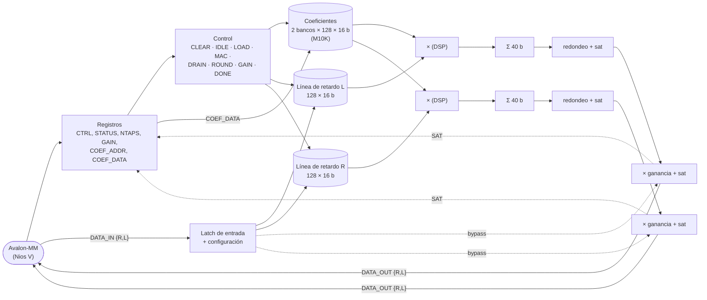

# Módulo de hardware personalizado: `filtro_audio` (HW-11, HW-18, DOC-03)

> El otro módulo propio, `seg7_time` (displays MM:SS), está en [seg7-time.md](seg7-time.md).

Filtro FIR estéreo con dos bancos de coeficientes y etapa de ganancia (volumen),
descrito en HDL propio y accesible por mapeo a memoria (§3-HW p.4, §3-SIS p.5).

| | |
|---|---|
| RTL | [`hw/rtl/filtro_audio.v`](../../hw/rtl/filtro_audio.v) (esclavo Avalon-MM) y [`hw/rtl/fir_core.v`](../../hw/rtl/fir_core.v) (datapath) — Verilog-2005, sin IP de catálogo |
| Coeficientes | [`scripts/design_fir.py`](../../scripts/design_fir.py) → `hw/rtl/fir_coefs.hex`, `sw/common/include/fir_coefs.h` |
| Punto fijo | [CD-14](../decisiones/CD-14.md): muestras y coeficientes Q1.15, acumulador de 40 bits, redondeo y saturación |
| Verificación aislada | [`sim/questa/rtl/tb_filtro_audio.sv`](../../sim/questa/rtl/tb_filtro_audio.sv), reporte en [verificacion-filtro.md](verificacion-filtro.md) |

## Funcionamiento

Por cada par de muestras que el procesador escribe en `DATA_IN`:

1. **LOAD**: cada muestra entra en la línea de retardo circular de su canal (128 posiciones).
2. **MAC**: dos multiplicadores-acumuladores, uno por canal, recorren los `NTAPS`
   coeficientes del banco elegido, un tap por ciclo, con un pipeline de 3 etapas (lectura
   de memoria → producto 16×16 → acumulado de 40 bits). En bypass se salta este paso,
   pero la línea de retardo se sigue actualizando: al volver al filtro no hay transitorio.
3. **ROUND**: `y = sat16((acc + 2^14) >>> 15)`.
4. **GAIN**: `z = sat16((y · g + 2^14) >>> 15)` con `g` Q1.15 sin signo (volumen, CD-05).
5. El resultado queda en `DATA_OUT`; si alguna etapa saturó se levanta `STATUS.SAT`.

Latencia: `NTAPS + 9` ciclos medidos desde la escritura hasta el dato
(136 ciclos = 2.72 µs con 127 taps a 50 MHz). A 48 kHz hay 1 041 ciclos por muestra:
el filtro usa el 13 % del tiempo y deja margen para el ecualizador opcional (OPC-01).

## Diagrama de bloques



## Mapa de registros

Base en el SoC: `0x0004_0100` (rango reservado para B en el
[mapa de memoria](mapa-memoria.md)); 8 registros de 32 bits, solo accesos de 32 bits.

| Offset | Registro | Acceso | Bits | Reset | Descripción |
|---|---|---|---|---|---|
| `0x00` | `CTRL` | RW | `[0]` BYPASS · `[1]` BANK · `[2]` CLEAR | `0x1` | BYPASS = 1: la salida es la entrada (con ganancia). BANK: 0 pasa-bajos 1 kHz, 1 pasa-banda 1–4 kHz. CLEAR: escribir 1 pone las líneas de retardo en cero (128 ciclos); se lee 0 |
| `0x04` | `STATUS` | R / W1C | `[0]` READY · `[1]` BUSY · `[2]` SAT · `[15:8]` MAX_TAPS · `[31:16]` VERSION | `0x0100_8002` | READY: hay un resultado y el filtro está libre. BUSY: procesando o borrando (tras el reset borra 128 ciclos). SAT: alguna salida saturó desde la última vez que se escribió 1 en este bit |
| `0x08` | `NTAPS` | RW | `[7:0]` | `127` | Taps usados, 1..128 (0 se toma como 1; > 128 como 128) |
| `0x0C` | `GAIN` | RW | `[15:0]` | `0x8000` | Ganancia Q1.15 sin signo: `0x8000` = 1.0, `0xFFFF` ≈ 2.0 (con saturación) |
| `0x10` | `COEF_ADDR` | RW | `[6:0]` índice · `[7]` banco | `0` | Dirección del próximo acceso a `COEF_DATA` |
| `0x14` | `COEF_DATA` | RW | `[15:0]` | — | Escribir: guarda el coeficiente y avanza `COEF_ADDR` dentro del banco (127 → 0). Leer: coeficiente en `COEF_ADDR` (con signo extendido) |
| `0x18` | `DATA_IN` | RW | `[15:0]` L · `[31:16]` R | `0` | Escribir arranca el procesamiento del par; leer devuelve la última entrada |
| `0x1C` | `DATA_OUT` | R | `[15:0]` L · `[31:16]` R | `0` | Resultado del último par |

**Espera (`waitrequest`)**: mientras `BUSY = 1` se retienen las escrituras a `DATA_IN`,
`COEF_DATA` y `CTRL` con CLEAR, y las lecturas de `DATA_OUT` y `COEF_DATA`. Así el
software hace `DATA_IN ← x; y ← DATA_OUT` sin sondear `STATUS`, y nunca lee un resultado a
medias ni cambia coeficientes en medio de una muestra. Toda lectura tiene 1 ciclo de
espera (dato registrado). La configuración (banco, taps, bypass, ganancia) se captura al
escribir `DATA_IN`.

## Diagramas de tiempo

Escritura de una muestra y lectura del resultado (la lectura espera a que termine el
procesamiento); fuente WaveDrom en [`docs/img/filtro-tiempos.json`](../img/filtro-tiempos.json):

```
clk          _|‾|_|‾|_|‾|_|‾|_|‾|_ ... _|‾|_|‾|_|‾|_|‾|_
address       | DATA_IN |  DATA_OUT ......................|
write        _/‾‾‾‾‾‾‾‾‾\______________________________________
read         ___________/‾‾‾‾‾‾‾‾‾‾‾‾‾‾‾‾‾ ... ‾‾‾‾‾‾‾‾‾‾\___
waitrequest  ___________/‾‾‾‾‾‾‾‾‾‾‾‾‾‾‾‾‾ ... ‾‾‾‾‾\______
busy         _____/‾‾‾‾‾‾‾‾‾‾‾‾‾‾‾‾‾‾‾‾‾‾‾ ... \______________
state          IDLE|LOAD|MAC k=0..N-1|DRAIN|ROUND|GAIN|DONE|IDLE
readdata                                          | {R,L} |
                   |<------- NTAPS + 9 ciclos (136 con 127 taps) ------->|
```

Recarga de coeficientes (cada escritura avanza el índice):

```
clk          _|‾|_|‾|_|‾|_|‾|_|‾|_|‾|_|‾|_
address       |COEF_ADDR| COEF_DATA | COEF_DATA | COEF_DATA |
writedata     |  0x80   |   h[0]    |   h[1]    |   h[2]    |
coef_addr        0x00   |   0x80    |   0x81    |   0x82    | 0x83
memoria                     [0x80]=h0   [0x81]=h1   [0x82]=h2
```

## Justificación del diseño

| Decisión | Alternativa | Por qué |
|---|---|---|
| MAC secuencial (un tap por ciclo) por canal | FIR paralelo (127 multiplicadores) | 2 bloques DSP en vez de ~254; 2.7 µs por muestra sobra frente a 20.8 µs del periodo de 48 kHz |
| Dos MAC (uno por canal) | Un MAC compartido | Mitad de latencia por 1 DSP más (de 87); deja tiempo para el ecualizador opcional |
| Dos bancos de coeficientes | Recargar coeficientes al cambiar de filtro | Cambiar de filtro es escribir `CTRL.BANK` (latencia < 100 ms trivial, §3-F p.4); 4 Kbit de memoria |
| Ganancia en el módulo | Volumen en software | En el Nios V/m (sin `mul`) cada multiplicación es `__mulsi3` (CD-05, medido) |
| `waitrequest` en `DATA_OUT` | Sondear `STATUS.READY` | Menos accesos al bus por muestra y sin carreras |
| Mapeado a memoria | En línea por Avalon-ST antes del IP de Audio | CD-04: no cambia el IP de Audio ni sus drivers verificados; el CPU decide qué pasa por el filtro |
