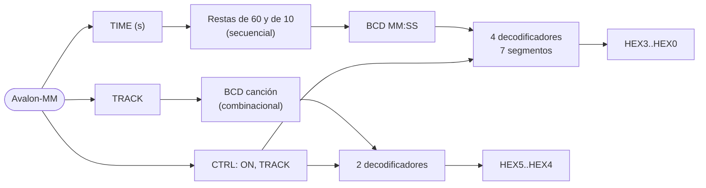

# Módulo de hardware propio: `seg7_time` (HW-10, DOC-03)

Controla los seis displays de 7 segmentos: tiempo transcurrido MM:SS en HEX3..HEX0 y
número de canción en HEX5..HEX4 (§3-HW p.4 "manejo directo de los displays", §3-F p.3–4).

| | |
|---|---|
| RTL | [`hw/rtl/seg7_time.v`](../../hw/rtl/seg7_time.v) — Verilog-2005 |
| Componente | [`hw/rtl/seg7_time_hw.tcl`](../../hw/rtl/seg7_time_hw.tcl), instancia `seg7` en `0x0004_0120` |
| Driver | [`sw/niosv/drivers/seg7.c`](../../sw/niosv/drivers/seg7.c) (NV-09) |
| Verificación | [`sim/questa/rtl/tb_seg7_time.sv`](../../sim/questa/rtl/tb_seg7_time.sv) aislado y `tb_filtro` en el SoC ([reporte](verificacion-filtro.md)) |
| Recursos | 115 ALMs, 100 registros, 0 memoria, 0 DSP |

## Funcionamiento

El software solo escribe el tiempo **en segundos** (por ejemplo, contando muestras
enviadas al códec, CD-10). El hardware hace el resto:

1. Al escribir `TIME`, un convertidor secuencial calcula minutos y segundos restando 60, y
   luego las decenas restando 10 (sin divisores; ≤ 113 ciclos = 2.3 µs).
2. Al terminar, el BCD `{M1, M0, S1, S0}` pasa a los displays de una vez (no se ven
   valores intermedios).
3. La canción (0..99) se pasa a BCD de forma combinacional.
4. Cada dígito se decodifica a segmentos activos en bajo (orden `{g,f,e,d,c,b,a}` de la
   DE1-SoC).



## Registros

| Offset | Registro | Acceso | Bits | Reset | Descripción |
|---|---|---|---|---|---|
| `0x0` | `CTRL` | RW | `[0]` ON · `[1]` TRACK | `0x1` | ON = 0 apaga los seis displays; TRACK = 1 muestra la canción en HEX5..HEX4 |
| `0x4` | `TIME` | RW | `[12:0]` | `0` | Segundos transcurridos; de 6 000 en adelante se muestra `99:59` |
| `0x8` | `TRACK` | RW | `[6:0]` | `0` | Número de canción; de 100 en adelante se muestra `99` |
| `0xC` | `STATUS` | R | `[15:0]` BCD mostrado · `[16]` BUSY · `[31:24]` versión | `0x0100_0000` | BUSY mientras convierte |

Lectura con latencia fija de 1 ciclo; sin `waitrequest`.

## Diagrama de tiempo (escritura de TIME = 125 s)

```
clk        _|‾|_|‾|_|‾|_|‾| ... |‾|_|‾|_|‾|_
write      _/‾‾\____________ ... ____________
address     |TIME|
writedata   |125 |
cst        IDLE |MIN(-60 x2)|SEC(-10 x0)|MTEN|IDLE
STATUS.BUSY ____/‾‾‾‾‾‾‾‾‾‾‾‾ ... ‾‾‾‾\______
HEX3..HEX0  00:00 ................... | 02:05
```

## Justificación

| Decisión | Alternativa | Por qué |
|---|---|---|
| Conversión a MM:SS en hardware | PIO de 28 bits y decodificación en software | Cumple la lectura estricta de "manejo directo de los displays en hardware" (P6); el CPU hace una sola escritura por segundo |
| Restas sucesivas | Divisor combinacional entre 60 | Menos lógica; 2.3 µs por actualización es irrelevante a 1 Hz |
| Saturación a 99:59 y 99 | Dar la vuelta | Una canción no dura 100 minutos; se evita mostrar un tiempo equivocado |
