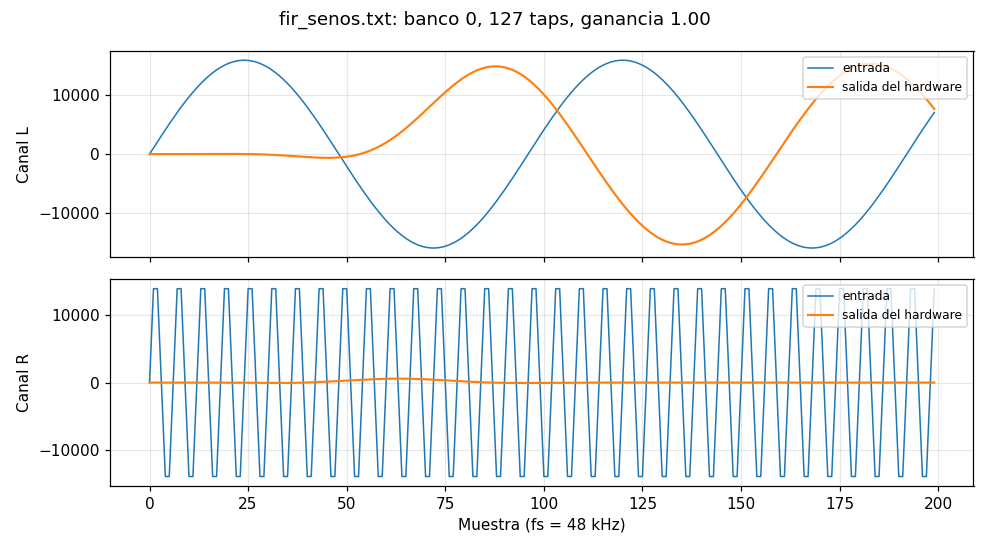
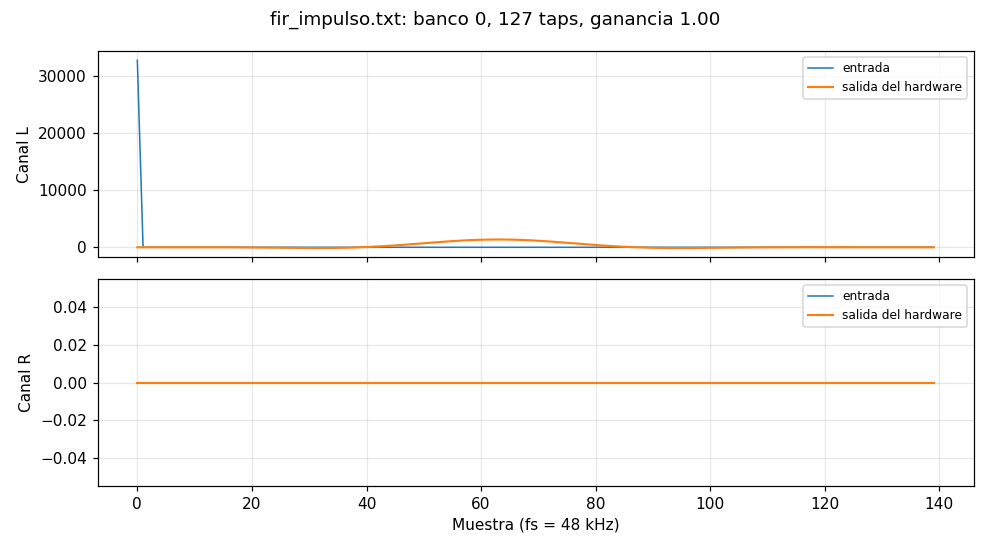
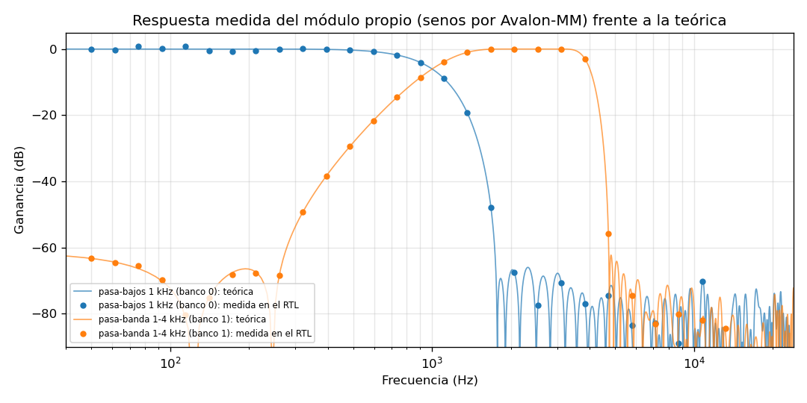

# Verificación aislada del módulo propio (PR-02, PR-03, HW-16)

§3-HW p.4 pide verificar el módulo de hardware personalizado, incluido el filtro DSP
propio, **de forma aislada y antes de integrarlo**, con casos de prueba y resultados
documentados. Este reporte es esa evidencia. Fecha: 7 de noviembre de 2026.

## Método

- **Simulador:** Questa Altera Starter 2025.2 (CD-13), `scripts/sim-rtl.sh <módulo>`.
- **Unidad bajo prueba:** solo el RTL propio (`hw/rtl/*.v`), sin el SoC ni el Nios V.
- **Estímulo:** el testbench actúa como un maestro Avalon-MM que respeta `waitrequest`,
  igual que lo hará el procesador. No se fuerza ninguna señal interna.
- **Referencia:** vectores dorados de [`sim/vectors/`](../../sim/vectors/README.md)
  generados por `scripts/design_fir.py` con un **modelo bit a bit** del datapath
  (`FirModel`). El mismo modelo en C (`sw/common/src/dsp.c`) reproduce los vectores en el PC
  (`make -C tests`), lo que da una segunda referencia independiente del Verilog.
- **Criterio:** igualdad **exacta** (0 LSB de tolerancia): el redondeo y la saturación del
  hardware y del modelo son los mismos (CD-14).

## Casos y resultados — `filtro_audio` (`tb_filtro_audio`)

| # | Caso | Qué demuestra | Resultado |
|---|---|---|---|
| R1 | Valores de reset | CTRL = bypass, STATUS = versión 0x0100 / 128 taps / BUSY mientras borra, NTAPS = 127, GAIN = 1.0 | PASS |
| R2 | Lectura/escritura de cada registro | CTRL (banco, bypass), NTAPS, GAIN (16 bits), COEF_ADDR | PASS |
| R3 | Límites de NTAPS | 0 → 1, 200 → 128 | PASS |
| R4 | STATUS de solo lectura | Escribir todo en 1 no cambia nada salvo borrar SAT | PASS |
| R5 | Coeficientes | Escritura con autoincremento, vuelta 127 → 0 dentro del banco, relectura con signo | PASS |
| R6 | CLEAR | Se lee 0; BUSY durante el borrado | PASS |
| D1 | `fir_impulso` | Salida = coeficientes del pasa-bajos (respuesta al impulso) | 140 muestras iguales |
| D2 | `fir_escalon` | Valor final = 0.5 × Σh; canal R con signo opuesto | 200 muestras iguales |
| D3 | `fir_senos` | 500 Hz pasa (L), 8 kHz se rechaza (R), retardo de grupo de 63 muestras | 200 muestras iguales |
| D4 | `fir_saturacion` | Entrada con el signo de cada coeficiente: satura y levanta SAT | 200 muestras iguales, SAT = 1 |
| D5 | `fir_ruido_banco1` | Banco 1 (pasa-banda 1–4 kHz) con ruido blanco en ambos canales | 200 muestras iguales |
| D6 | `fir_bypass_gain` | Bypass con ganancia 0.5 | 64 muestras iguales |
| D7 | `fir_taps16` | Solo 16 taps | 64 muestras iguales |
| D8 | `fir_ganancia_alta` | Ganancia 1.5: satura la etapa de ganancia y levanta SAT | 160 muestras iguales, SAT = 1 |
| T1 | Latencia | De la escritura de `DATA_IN` al dato de `DATA_OUT` | 136 ciclos = 2.72 µs (127 taps) |

**Total: 1 253 comprobaciones, 0 errores — PASS.** Salida completa:
[`docs/verificacion/resultados/rtl_filtro_audio.txt`](../verificacion/resultados/rtl_filtro_audio.txt).

## Respuesta en frecuencia medida (`tb_filtro_respuesta`, evidencia de PR-10)

Senos de 30 frecuencias (50 Hz – 20 kHz, amplitud 0.5) por el módulo, solo por Avalon-MM,
en los dos bancos; amplitud RMS de la salida tras el transitorio
(`scripts/sim-rtl.sh filtro_respuesta && python3 scripts/plot_respuesta.py`):

| Banco | Error máximo en la banda de paso | Atenuación mínima medida fuera de banda |
|---|---|---|
| 0 — pasa-bajos 1 kHz | 0.83 dB (en 50–110 Hz la ventana de 480 muestras cubre menos de un periodo) | 67.4 dB |
| 1 — pasa-banda 1–4 kHz | 0.08 dB | 55.7 dB |

## Casos y resultados — `seg7_time` (`tb_seg7_time`)

| Caso | Displays (HEX5..HEX0) | Resultado |
|---|---|---|
| Reset | `   00:00` | PASS |
| 0, 59, 125, 599, 3 599, 5 999 s | `00:00`, `00:59`, `02:05`, `09:59`, `59:59`, `99:59` | PASS |
| 6 000 y 8 191 s (fuera de rango) | `99:59` | PASS |
| Canción 7 con CTRL.TRACK | `07 99:59` | PASS |
| Canción 150 (fuera de rango) | `99 99:59` | PASS |
| CTRL.ON = 0 | todo apagado | PASS |

**14 comprobaciones — PASS.** Salida completa:
[`docs/verificacion/resultados/rtl_seg7_time.txt`](../verificacion/resultados/rtl_seg7_time.txt).

## Defectos encontrados y corregidos antes de integrar

| Módulo | Defecto | Cómo se encontró | Corrección |
|---|---|---|---|
| `fir_core` | El pulso de saturación salía un ciclo antes que `done` y el envoltorio nunca lo veía: `STATUS.SAT` no se levantaba | D4 y D8 (SAT = 0, el modelo dice 1) | `sat` y `done` salen en el mismo ciclo |
| `fir_core` | Concatenaciones sin signo antes de `>>>` (redondeo de negativos) | Revisión del RTL antes de simular | `$signed(...)` |
| `seg7_time` | La canción y el tiempo se truncaban antes de compararse con el máximo (150 → "22") | Caso "canción 150" | Se compara el valor completo |

## Puerta de paso (HW-16)

- [x] Testbench del filtro con vectores dorados en verde (equivale a DK-11).
- [x] Testbench de la interfaz de registros en verde (equivale a DK-12).
- [x] Testbench de `seg7_time` en verde (DK-13).
- [x] Reporte escrito (este documento).

El módulo puede integrarse al SoC (HW-17). Los testbenches cocotb del contenedor
(DK-11..13) reutilizarán los mismos vectores cuando exista el contenedor (DK-05, C).
