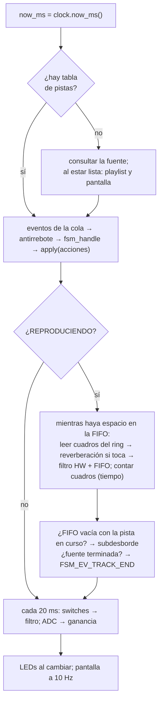
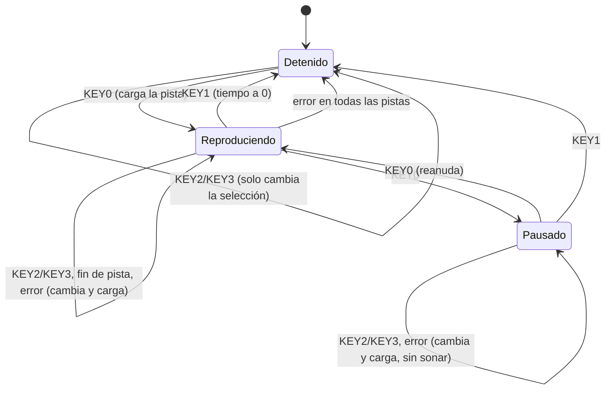

# Diseño del software (DOC-01)

Documento de diseño de software del reproductor (§5 p.7, 3 %): módulos, métodos,
bibliotecas, API y lista de chequeo de los requisitos de software. Cubre el Nios V y la
lógica portable; el software del HPS (persona D) se agrega cuando exista `sw/hps/`.

## 1. Organización

```
sw/
├── common/            lógica portable: sin system.h, sin registros, sin malloc
│   ├── include/       API (un header por módulo)
│   └── src/
├── niosv/
│   ├── drivers/       un .h/.c por periférico, punteros volatile a system.h
│   ├── src/           aplicación del reproductor (main.c)
│   └── tests/         un programa por periférico o escenario (PR-05) + testbench en sim/questa/
└── hps/               (persona D) SD, FAT32, productor del ring
tests/                 pruebas en el PC de sw/common (make test)
```

Tres reglas sostienen la portabilidad:

1. **`sw/common` no conoce el hardware.** Compila igual con el gcc del PC, el
   `riscv32-unknown-elf-gcc` del Nios V y el `arm-linux-gnueabihf-gcc` del HPS
   (`make hps` lo comprueba en la CI). Lee los datos little-endian byte a byte (`le.h`)
   y no hace accesos desalineados.
2. **La lógica habla con el hardware por puertos** (`ports.h`): structs de punteros a
   función. `main.c` los llena con drivers; las pruebas, con mocks.
3. **Sin HAL** en el Nios V (§3-SW p.5): solo `irq.c` usa `alt_ic_isr_register` /
   `alt_ic_irq_enable` / `alt_ic_irq_disable`. `scripts/audit-hal.sh` (en `make lint`) lo
   verifica.

## 2. Módulos

### 2.1 Lógica portable (`sw/common`)

| Módulo | Responsabilidad | Tarea | Prueba |
|---|---|---|---|
| `err` | Códigos de error comunes (`ERR_OK` = 0, negativos) y su texto | SC-01 | `test_wav` |
| `le` | `le16`/`le32` y lecturas con comprobación de límites | SC-02 | `test_wav` |
| `wav` | Parser RIFF/WAVE, metadatos `LIST/INFO` e ID3, duración, respaldo de metadatos | SC-03..06 | `test_wav` |
| `playlist` | Pista actual, siguiente/anterior con vuelta, avance automático | SC-07 | `test_fsm` |
| `fsm` | Máquina de estados de reproducción como tabla de transiciones | SC-08 | `test_fsm` |
| `evq` | Cola sin bloqueo de un productor (ISR) y un consumidor (lazo) | SC-09 | `test_input` |
| `ports` | Interfaces hacia el hardware (audio, filtro, reloj, panel, entradas, fuente, pantalla) | SC-14 | `test_app` |
| `shm_proto` | Protocolo HPS ↔ Nios V: control, tabla de pistas, ring (borrador de SC-13) | SC-13 | `test_shm` |
| `shm_source` | Lado Nios V del canal: implementa el puerto de fuente sobre `shm` | NV-13 | `test_app`, `tb_player` |
| `hps_model` | Modelo del productor del HPS para probar sin tarjeta | — | `test_app`, `tb_player` |
| `switches` | SW[2:0] → filtro con confirmación de dos lecturas | CD-08, NV-05 | `test_input` |
| `debounce` | Ventana de 50 ms por botón | NV-04 | `test_input` |
| `clock` | Ciclos → milisegundos sin dividir | NV-12 | `test_input` |
| `app` | Lazo principal: eventos → FSM → acciones, bombeo de audio, encuesta, pantalla | NV-14 | `test_app`, `tb_player` |
| `volume` | ADC → escalón logarítmico con histéresis → ganancia Q15 | SC-11 (A) | `test_volume` |
| `dsp` | Modelo del FIR del hardware, ganancia, reverberación, biquad | SC-10 (B) | `test_dsp` |
| `screen` | Pantalla 80 × 13 del reproductor sobre un puerto de texto | NV-11 (A) | `test_screen` |
| `tone` | Tono de prueba por tabla | IN-02 (A) | `test_tone` |

### 2.2 Drivers del Nios V (`sw/niosv/drivers`)

| Driver | Periférico | Tarea |
|---|---|---|
| `hw.h`, `pio.h` | Acceso por puntero (`HW_REG`), PIO de LEDs/KEY/SW | HW-02 (A) |
| `irq` | Única excepción al HAL: registrar y habilitar IRQ | NV-03 |
| `keys` | KEY[3:0] por IRQ: la ISR limpia `edgecapture` y encola | NV-03 |
| `timebase` | `mtime` → ms (vía `clock`) y ciclos | NV-12 |
| `ports_niosv` | Puertos de `ports.h` sobre los drivers | SC-14 |
| `audio`, `codec`, `adc`, `vga_text` | IP del University Program | NV-06..08, NV-11 (A) |
| `filtro`, `seg7` | Hardware propio | NV-09, NV-10 (B) |

## 3. Flujo de ejecución

### 3.1 Arranque (`sw/niosv/src/main.c`)

1. LEDs en 0, base de tiempo, pantalla limpia, 7 segmentos, ADC, FIFO de audio.
2. Autoprueba del módulo propio (NV-15) y reinicio de su estado.
3. Códec WM8731 por I²C; si no responde, mensaje y LEDR9 parpadeando.
4. Cola de eventos y botones por IRQ.
5. Fuente sobre `shm` (`SHM_BASE`), puertos y `app_init` (marco de la pantalla).
6. `for (;;) app_step(&app);`

### 3.2 Una vuelta del lazo (`app_step`)



Nada bloquea: si la FIFO está llena o el ring vacío, la vuelta termina y la siguiente
lo intenta de nuevo. La FIFO del IP (128 cuadros = 2.7 ms) es todo el audio procesado
que espera salir, así que un cambio de filtro se oye a los ≤ 41 ms (CD-08), muy por
debajo de los 100 ms del requisito.

### 3.3 Interrupciones

| IRQ | Fuente | ISR | Qué hace |
|---|---|---|---|
| 2 | `pio_key` | `keys_isr` | Lee y limpia `edgecapture`; `evq_push` por botón |

La ISR no llama a la FSM ni a la pantalla: la cola (SC-09) desacopla. Los índices de la
cola los escribe un solo lado cada uno, así que no hace falta deshabilitar interrupciones.

### 3.4 Máquina de estados (SC-08, CD-11)



### 3.5 Canal con el HPS (NV-13, SC-13)

| Región de `shm` | Tamaño | Escribe |
|---|---|---|
| Control (`shm_ctrl_t`) | 64 B | Cada campo, un solo lado |
| Tabla de pistas | 32 × 160 B | HPS |
| Ring de cuadros estéreo a 48 kHz | 8 192 × 4 B (170 ms) | HPS escribe, Nios V consume |

Un cambio de pista es un comando con número de secuencia; el Nios V no consume hasta que
el HPS confirma ese número, y el HPS descarta el ring al confirmar. Así nunca se oyen
restos de la pista anterior (`test_shm`, `test_app`, `tb_player`). Detalle en
`sw/common/include/shm_proto.h`.

## 4. API principal

Resumen; la documentación completa está en cada header de `sw/common/include/`.

```c
/* wav.h */
err_t wav_parse(const wav_reader_t *r, wav_info_t *info);
void  wav_meta_fallback(wav_info_t *info, const char *filename);
uint32_t wav_duration_s(uint32_t data_size, uint32_t byte_rate);

/* playlist.h / fsm.h */
err_t    playlist_init(playlist_t *p, uint32_t count);
uint32_t playlist_next(playlist_t *p);      /* y _prev, _auto_advance, _number */
void     fsm_init(fsm_t *f, playlist_t *pl);
uint32_t fsm_handle(fsm_t *f, fsm_event_t ev);   /* -> FSM_ACT_* */

/* evq.h */
err_t evq_push(evq_t *q, uint8_t ev);       /* ISR */
err_t evq_pop(evq_t *q, uint8_t *ev);       /* lazo principal */

/* shm_proto.h (lado Nios V) */
uint32_t shm_nios_send(volatile shm_t *s, uint32_t cmd, uint32_t arg);
uint32_t shm_nios_read(volatile shm_t *s, uint32_t seq, uint32_t *dst, uint32_t max);
uint32_t shm_nios_stream(volatile const shm_t *s, uint32_t seq);

/* app.h */
void app_init(app_t *a, const app_ports_t *ports, evq_t *events, int16_t *rev_l, int16_t *rev_r);
void app_step(app_t *a);
```

## 5. Bibliotecas y herramientas

| Biblioteca | Dónde | Uso |
|---|---|---|
| picolibc reducida del BSP | Nios V | Arranque C y `memcpy`; sin `printf` en la aplicación (cuesta ~10 KB, A) |
| `libgcc` | Nios V | `__mulsi3`/`__udivsi3`: el Nios V/m es RV32I. El lazo evita multiplicar y dividir en el camino de cada muestra (`clock`, `put_u32`, cuenta de cuadros) |
| HAL (solo `sys/alt_irq.h`) | Nios V | Registro de interrupciones |
| libc del PC | Pruebas | `stdio` y `malloc` solo dentro de `tests/` |

Compilación: C11 con `-Wall -Wextra` en todo el código propio (NV-02). Las pruebas
del PC agregan `-Werror` y ASan/UBSan; `WERROR=1 scripts/build-niosv.sh` hace lo mismo
en el Nios V (los headers del BSP se tratan como de sistema).

## 6. Memoria (NV-16)

`scripts/report-memory.sh build/niosv/app/build/audio_player.elf`, aplicación completa:

| Sección | Bytes |
|---|---|
| `.text` + `.rodata` + `.entry` + `.exceptions` | 20 380 |
| `.rwdata` | 500 |
| `.bss` | 10 828 (9 600 de la reverberación: 2 × 2 400 muestras) |
| **Total** | **31 708 de 131 072 (24 %)**; 99 364 libres para pila y heap |

No hay memoria dinámica: todo el estado es estático (`app_t`, la cola, los buffers de
reverberación). El audio en tránsito vive en `shm` (32 KB del ring) y en la FIFO del IP.

## 7. Requisitos de software y cumplimiento

| Requisito (PDF) | Cómo se cumple | Evidencia | Estado |
|---|---|---|---|
| Sin HAL; acceso por punteros (§3-SW p.5) | Drivers con `HW_REG`; HAL solo en `irq.c` | `scripts/audit-hal.sh` en `make lint` y en la CI | Cumple |
| Interrupciones para los botones (§3-SW p.5) | `keys.c`: ISR corta + cola | `tb_pio`, `tb_player` | Cumple (simulación) |
| Gestión de memoria (§3-SW p.5) | Todo estático, 24 % de la RAM | §6 de este documento | Cumple |
| Interfaz de usuario (§3-SW p.5) | Lazo `app_step`, pantalla a 10 Hz, LEDs | `test_app`, `tb_player` | Cumple (simulación) |
| Leer WAV y metadatos (§3-F p.3) | `wav.c` (PCM 16 bits, 8/16/44.1/48 kHz, `LIST/INFO`, ID3) | `test_wav` (26 archivos) | Cumple |
| ≥ 10 canciones, siguiente/anterior, avance automático (§3-F p.3) | `playlist` + `fsm`, lista circular | `test_fsm`, `test_app`, `tb_player` (2 vueltas) | Cumple (simulación); falta IN-07 en tarjeta |
| Play/pausa/stop (§3-F p.3) | FSM | `test_fsm`, `tb_player` | Cumple (simulación) |
| Tiempo transcurrido y duración (§3-F p.3, §3-SIS p.6) | Cuadros / 48 000 (CD-10); duración del parser | `test_app` | Cumple |
| Respuesta a botones < 200 ms (§3-F p.4) | ISR + lazo sin bloqueo | `tb_pio` (17 µs), `test_app`, `tb_player` | Cumple (simulación); PR-07 en tarjeta |
| Cambio de filtro < 100 ms (§3-F p.4) | Encuesta de 20 ms + FIFO de 2.7 ms | `test_app` (≤ 41 ms) | Cumple (simulación); PR-07 |
| Cambio de canción < 2 s (§3-F p.4) | Comando al HPS + descarte del ring | `test_app` | Cumple con el modelo del HPS; PR-07 con la SD real |
| Reproducción sin cortes (§3-F p.4) | Ring de 170 ms + contador de subdesbordes (LEDR5) | `test_app` (0 en 2 vueltas) | PR-08 en tarjeta |
| SD mediante el HPS (§3-SW p.5) | Protocolo `shm_proto.h` | `test_shm` | Lado Nios V listo; HPS pendiente (D) |
| Arranque < 10 s, sin interacción con el SO (§3-F p.4, §3-SW p.5) | — | — | Pendiente (D: HP-04, HP-08) |

## 8. Pendiente

- Integrar con el productor real del HPS (HP-06/HP-07, D) y revisar con D el borrador de
  `shm_proto.h` (SC-13).
- Pruebas en la tarjeta: IN-07, PR-07, PR-08 ([docs/pruebas-tarjeta.md](../pruebas-tarjeta.md)).
