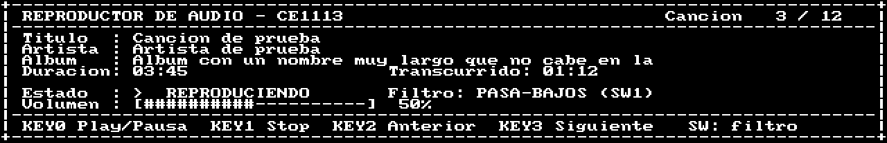

# Resultados de la verificación (testbenches)

Evidencia de la verificación **sin tarjeta** de la plataforma del SoC (persona A). Cada
testbench simula en Questa el **SoC completo** (`audio_soc` generado por Platform
Designer, con el Nios V/m ejecutando un programa de prueba de `sw/niosv/tests/`) y hace de
"tarjeta" con modelos de los chips externos escritos a partir de sus datasheets. Todos
se verifican solos y terminan en `PASS` o `FAIL`.

- Fecha de la corrida: 5 de noviembre de 2026 (commit `d30841d`).
- Salida de cada prueba: carpeta [resultados/](resultados/), extraída de los transcripts
  de Questa con `scripts/export-results.sh`.

## Resumen

| Prueba | Programa en el Nios V | Modelo externo | Qué verifica | Resultado clave | Estado |
|---|---|---|---|---|---|
| [`tb_pio`](resultados/tb_pio.txt) | `test_pio` | KEY/SW/LEDR | Escritura de LEDR, lectura de SW, IRQ por flanco de cada KEY, dos KEY a la vez, rebote (3 flancos → 1 evento), IRQ de SW | Respuesta botón → LED **17.22 µs** (requisito < 200 ms) | PASS |
| [`tb_audio`](resultados/tb_audio.txt) | `test_audio` | `wm8731_model` (maestro, Left Justified, 16 bits, 48 kHz) | 240 pares seguidos (5 ms): bits en orden, canales sin cruzarse, ninguna muestra perdida ni repetida, relleno por sondeo y por IRQ de escritura | **0 huecos** en 5 ms de audio | PASS |
| [`tb_codec`](resultados/tb_codec.txt) | `test_codec` | `wm8731_model` (esclavo I²C 0x34) | Autoinicialización completa del IP (57 transferencias I²C), registros del WM8731 y escrituras de `codec_init`/`codec_mute` | R7 = 0x041, R8 = 0x000, R9 = 0x001, R5 0x006 → **0x000**; códec listo a los **71.4 ms** | PASS |
| [`tb_adc`](resultados/tb_adc.txt) | `test_adc` | `adc_model` con **AD7928** | CH0 sigue al potenciómetro en 5 posiciones (0x000, 0xFFF, 0x800, 0x3A5, 0xC3C) con valores distintos en los otros canales | LEDR = CH0 >> 2 en los 5 casos | PASS |
| [`tb_adc` LTC](resultados/tb_adc__gLTC_1.txt) | `test_adc` | `adc_model` con **LTC2308** (`-gLTC=1`) | Lo mismo con el chip de las revisiones nuevas de la placa | LEDR = CH0 >> 2 en los 5 casos | PASS |
| [`tb_shm`](resultados/tb_shm.txt) | `test_shm` | — | Memoria compartida de 64 KB: bus de datos, bus de direcciones, March C- en los extremos, sin solape con la RAM, accesos de 8/16 bits | Sin errores | PASS |
| [`tb_vga`](resultados/tb_vga.txt) | `test_vga` | Monitor VGA | Temporización 640 × 480 @ 60 Hz y texto de las filas 9–12 comparado **celda por celda** con la pantalla de referencia del PC | Línea 32.000 µs, HS 3.840 µs, 640 px activos, 320/320 celdas correctas | PASS |
| [Pruebas en el PC](resultados/pc_tests.txt) | — | — | `volume.c`, `screen.c`, `tone.c` compilados con `gcc -Wall -Wextra -Werror` | Tono de 440 Hz con SNR de **48.9 dB** | PASS |

Captura de la pantalla tomada del stream de píxeles en `tb_vga` (líneas 0–103):



## Cómo reproducir

```bash
scripts/build-soc.sh
scripts/test-all.sh --all        # todas las pruebas (~40 min: codec y vga son lentas)
scripts/export-results.sh        # actualiza docs/verificacion/resultados/
```

Una sola prueba: `scripts/sim-tb.sh <pio|audio|codec|adc|shm|vga>`; el ADC con LTC2308:
`ELAB_OPTS=-gLTC=1 scripts/sim-tb.sh adc`; el códec en modo rápido de depuración (salta
las escrituras al ADV7180, no vale como evidencia): `ELAB_OPTS=-gFAST=1 scripts/sim-tb.sh codec`.

## Hallazgos que cambiaron el diseño

| Prueba | Hallazgo | Cambio |
|---|---|---|
| `tb_adc` | Con el LTC2308, el IP del ADC guarda cada resultado en el registro del canal anterior: con un solo canal, CH0 nunca se actualizaría | El SoC convierte 2 canales (+74 ALMs) |
| `tb_codec` | La ROM de autoinicialización deja R5 = 0x006 (de-énfasis de 48 kHz, atenúa agudos) y además configura el ADV7180 (47 transferencias): el códec está listo a los ~71 ms | `codec_init` pone R5 = 0x000; el tiempo cuenta para el arranque < 10 s |
| `tb_vga` | El borrado del Character Buffer tarda un cuadro de video (16.7–33 ms, no "5000 ciclos") y lo que se escribe mientras tanto se pierde; las lecturas del esclavo de caracteres devuelven el dato anterior | `vga_text_init` espera el borrado; el driver no ofrece lectura |
| `tb_shm` | Un acceso a memoria en un lazo cuesta ~30 ciclos en el Nios V/m | Se tiene en cuenta en el presupuesto del lazo de audio (CD-04, CD-05) |

## Artefactos de simulación (no son del diseño)

Se resuelven en los scripts o testbenches y están comentados donde se aplican:

1. El `audio_soc_tb` que genera Platform Designer no elabora con varios conduits: los
   testbenches instancian `audio_soc` directamente (`sim/questa/tb_*.sv`).
2. El `.mif` de la fuente del Character Buffer tiene 8 valores por línea y el modelo
   `altsyncram` solo lee el primero: `sim-tb.sh` lo expande en la copia de simulación
   (`scripts/expand-mif.py`). Quartus lo lee bien.
3. La FIFO de doble reloj del video (`dcfifo` en modo *show-ahead*, familia "Cyclone II")
   deja su salida en X hasta la primera lectura y traba el VGA: `tb_vga` convierte esa X
   en 0.
4. El IP del códec da la transferencia por terminada ~20 µs antes del STOP en el bus:
   `tb_codec` espera 200 µs antes de revisar.

## Qué no cubre la simulación

Pines mal asignados, niveles analógicos, el códec y el monitor reales, y tiempos de la
tarjeta. Eso se prueba en la DE1-SoC con [docs/pruebas-tarjeta.md](../pruebas-tarjeta.md)
(IN-01..IN-04, PR-05).
